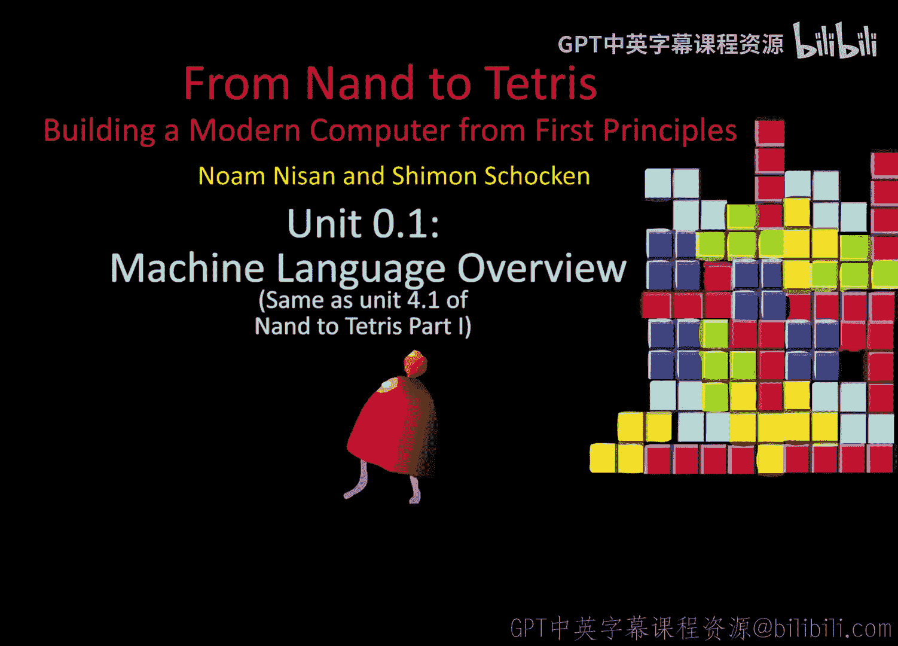

# 004：机器语言概述 🖥️

在本节课中，我们将从用户视角审视我们即将构建的计算机，了解其规格与能力。我们将探讨计算机如何通过单一硬件执行多种任务，并深入理解机器语言的核心概念及其作用。

## 计算机的通用性

上一节我们介绍了ALU和内存层次结构。本节中，我们来看看计算机的通用性原理。

大多数机器功能单一，例如洗衣机只能洗衣。然而，计算机却能执行多种任务，如文字处理、游戏、通信和视频播放。单一硬件如何实现如此多样的功能？

其核心理念是**通用性**。艾伦·图灵在20世纪初的理论模型中首次形式化了这一概念。他定义了**图灵机**模型来捕捉计算的本质，并发现了一个惊人现象：尽管存在许多不同的图灵机，但存在一个**通用图灵机**，在给定正确程序的情况下，可以模拟所有其他图灵机。这是“一机多用”理念的首次体现。

冯·诺依曼将这一理念付诸实践，设计了首个通用计算架构。其架构的核心是**存储程序计算机**的概念，即程序（软件）可以存储在硬件中，硬件根据加载的软件执行不同的操作和功能。正是这一原理，使得我们今天使用的单一计算机能够执行无数不同的任务。

## 硬件与软件的协作

现在，让我们更仔细地看看这是如何运作的。

计算机内部包含中央处理器和内存。它读取输入并产生输出。关键在于，内存中存储的程序会告诉硬件该做什么。硬件是固定的，但程序（软件）可以改变。随着软件的改变，计算机执行的功能也随之改变。

那么，静态的单一硬件如何根据程序执行多种任务？程序由一系列**指令**组成，每条指令都用二进制编码。硬件只需逐条执行指令。不同的指令集、不同的指令序列，将导致硬件产生完全不同的结果。

整个指令序列，即整个程序，共同构成了程序的功能。该功能完全取决于所编写的程序本身。

## 机器语言的要素

接下来，我们看看需要仔细研究的几个要素，这些要素共同促使硬件按程序要求工作。

以下是构成机器语言控制的三个基本要素：

1.  **指令规范**：程序由指令序列构成。指令具体告诉计算机做什么。
2.  **执行流控制**：我们需要知道在任何给定时刻执行哪条指令。通常顺序执行，但有时需要改变顺序（例如实现循环或条件分支）。软件需要能够控制硬件的操作流程。
3.  **操作数指定**：即使硬件知道要执行加法，软件也必须告诉硬件从何处获取待相加的两个值，以及将结果存放在何处。

每个机器语言、每种硬件允许软件进行控制的方式，都需要对这三方面进行规范。我们稍后将讨论每种可能性的选项。

## 机器语言与高级语言

一旦定义了机器语言，它就规定了硬件允许软件执行的操作。机器语言规范本身就是一种编程语言，但它是一种对硬件方便、对人类却极不友好的语言。

因此，现实中人类程序员几乎从不直接使用机器语言编程，而是使用**高级编程语言**。高级语言专为人类设计，便于轻松表达意图。然后，被称为**编译器**的自动程序会将高级语言代码翻译成机器语言软件，从而在运行时告诉硬件该做什么。

通常，我们不必过于担心机器语言，因为人类程序员并不直接使用它。然而，从计算机的角度看，最终运行的始终是机器语言程序，任何其他程序都以某种方式被翻译成这种机器语言形式，这才是真正指挥硬件的东西。

## 本课程中与机器语言的交互

尽管人们通常不直接用机器语言编写程序，但在本课程中，我们处理的是运行机器的硬件以及直接在其上操作的软件。为了理解如何构建计算机，我们需要学习机器语言，因此将不得不直接处理机器语言。

在某些其他情况下，人们也会直接处理机器语言，例如需要为特定任务编写高度优化代码时。在这些情况以及我们的课程中，我们需要让机器语言的使用稍微容易一些。通常有两种方法可以简化机器语言的工作：

1.  **助记符表示**：机器语言指令始终是比特序列，但这很难阅读和理解。实际上，指令编码的内容通常是我们能理解的。例如，一段比特序列可能编码“加法”操作。这时，使用助记符形式（如 `ADD`）比记一串 `0 1 1 1 0` 更方便。同样，指令中编码寄存器或内存位置的部分也可以用 `R2` 或类似符号表示。这相当于讨论比特序列，只是对人类更友好。最初，我们可以简单地认为这些助记符形式并不实际存在，只是我们谈论真实比特的一种方式。
2.  **汇编器与符号**：更进一步，我们可以允许用户以这种合成形式（即**汇编语言**）编写代码，然后通过一个称为**汇编器**的程序轻松地将其翻译成比特。这是第二种解读方式。在本课程第六周，你将实际构建这样一个汇编器。

此外，为了让我们（以及少数需要直接使用机器语言的情况）编写程序更容易，我们还可以免费获得另一个特性：**符号**。很多时候，在机器语言程序中，我们需要访问内存位置。例如，可能有一条指令告诉计算机“给内存位置129加1”。对程序员来说，具体是位置129并不重要，重要的是那里存储了一个“索引”值。这个值本可以存放在位置250或其他任何位置。关键点是，每次使用这个值时，都访问同一个内存位置。

因此，我们可以允许用户为该内存位置使用一个符号名称，例如称之为 `index`。然后让我们的汇编器（它已经提供了便利）自动将这个符号 `index` 翻译成某个具体的、固定的内存地址（例如129）。这样，我们就能以对人类更直观的方式编写程序，而实际上，每当看到 `index`，它都意味着同一个固定的内存位置。

## 总结

本节课中，我们一起学习了机器语言的概述。我们探讨了计算机通用性的理念，理解了硬件如何通过执行不同的软件程序来实现多样功能。我们分析了机器语言控制硬件的三个核心要素：指令规范、执行流控制和操作数指定。我们还区分了机器语言与高级编程语言的角色，并介绍了在本课程中简化机器语言编程的两种方法：使用助记符和符号。有了这些背景知识和视角，在接下来的单元中，我们将具体讨论机器语言的构成要素，并最终介绍本课程将要构建的计算机——Hack计算机——的特定机器语言。