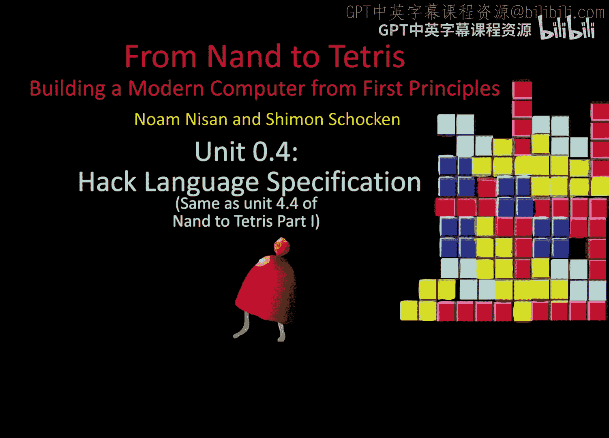

# 007：Hack语言规范 🖥️

在本单元中，我们将完成对Hack机器语言的描述和规范说明。

## 概述

我们将学习Hack机器语言的完整规范，包括其两种表示形式：符号化表示和二进制表示。理解这两种形式及其映射关系，是后续编写和运行程序的基础。

## 机器语言的整体框架

上一节我们介绍了计算机硬件平台的基本构成。现在，我们来看看其软件层面的核心——机器语言。

整体背景是，我们有一个由指令内存、CPU和数据内存组成的硬件平台。我们有一套机器语言，由A指令和C指令构成。我们在上一个单元描述了这些指令。一个Hack程序就是一系列这样的指令组合在一起，我们一次执行一条指令。这就是整体情况。

事实上，对于任何机器语言，你都可以用两种不同的风格或语言来编写程序。你可以使用助记符和友好的符号进行符号化编写，正如我们在幻灯片左下方看到的那样。或者，你也可以使用约定好的二进制代码来编写。

如果你用符号编写程序，就需要有人将这些程序从符号翻译成二进制代码。一旦程序以二进制代码的形式被指定，你就可以将这些代码加载到计算机中并实际执行。

我们将用整整一周的时间来讨论这个翻译过程，以及一个非常特殊的程序——汇编器。因此，我不会花太多时间讨论翻译过程，但我想让大家知道，在构建这台计算机时，这是一个必须面对的挑战。

## A指令的语法规范

首先，我们来详细看看A指令的语法。

### 符号化语法

A指令的符号化语法我们之前已经见过：`@value`。这个值可以是一个最大为 `2^15 - 1` 的数字。你可能想知道这个数字从何而来，稍后就会看到。或者，它也可以是一个指向该数字的符号，关于符号的讨论我们将推迟到后面的单元。例如：`@21`。

### 二进制语法

以下是同一条指令的二进制形式。我们以一个特殊的代码 `0` 开始，它告诉计算机这是一条A指令。然后，我们指定与符号指令中相同的值，但使用二进制代码来指定。这样我们就得到了像这里展示的例子。

再次说明，开头的 `0` 有时被称为操作码。然后是15位，代表我们想要加载到A寄存器中的值。在这个例子中，二进制数 `0000000000010101` 等于十进制的 `21`。

## C指令的语法规范

上一节我们介绍了A指令，本节中我们来看看C指令的规范。

### 符号化语法

C指令的符号化定义非常用户友好。我们有一个可以存储到特定目的地的计算，以及一个可选的跳转指令。这就是符号表达的巨大优势。

### 二进制语法

如果我们想用二进制表达它，就必须约定一些代码。在设计这种语言时，我们已经完成了这项工作。以下是同一符号指令的16位规范。

第一位是操作码，它告诉计算机这是一条C指令。我们只有两种类型的指令：A指令和C指令，这就是为什么我们只需要一位来表示操作码，即 `0` 或 `1`。因此，操作码 `1` 表示这是一条C指令。接着是两位我们未使用的位，按照惯例我们将其设为 `1`。

接下来的七位共同指定了要执行的计算。这些是稍后将发送给ALU的控制位，告诉ALU它必须执行哪种计算。再接下来的三位代表目的地。最后三位代表我们使用“jump”这个词符号化调用的跳转条件。

这就是指令在二进制形式下的不同字段。

## 符号与二进制的映射关系

现在我们已经了解了两种指令的格式，接下来让我们讨论C指令的符号表达与二进制表达之间的映射关系。

### 计算字段映射

以下是计算字段的映射表。

以下是关联符号化计算助记符与其二进制等价物的表格。左侧是符号，右侧是二进制代码。表格底部还有一个 `a` 位。

例如，假设计算是 `D+1`。符号上，我们希望计算机计算 `D+1`。我们查表，在表格中间某处找到 `D+1`，并看到它列在 `a=0` 的列中。因此我们知道 `a` 位应为 `0`。然后我们查看表格中该行的其余部分，看到 `c` 位应为 `0111111`。就是这样。这就是我们用二进制表示 `D+1` 操作的方式。只需查表即可获得。

### 目的地字段映射

目的地字段的映射原理非常相似。

我们有一个映射表，左侧给出符号助记符，下一列是它们的二进制代码等价物。由于有8种不同的可能目的地，这些代码非常方便地从 `000` 排到 `111`。

再次说明，如果有人给你一个特定的目的地，比如 `M`，你可以在表中查找，并立即看到它对应于二进制代码 `011`。这就是在需要时从符号翻译成二进制代码的方法。

### 跳转字段映射

最后，让我们关注跳转字段。

其概念与目的地字段几乎相同。左侧是助记符，下一列有八种不同的二进制组合。同样非常方便，我们有八种不同的跳转条件，因此其二进制等价物也方便地从 `000` 排到 `111`。

## 完整的C指令规范

基本上，这总结了符号和二进制代码之间的映射关系。如果你想把它全部整合起来，我们可以在一张幻灯片中完成。这是C指令的完整规范，展示了其符号形式和二进制形式的所有细节。如果你必须编写一个计算机程序来将一种语言翻译成另一种语言，你可以开始看到如何使用这个逻辑来编写这个程序。顺便说一下，这是我们将在本课程最后一周要做的事情。

## Hack程序示例

现在我们已经理解了具体指令在二进制和符号形式下的样子，让我们继续讨论Hack程序的整体概念。

以下是一个Hack程序的示例。在课程的这个阶段，你不需要理解这个程序，我们只是给你一个程序外观的初步概览，我们可以做一些快速的观察。

首先，一个Hack程序是一系列Hack指令。这个程序是使用符号指令编写的。允许使用空白，你可以在任何你认为能提高程序可读性的地方插入空行。欢迎使用注释，并且可以随意使用。

最后，我想说这不是编写Hack代码的好方法。有更好的方法来编写代码，使用更少的数字和更多的符号，这是我们将在课程后面再次做的事情。现在，我只是想让你看一个典型Hack程序的例子。

如果我们想在计算机中运行这个程序，首先必须将其翻译成二进制代码。因此，我们需要一个人类汇编员或一个计算机程序来进行从一种形式到另一种形式的翻译。一旦程序以二进制代码表达，我们就可以将其加载到计算机中并执行它。程序将有望做一些有用的事情。如果没有，我们可以返回去调试程序，重新编译或重新汇编，重新运行，等等，直到我们满意为止。

## 总结

本节课中我们一起学习了Hack机器语言的完整规范。这是讨论Hack机器语言的最后一个单元。在下一个单元中，我们将讨论如何使用这种语言来控制连接到Hack计算机的输入输出设备。