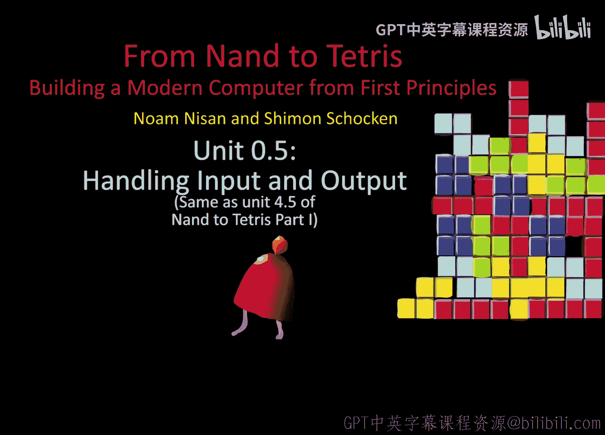
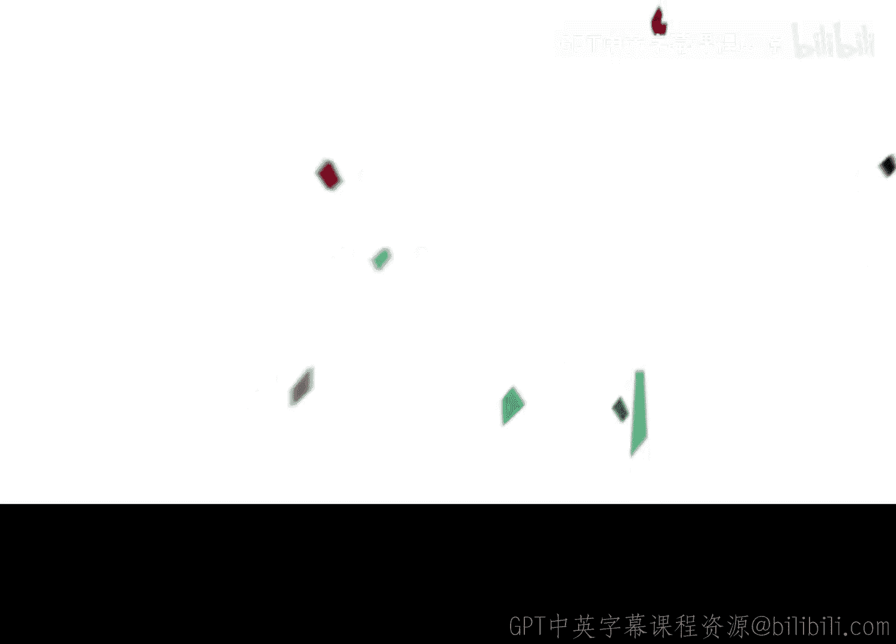

# 008：处理输入与输出 🖥️⌨️

在本单元中，我们将学习如何使用机器语言来控制和操作计算机的输入输出设备。我们将重点介绍两种核心设备：显示器和键盘，并解释如何通过操作内存中的比特位来与这些设备进行交互。

上一节我们介绍了计算机的基本架构，本节中我们将为其扩展两种重要的IO设备。

## 屏幕内存映射 🖼️

为了控制显示器，我们需要理解一个核心概念：**屏幕内存映射**。屏幕内存映射是数据存储器（RAM）中的一个特定区域。物理显示单元会持续不断地从该内存映射区域刷新其显示内容，每秒发生多次。

因此，如果我想在屏幕上显示内容，我只需要操作内存映射中的相应比特位。在下一个刷新周期，我对内存所做的更改就会反映在屏幕上。

以下是屏幕内存映射的工作原理：

*   **物理屏幕抽象**：Hack计算机的显示器被抽象为一个256行、512列的矩阵。每个行列交点称为一个**像素**。这是一个黑白屏幕，每个像素只能是开启（黑色）或关闭（白色）状态。
*   **内存映射结构**：屏幕内存映射由8K个16位字（word）组成。每个字对应屏幕上的16个连续像素。整个映射恰好对应256 * 512 = 131,072个像素。
*   **像素寻址**：要操作屏幕上特定行（`row`）和列（`col`）的像素，需要找到对应的内存地址和比特位。计算步骤如下：
    1.  计算目标像素所在的内存字地址：`address = 32 * row + col / 16` （`col / 16` 为整数除法，舍去余数）。
    2.  从内存中读取该地址的16位字。
    3.  在该字中，定位目标比特位：`bit_position = col % 16` （取`col`除以16的余数，范围0-15）。
    4.  将该比特位设为0或1。
    5.  将修改后的16位字写回内存。

在Hack架构中，屏幕内存映射由一个名为`Screen`的芯片实现。当我们将此芯片集成到完整的计算机内存中时，其基地址是16384。因此，在完整系统中访问屏幕内存的绝对地址为：`16384 + (32 * row + col / 16)`。

## 键盘内存映射 ⌨️

与屏幕类似，键盘也通过一个内存映射区域与计算机连接。这个映射比屏幕简单得多。

以下是键盘内存映射的工作原理：

*   **物理连接抽象**：物理键盘通过一个名为`Keyboard`的16位寄存器芯片连接到计算机。该芯片代表键盘在计算机架构内部的状态。
*   **扫描码**：当按下键盘上的一个键时，该键对应的**扫描码**（一个预先约定好的数值）会通过连接线传输并出现在键盘内存映射（即`Keyboard`寄存器）中。松开按键时，寄存器值恢复为0。
*   **查询按键**：要检测当前按下了哪个键，程序只需读取`Keyboard`芯片的输出值。如果值为0，表示没有按键被按下；如果值为非零，则该值就是被按下键的扫描码，通过查表即可知道是哪个键。

在完整的Hack计算机内存地址空间中，键盘内存映射位于地址24576。因此，通过读取内存地址24576的值，即可获取键盘输入状态。

## 硬件模拟器演示 💻

为了更直观地理解，我们可以在硬件模拟器中观察这些芯片的工作方式。

### 屏幕芯片演示

1.  加载内置的`Screen.hdl`芯片。这是一个内存芯片，具有地址输入、数据输入、数据输出和加载位。
2.  其GUI侧边会模拟一个256x512像素的物理屏幕。
3.  例如，要将第3行的前16个像素涂黑：
    *   计算地址：`32 * 3 = 96`。
    *   在地址输入中写入96，在数据输入中写入-1（其二进制补码表示是16个1），并断言加载位。
    *   点击“时钟”按钮执行写入操作。你会看到内存地址96的值变为-1，同时模拟屏幕上第3行开头出现了16个黑点。

### 键盘芯片演示

1.  加载内置的`Keyboard.hdl`芯片。这是一个只读芯片，只有一个输出引脚。
2.  点击模拟器界面上的“启用键盘”按钮，将芯片连接到你的物理键盘。
3.  按下键盘上的任意键（例如‘G’、空格、方向键），芯片的输出引脚会实时显示该键对应的扫描码（如71、32、133等）。
4.  松开按键，输出值恢复为0。

本节课中我们一起学习了计算机输入输出的基本原理。我们了解到，在底层硬件层面，IO设备是通过特定的内存映射区域来控制的。对于屏幕，我们通过向屏幕内存映射的特定比特位写入0或1来控制像素的亮暗；对于键盘，我们通过读取键盘内存映射寄存器中的扫描码来获取用户的按键输入。这些操作虽然基础，但却是所有高级图形和交互功能的基石。在课程的第二部分，我们将基于这些硬件知识，构建更高级的软件层和IO库。