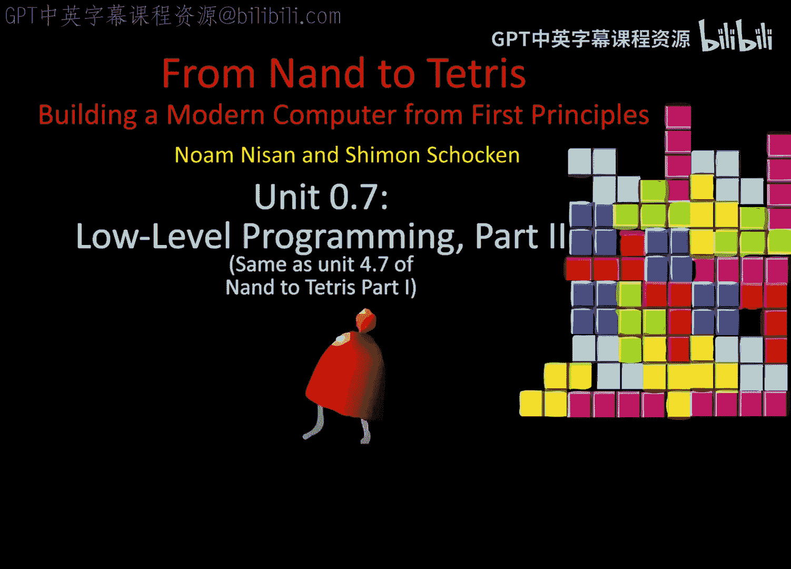

# 010：底层编程第二部分



## 📖 概述

在本单元中，我们将学习底层编程中的三个核心概念：**分支**、**变量**和**迭代**。这些概念是高级编程语言中常见结构的基础，我们将了解如何在机器语言层面实现它们。

---

## 🔀 分支

上一单元我们介绍了如何在内存中使用寄存器，这是底层机器语言进行一切操作的基础。本节中，我们来看看更接近高级程序员思维的概念——分支。

分支是计算机的一项基本能力，它让计算机能够评估一个布尔条件或表达式，并根据其结果决定是跳转到程序的另一个部分执行，还是继续执行下一条指令。

任何编程语言都有各种分支机制。例如，在Java或Python中，有 `if-else`、`while`、`repeat`、`switch` 等结构。在机器语言中，我们通常只有一种分支机制，称为 **Go to**。

以下是一个具体示例。在这个程序中，我们希望检查某个数据值，判断它是否为正数。按照约定，该值存放在 `RAM[0]` 中。程序执行完毕后，如果 `RAM[0]` 为正数，则在 `RAM[1]` 中存入 `1`，否则存入 `0`。

这本质上是一个 `if-else` 结构。遗憾的是，在底层编程中，我们无法直接表达这种结构。底层编程更加精简和原始，因此我们需要通过一系列指令来实现它。

以下是实现该功能的一段代码：

```
// 检查 R0 是否大于 0，如果是，设置 R1 为 1
@R0
D=M
@8
D;JGT
@R1
M=0
@10
0;JMP
@R1
M=1
@10
0;JMP
```

在指令 8 和 9 中，我们处理了将 `R1` 设置为 `1` 的操作。在指令 2 和 3 中，我们检查了数据输入（现在存放在 `D` 寄存器中）的值，并据此决定是否跳转到指令 8。

如果不确定这段代码的工作原理，建议暂停视频，在脑海中或纸上模拟运行，以理解分支在此处是如何工作的。

现在，作为实验，我们移除行号和注释，只留下代码本身。你会发现，剩下的代码非常难以阅读和理解。这是一个典型的“神秘代码”例子，尽管它能完美运行，但缺乏可读性。

这正是引用 Donald Knuth 名言的好时机：“与其想象我们程序员的主要任务是指导计算机做什么，不如集中精力向人类——我们的同行程序员——解释我们想让计算机做什么。” 这一点至关重要，因为如果我们的程序不能自我说明，我们将无法修复和扩展它们。

那么，如何让这个程序更具可读性呢？幸运的是，汇编语言有一个非常好的特性，叫做 **符号引用**。

---

## 🏷️ 符号引用与标签

让我们看看如何改进。我引入了一个自己创建的标签，并决定称之为 `POSITIVE`，因为它大致描述了我想要做的事情。这个 `POSITIVE` 标签在代码中出现了两次。

首先，我声明了这个标签。我在这里的意思是：这里有一段代码，我希望从程序的其他地方跳转过来，我将这个代码位置称为 `POSITIVE`。

在设计 Hack 汇编语言时，我们决定通过将标签写在圆括号内来声明标签。因此，在 Hack 汇编语言中，声明标签的语法是 `(LABEL_NAME)`。

使用标签时，我们不再说 `@8`，而是说 `@POSITIVE`。汇编器（翻译器）的任务就是将这些标签翻译成具体的数字。

翻译遵循一个通用规则：`@LABEL` 会被翻译成 `@n`，其中 `n` 是标签声明之后的下一条指令的编号。

请记住，指令有隐式的编号。当我们把这段代码加载到指令内存时，会发生以下情况：

首先，标签声明本身不会被翻译成机器码。它们被忽略，不生成任何代码。

其次，对标签的引用会被替换为对该标签声明之后的下一条指令编号的引用。

因此，`@POSITIVE` 变成了 `@8`（因为 `8` 是 `POSITIVE` 标签后的指令编号），`@END` 变成了 `@10`。

一旦我们理解了这一点，就可以在程序中自由地发明和使用任意多的标签，并用它们来实现分支逻辑。

---

## 📦 变量

处理完分支后（显然我们还会再次涉及它，因为任何非平凡的程序都离不开分支），让我们继续讨论另一个抽象概念：**变量**。

变量是一个具有名称和值的容器的抽象。在高级语言中，我们有不同类型的数据和变量。然而，在机器语言的底层，至少在 Hack 机器语言中，我们只有一种变量类型：16 位的值。这个抽象可以通过使用数据内存中的一个单独寄存器来实现。如果我们要在程序中创建变量，就使用一个单独的寄存器来表示每一个变量。

以下是一个变量应用的例子。在这个程序中，我想交换 `RAM[0]` 和 `RAM[1]` 的值。我使用了一个经典的编程惯用法，它在几乎所有基础编程课程中都会出现：创建一个变量（通常称为 `temp`，表示它是一个临时变量），然后进行一些操作，最终完成交换。

问题在于，如何在目前还没有变量概念的机器语言中实现它？这是一个引入变量的好机会。

以下是我决定如何实现它的代码。让我们只关注程序中的红色指令。在第一条红色指令中，我声明了一个名为 `temp` 的变量，然后立即使用它。

`@temp` 这个神秘命令的含义是什么？请注意，与标签和引用不同，我们并没有一个对应的叫做 `temp` 的标签。那么，当我们这样写 `@temp` 时，我们是什么意思呢？

我们的意思是向计算机提出以下请求：请到内存单元中，找到一个可用的内存寄存器（假设是第 N 号寄存器），并从现在开始用它来代表我称之为变量 `temp` 的东西。

因此，从现在开始，每当你看到符号指令 `@temp`，我请求你将其视为我们已经知道如何处理的 `@N` 指令。

这就是变量抽象的实现方式。

让我们观察一下，当你翻译这个程序并将其加载到指令内存时会发生什么。

首先，你会看到代码中原来的 `@temp` 变成了 `@16`。因为 `@temp` 在程序中出现了两次，所以我们有两个 `@16` 指令的出现。

这是如何发生的呢？编写汇编器或实现此翻译器的人，是根据我们作为语言设计者制定的“契约”来工作的。

这个契约有两条规则：
1.  对一个没有对应标签声明的符号的引用，被视为对一个变量的引用。我们假设程序员想要创建一个变量。
2.  变量从 RAM 地址 16 开始分配。

在这个特定例子中，我们只有一个变量，所以它最终被分配到 `RAM[16]`。如果程序中有更多变量，我们将使用 `RAM[17]`、`RAM[18]` 等地址。实际上，你可以使用任意多的变量。在 Hack 语言中，你实际上可以使用数千个变量，但通常程序员只会用到半打或一打左右。

关于变量的这一小节结束时，如果你看这段代码，你会发现这个程序相对容易阅读和调试。我们有一个符号标签和一个符号变量 `temp`，与之前使用实际数字表示地址的程序相比，理解这里发生了什么要容易得多。

这个程序还有另一个更微妙但非常好的优点：它是所谓的 **可重定位代码**。

我可以把这个程序加载到内存中，不一定是从地址 0 开始。我可以把它放在内存中任何我想要的地方，只要我记得这个程序使用的基础地址。这一点极其重要，因为你知道，当你在个人电脑上工作时，通常同时运行着多个程序，这意味着多个程序被加载到主内存中。一旦我们使用符号引用仔细编写这些程序，就不必担心它们将位于内存中的哪个位置。我们可以编写一个叫做“加载器”的程序来处理这个技术细节。

所以，符号化程序是好的。

---

## 🔁 迭代

接下来我想讨论的编程惯用法是 **迭代**。

例如，假设我们想计算级数 1 + 2 + 3 + ... + n 的和，其中 n 是给定的输入。我们该怎么做？

通常，我们会使用一个累加器变量来累积级数的运行总和。你把这个变量设为 0，然后 0+1=1，1+2=3，3+3=6，依此类推，直到达到 n。

如果你必须用底层语言编写这个程序，最好从一些面向底层的伪代码开始。以下是我所做的。

一旦你确信这段伪代码确实能实现所需的功能，我们就可以继续在纸上将这段伪代码翻译成符号机器语言。

让我们从程序的第一部分开始，在这里我们声明并初始化三个变量 `n`、`i` 和 `sum`。

首先，请注意我伪代码中使用的变量名与符号语言中的变量名之间存在一一映射关系，这很好。

我们有这三个变量。假设我只翻译程序的这一部分并将其加载到指令内存中，我将得到：`@n` 被翻译成 `@16`，`@i` 被翻译成 `@17`，`@sum` 被翻译成 `@18`。这并不奇怪，因为它遵循了我们之前讨论的契约：变量从地址 16 开始分配到连续的 RAM 地址。

让我们记住这一点，并完成将伪代码翻译成机器语言的工作。这个程序的细节并不是特别重要（当然，如果你真的要写这个程序，它们很重要），但对于我想在本单元强调的内容来说并不重要。不过，我仍然希望你再次暂停视频，并确信自己理解这段代码在做什么。

顺便说一下，当你编写这样的程序时，如果我把它作为作业交给你，我强烈建议你先用伪代码写出来。

然后，我建议你调试你的伪代码，并说服自己伪代码确实能工作。一旦你确信它能工作，你就可以将编写机器代码的任务简化为仅仅从伪代码翻译成机器语言。你看，这样做要容易得多。你看着像 `n = R0` 这样的伪代码命令，然后写一组实现相同功能的机器语言指令；或者看看伪代码中循环指令后面的语句，比如 `if i > n goto STOP`，只专注于翻译这一条指令要容易得多。

这是编写底层代码并确信其能工作的一种方法。

验证代码能工作的第二种方法同样重要：一旦你的程序写好了，你必须模拟它。我们建议你在纸上使用一种叫做 **跟踪表** 的东西来模拟它。

跟踪表是一张纸，你在上面写下程序中所有主要“参与者”或你感兴趣的主要变量的名称，然后在表中记录这些变量在整个程序执行过程中的值。这些是迭代 0 时这些变量的值。然后你遍历循环，找出第一次迭代、第二次迭代、第三次迭代等之后发生了什么。你这样做了三到四次迭代，试图说服自己程序确实在工作。

---

## 💡 最佳实践建议

最后，这是我们编写 Hack 机器语言程序的最佳实践建议：

1.  **设计**：首先，你必须使用某种伪代码来设计程序。你可以遵循我们在上一张幻灯片中使用的伪代码示例。
2.  **翻译**：其次，你必须将你的伪代码用 Hack 汇编语言重新表达出来。
3.  **测试**：最后，我们建议你使用某种跟踪表在纸上测试最终的程序。

请注意，我是在没有接触计算机的情况下完成所有这些事情的，一切都是在纸上完成的（实际上我可能用了文本编辑器，但文本编辑器对我来说就像使用一张纸）。在你真正在计算机上运行程序之前，确信程序能正常工作是非常重要的。

---

## 📝 总结

在本单元中，我们一起学习了底层编程中的三个核心概念：**分支**、**变量**和**迭代**。我们了解了如何使用 `Go to` 指令和标签实现分支逻辑，如何通过分配内存地址来创建和使用变量，以及如何通过循环和累加实现迭代操作。我们还探讨了使用符号引用和伪代码来编写更清晰、可维护且可重定位的代码的最佳实践。


在下一个单元中，我们将讨论**指针**和**输入/输出**，这将是我们 Hack 底层编程部分的结尾。