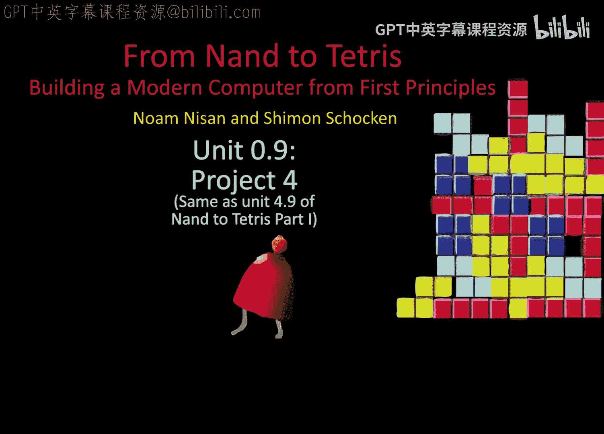

# 012：项目4概述 🖥️

在本节课中，我们将学习项目4的具体内容。项目4要求我们编写两个低级别的程序，直接操作Hack计算机的硬件。我们将通过这两个程序，为下周构建完整的Hack计算机硬件平台做好准备。

上一节我们介绍了Hack汇编语言和硬件平台的基本概念，本节中我们来看看项目4的具体任务。

## 项目4的第一个程序：乘法（Mult）

第一个程序名为 `Mult`。其目标是计算内存中 `R0` 和 `R1` 两个寄存器的乘积，并将结果存入 `R2`。

以下是该程序在CPU模拟器中执行结束时的截图示例。可以看到，`RAM[0]` 的值为6，`RAM[1]` 的值为7，而 `RAM[2]` 的结果为42，这正是预期的乘积。

程序执行流程如下：用户将程序加载到指令内存后，还需在 `RAM[0]` 和 `RAM[1]` 中存入两个数字。点击运行按钮后，程序便会开始计算这两个数的乘积。

在模拟器屏幕的右侧，我们提供了一个测试脚本。该脚本会用我们预设的多组数字对来测试你的程序。你可以查看这个脚本，了解我们将对你的程序进行哪些测试。需要说明的是，模拟器中的屏幕是一个多功能设备，有时作为物理屏幕显示，有时则用于展示测试脚本等信息。

那么，如何编写这样的程序呢？关键在于，Hack机器语言本身**没有乘法指令**，只有加法和减法指令。因此，我们必须**使用加法和减法来实现乘法运算**。

实现提示是：你需要**使用一个循环**来逐步累加，从而计算出结果。顺便一提，在本课程的后续部分（Nand2Tetris第二部分），你将有机会开发一个操作系统，其中会包含一个数学库，提供包括高效乘法在内的各种数学运算。但在当前项目中，我们只要求你实现一个能完成乘法功能的程序，不要求使用特别高效的算法。

## 项目4的第二个程序：填充屏幕（Fill）

第二个程序是一个简单的交互式程序，其功能如下：
1.  程序持续监听键盘输入。
2.  只要用户没有按下任何键，屏幕保持原状。
3.  一旦用户按下键盘上的任意键，程序会将整个屏幕涂黑。
4.  当用户松开按键时，屏幕会恢复为空白（全白）。
5.  这个过程可以无限重复：按下变黑，松开变白。

这个程序实际上包含两个挑战：一是探测键盘状态（是否有按键被按下），二是控制屏幕的填充（全黑或全白）。填充操作的本质是向屏幕内存映射区域写入特定的值。

这个练习的简化之处在于，我们操作的是**整个屏幕内存映射**，而不是单个像素。我们采用一种“散弹枪”式的方法，要么打开所有像素（变黑），要么关闭所有像素（变白）。因此，从整体上看，这个程序并不算非常复杂，但它很有趣，能让你了解如何使用标准的Hack机器语言代码来控制外围设备。

以下是通用的实现策略：
*   **监听键盘**：持续检查键盘内存映射地址的值。
*   **填充屏幕**：根据键盘状态，编写代码将整个屏幕内存映射区域填充为黑色或白色像素。
*   **使用循环和指针**：为了填充整个屏幕区域，我们需要寻址内存映射中的每一个寄存器。这可以通过一个使用指针的循环来实现，其方式与之前单元中讨论的指针操作非常相似。你已经掌握了实现这个程序所需的所有工具。

在CPU模拟器中测试此程序时，请确保选择了“无动画”选项。我们无法为这个交互式程序提供一个自动测试脚本，因此你需要手动测试：按下和松开键盘按键，观察屏幕是否相应地变黑或变白。你也可以发挥创意，尝试不同的填充方式，例如按列填充或创造出某种图案，但这会更具挑战性。

## 程序开发流程与最佳实践

现在，我们来了解一下使用Hack机器语言开发程序的通用流程和最佳实践。

### 开发周期

开发Hack机器语言程序的过程非常简单：
1.  **编写**：使用任何文本编辑器编写程序，并将其保存为扩展名为 `.asm` 的文件（通常以大写字母开头命名，如 `Mult.asm`）。
2.  **翻译与加载**：将 `.asm` 文件加载到CPU模拟器中。模拟器会自动将其翻译成二进制代码。
3.  **运行与调试**：在模拟器中运行程序，检查结果。
    *   如果满意，即可提交。
    *   如果不满意（在最初的调试迭代中很可能如此），则需要查找并修复错误。
4.  **迭代**：回到文本编辑器修改程序，保存后重新加载到模拟器中，再次测试。建议同时打开文本编辑器和CPU模拟器两个窗口，以便快速切换。但请记住，每次修改后都必须重新加载程序。

关于错误诊断：CPU模拟器的错误诊断功能比较基础。如果程序存在语法错误，模拟器会拒绝加载并给出一个包含错误行号的提示信息。修复所有语法错误后，更困难的运行时错误才会出现，这通常需要通过观察程序执行过程来发现和修复。

### 编程建议与技巧

编写机器语言程序与编写高级语言程序遵循相同的原则。我们期望你的程序**简短、高效、优雅且具有自描述性**。

以下是一些非常重要的技术建议，能让你的编程工作更轻松：

**1. 使用符号变量和标签**
这是编写清晰程序的关键。避免在代码中直接使用数字地址，而应使用有意义的标签（用于跳转）和变量名（用于存储数据）。

**2. 使用合理的命名**
为标签和变量起一个易于理解的名字，例如 `LOOP`、`END`、`i`、`sum`、`count`，而不是像 `G531%` 这样晦涩难懂的名称。

**3. 遵循命名约定（建议）**
虽然汇编器不强制要求，但遵循以下约定能帮助你更好地区分变量和标签：
*   **变量名使用小写字母**（如 `i`, `x`, `sum`）
*   **标签名使用大写字母**（如 `LOOP`, `END`, `STOP`）
这样，当你看到 `@sum` 时，如果 `sum` 是小写，你就知道它是一个变量；如果是大写，则代表跳转到名为 `SUM` 的标签。

**4. 使用注释和缩进**
像高级语言一样为你的代码添加注释，解释高级别的操作意图。同时，使用缩进来保持代码结构清晰美观。可以参考课程之前提供的示例代码风格。

**5. 先编写伪代码**
编写机器级代码总是具有挑战性的。一个有效的方法是先使用高级伪代码或你自创的类似高级语言的语法来设计程序逻辑。在纸上验证伪代码逻辑正确后，再将其翻译成机器语言，这样可以大大简化后续的调试过程。

## 所需资源

所有项目所需的文件都可以在Nand2Tetris官网的项目4页面找到。如果你在课程开始时已经下载了软件套件，那么在你的个人电脑上，`projects/04` 目录中已经包含了项目4所需的所有文件，无需额外下载。

本节课中我们一起学习了项目4的两个编程任务：实现乘法运算和创建交互式屏幕填充程序。我们还探讨了Hack机器语言的开发流程，并介绍了一系列编写清晰、高效代码的最佳实践。这些知识和技能将为我们下周构建完整的Hack计算机硬件平台打下坚实的基础。