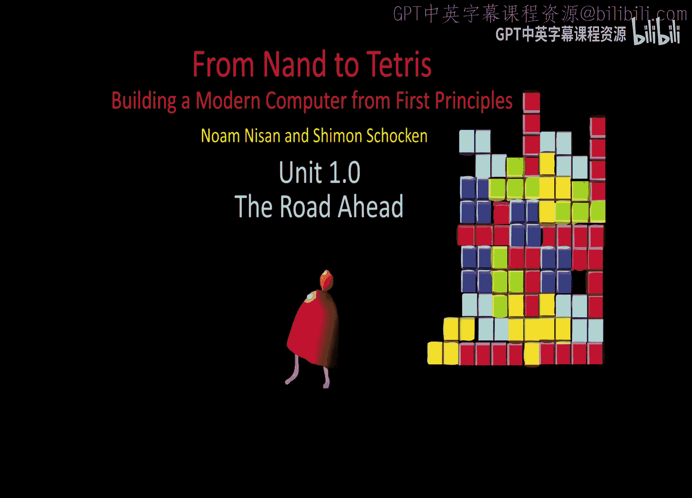

# 013：前路展望 🚀

在本单元中，我们将回顾第一部分的成果，并展望第二部分的学习路线图。我们将探讨高级编程语言如何通过层层抽象，最终在底层硬件上运行，并明确学习第二部分所需的基础知识。

## 课程回顾与展望

如果一切按计划进行，那么你已经完成了机器语言入门。我们现在准备继续前进，讨论接下来的内容。

这是我们第一部分构建的计算机，现在开启第二部分的学习。

就像许多其他经典的计算机科学课程一样，我们将从熟悉的“Hello World”程序开始。这个程序用一种名为Jack的语言编写，这是一种基于对象的高级语言，我们将在本课程的第二部分中使用。

我们编写这个程序，以某种方式将其放入计算机，点击某个按钮，然后屏幕上就显示出“Hello World”。在大多数课程中，学生此时会继续开发一些更有趣的程序。但在本课程中，我们在此停下，并问自己一系列关于“表面之下”发生了什么的有趣问题。

## 深入思考程序执行

首先，看看程序执行这个概念，它简直像魔法一样。毕竟，程序只是我写在纸上或用文本编辑器写下的一堆静态字符。突然间，我可以将这个程序转化为一系列低级指令，使计算机真正执行某些操作。这非常迷人，但我们却习以为常。

计算机如何知道如何在屏幕上显示“Hello World”这些文字或图像？它如何知道显示一个“H”？更进一步，它如何知道在屏幕上显示一个像素？这些都是我们通常不会费心去思考的非常有趣的问题。

再看看像 `class`、`function`、`do`、`while` 这样的关键字。当我们写下这些词时，我们确切地知道想让计算机做什么，但计算机如何理解如何处理它们？它如何解析我们的代码并理解这些词的位置？即使它理解找到了 `while` 并且 `while` 应该表示一个循环，计算机又如何知道如何执行这个循环？

再看看像 `print`、`screen` 和 `printLine` 这样的命令。看起来这些命令调用了存在于其他类中的方法或函数，对吧？一个名为 `Output` 的类，它可能不在这里，而是某个类库或操作系统的一部分。那么，计算机如何知道如何将控制权转移给这些方法？然后在它们完成任务后，又如何将控制权返回给我们的程序？

所有这些问题以及数百个类似的问题都极其有趣和重要，然而高级程序员却不会停下来思考它们。为什么他们可以处于这种“无知的幸福”状态？答案是，高级程序员将他们的高级语言视为一种**抽象**。就他们而言，他们编写的程序也是抽象。

能够向系统的用户隐藏低级技术细节，这是一个极其重要的原则，不仅在计算机科学中，在任何大规模的科学或技术项目中都是如此。因为高级程序员有足够多自己的问题需要解决。应用程序编程本身就是一个足够有趣且充满挑战的工作领域，如果我们期望高级程序员还要一直思考如何在屏幕上渲染像素、解析程序等等，他们会发疯的，无法专注于自己的工作。因此，他们不必考虑底层细节实际上是一种优点。

然而，必须有人去思考这些问题。至少，如果你有求知欲，你应该问自己：是什么让这些抽象得以运作？答案是，让它们运作的是诸如**汇编器**、**虚拟机**、**编译器**和**操作系统**这样的东西。弥合这个鸿沟，理解这些东西如何工作，正是本课程第二部分的核心内容。

## 学习底层知识的意义

有些人可能会说，既然为了成为一名应用程序员，我不必担心这些事情，那我为什么还要担心呢？答案是，确实，你可以在不理解编译器和操作系统内部原理的情况下，编写出非常优秀的高级程序。然而，如果你这样做，你将停留在某种有限且受限制的能力水平上。

但是，如果你花时间去深入了解这些奇妙的软件层是如何工作的，你将成为一个能力更强、更成熟的软件开发人员。😊 不仅如此，从智力上讲，你也会成为一个更丰富的人。因为要开发虚拟机、编译器和操作系统，你必须学习如何使用一些极其优美的**算法**、**数据结构**、**编程技术**以及各种能极大提升你能力的东西，这不一定是为了理解低级细节，而是作为一个软件开发人员、思考者，当然也作为一个应用计算机科学家。

## 课程路线图概览

好的，考虑到这一点，以下是我们旅程的主要站点。😊

最后一个站点是高级语言。我想用本单元来讨论我们旅程的终点，即在结束时，我们将能够用Jack语言编写程序，它在许多方面与Java非常相似。我想给你一个例子，看看这些程序会是什么样子。

我随意选择了一个在二维空间中处理点的小问题。我们在这里看到的是点P1和P2。点P3是P1和P2的向量加法，看起来我们对P1和P3之间的距离感兴趣。我们如何使用Jack进行这样的操作呢？

事实证明，已经有人编写了一个名为 `Point` 的类，它包含了各种服务，对于执行此类2D操作非常有用。这个人不仅给了我这个类，还给了我这个类的API，这样我就可以使用这个API编写一个小程序，执行你在图片上看到的内容。以下是这个程序。

我打开文本编辑器，写下这些代码行：我定义了一个新类，称之为 `Main`；定义了一个新函数，也叫做 `main`；然后我声明了三个名为 `p1`、`p2`、`p3` 的对象变量，这些变量的类型是 `Point`。接着，我继续构造 `p1` 和 `p2`。我知道怎么做，因为我有API，所以我阅读构造函数的签名，并基于此初始化和构造这两个点，将它们赋值给对象变量 `p1` 和 `p2`。然后我必须将 `p1` 和 `p2` 相加，我查看API，有一个 `plus` 方法，所以我根据其签名使用它，构造了一个新点 `p3`。

然后为了调试目的，我在屏幕上打印这个点。如果这个程序现在运行（虽然它还不能），我希望能在屏幕上看到 `(4,6)`。接着我打印一行，并计算 `p1` 和 `p3` 之间的笛卡尔距离，然后打印它。我在同一条语句中完成。再次，如果这被执行，我希望能看到数字 `5`，然后我返回。

好的，我使用 `Point` 类作为一个抽象，并做了一些恰好符合我期望的操作。我认为这个小例子向你展示了基于对象编程的巨大力量，因为用大约10行代码，我就完成了一些非常有用的工作。当然，前提是有人费心为我开发了 `Point` 类。

## 探究底层实现

因此，接下来我想深入研究一下 `Point` 类。让我们开始吧。

当我们打开 `Point` 的实现时，首先看到的是类级别的声明。这个类首先声明每个 `Point` 类型的对象由两个数字 `x` 和 `y` 来表征，它们是这个点的坐标。然后有一个类级别的静态变量叫做 `pointCount`，用于存储到目前为止设计或构造了多少个 `Point` 对象。

接下来是构造函数。签名与我们在API中看到的一样，这是构造函数的主体。这里没有什么神秘的。如果你熟悉Java或Python，它看起来非常相似。唯一的区别是，构造函数以一个显式的 `return` 语句结束，这在Java和Python等语言中是隐式的。在这个显式语句中，它返回刚刚创建的对象的地址，这个地址直接进入调用代码中的 `p1` 和 `p2`，所以一切按预期工作。

让我们继续探究这个类。这是我们之前看到的，有一些访问器我没有在API中列出。这是 `plus` 方法的定义，如果你愿意，可以稍后查看代数运算，并确信它确实执行了向量加法。

我们还有这个笛卡尔距离方法，它使用了勾股定理。然后我们有 `print` 方法，就是这样。

这里我想提出一个重要观点，所以请看着我并注意代码。重点是，没有必要过分深入 `Point` 类，因为本单元的目的不是教你Jack，也不是教你基于对象的编程，目的只是让你感受一下Jack中基于对象编程是什么样子，并让你感觉它与你可能在其他编程语言、其他计算机科学入门课程中所做的非常相似。所以，对于那些有编程经验的人来说，Jack是一种相当简单、朴实的语言。

## 从高级代码到可执行代码

好的，回顾一下，我们这里有两个类：`Main.jack` 与 `Point.jack` 交互以执行一些操作。提醒一下，我们现在位于旅程的最后一个站点。接下来我想探讨的问题是：我们如何将这些高级代码一路向下转化为可以在我们裸机硬件上实际运行的可执行代码？

我们是这样做的。我们取这两个类，`Main` 和 `Point`，把它们放在我们计算机上的某个目录里，可以任意命名。我决定称之为 `Points`（复数）。然后我们将Jack编译器应用于整个目录。结果，我们将得到两个新文件，它们具有相同的前缀名、相同的类名，但扩展名是 `.vm` 而不是 `.jack`。这两个文件将与我们的源代码位于同一目录。顺便说一下，如果你习惯用Java，这正是你用Java所做的，因为你从两个扩展名为 `.java` 的Java类开始，应用Java编译器后，你会得到用字节码编写的两个类，扩展名将是 `.class` 而不是 `.vm`，这只是一个小小的语法细节。

然后，你可能不知道，但接下来你将应用一个叫做**VM翻译器**的东西。在Java中，这是通过 `java` 命令本身完成的。在我们的世界里，VM翻译器将把VM代码翻译成一个包含许多Hack汇编指令的文件。然后我们可以取这个 `.asm` 文件，如你所见，把它交给汇编器。汇编器最终会从中产生另一个扩展名为 `.hack` 的文件。然后我们可以把这个文件放入我们在第一部分构建的计算机中，运行它，瞧！我们将在面前的屏幕上看到我们程序的输出闪烁。

这就是将一个高级程序通过层层处理，直到变成可以实际执行的东西的过程。在本课程第二部分中，我们不仅会多次做这些事情，实际上还会自己构建所有这些工具。

## 课程计划与预备知识

好的，再次重申，这是课程计划。我们从模块0开始，在这个模块中，我们要求你熟悉Hack汇编语言，这非常重要。一旦完成，我们将进入接下来的两个模块，在那里我们将构建一个虚拟机和VM翻译器。

然后，我们将跳到旅程的终点，要求你用Jack编写一些非平凡的程序。显然，我们会教你很多关于如何使用Jack语言的知识，但不会太多，因为Jack是自解释的。然后你将使用这种语言来开发一些交互式游戏或其他简单程序。

一旦你理解了语言本身，熟悉了语言本身，我们将为Jack语言编写一个编译器。我们将使用像Java或Python这样的语言来编写这个编译器，一种你感觉舒适的语言。最后，在课程的最后一个模块，我们将开发操作系统，为Jack提供各种重要的扩展，并弥合高级编程与裸机硬件之间的各种鸿沟。

在我们开始第二部分的旅程之前，我想说一些免责声明，并和你一起做一个小小的自我检查。

首先，我想说明，第二部分比第一部分要求高得多。我认为它和第一部分一样有趣，但你必须编写许多程序，做很多项目，所以你必须做好适当的心理和时间承诺，来学习这门严谨且富有挑战性的课程，尽管它会很有趣，我认为你会非常享受，但仍然会有很多工作。

在本单元中，我向你展示了几个使用Jack语言进行高级编程的例子。我想问你以下问题，并且请你真诚地在内心深处回答：看到这些编程示例，你感到舒适吗？你对诸如对象、构造函数、引用变量以及在Java或C#等语言中应用 `new` 操作感到舒适吗？

如果答案是肯定的，如果你理解类、方法和构造函数等是什么，那么你已经准备好学习这门课程。如果答案是否定的，那么我恳请你不要学习这门课程，而是去学习一些计算机科学入门课程，使用像Java或Python这样体面的基于对象的语言，学习高级编程的方方面面，然后再回来完成本课程的第二部分。当然，你可以享受讲座，至少我希望是其中一些，而不做任何项目，但这将错过本课程的目的。所以再次强调，如果你感觉舒适，很好；如果不，你需要一些准备。

我的下一个问题是：在本单元中，我们也看到了不少低级编程的例子。所以我的问题是：你对于使用Hack汇编语言进行低级编程感到舒适吗？你理解 `A=M` 是什么吗？你知道 `A` 是什么，`M` 是什么，这个操作的含义是什么吗？如果答案是否定的，那么我要求你回到机器语言入门，根据我的指导学习你需要的内容，并完成项目4。完成这个项目，提交它，获得评分，然后回来继续学习第二部分。

如果对这两个问题的回答都是响亮的“是”，那么欢迎加入，你已经准备好学习第二部分，我们可以继续前进，真正开始课程。在下一个单元，我们将讨论一些编译方面的内容，然后开始实际构建我们的虚拟机。

## 总结

在本单元中，我们一起回顾了课程第一部分的成果，并展望了第二部分的学习蓝图。我们探讨了高级编程语言背后的抽象层，理解了从Jack高级语言代码到最终在Hack硬件上运行所需的完整工具链，包括编译器、虚拟机、VM翻译器、汇编器等。最后，我们明确了学习第二部分所需的高级编程（如面向对象）和低级编程（Hack汇编）基础，为接下来的深入学习做好了准备。🚀