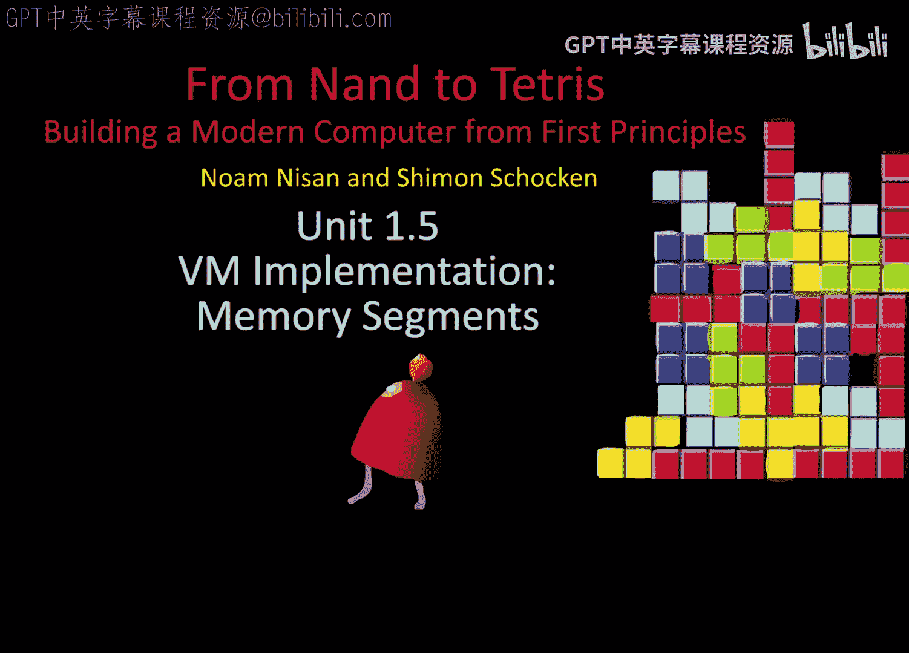

# 018：内存段

在本单元中，我们将继续探讨虚拟机的实现，重点关注内存段的实现方式。

## 概述

上一单元我们开始讨论虚拟机的实现，并介绍了栈架构的实现。本节中，我们将深入探讨如何实现虚拟机规范中定义的各个内存段。

## 内存段的统一抽象

首先需要明确，所有内存段的访问方式都是统一的。我们使用完全相同的语法来寻址任何段中的任何位置：`push` 或 `pop`，后跟段名和一个非负整数索引。例如：`push constant 17`、`pop local 2` 等。

那么，如何在宿主计算机上实现这些内存段呢？我们将循序渐进，从 `local` 段开始。

## 实现 Local 段

`local` 段使用我们一直使用的统一语法访问：`push/pop segment_name index`。以下是一个简单的栈机示例，展示了这两个数据结构。

在宿主 RAM 上，栈的实现方式与之前单元相同：我们约定栈从地址 256 开始，并使用一个称为 `SP` 的指针来记录栈中下一个可用位置的地址。我们决定将 `SP` 映射到宿主内存的 `RAM[0]`。

至于 `local` 段，原则上可以放置在 RAM 的任何位置。我们不关心 `local` 段存储在哪里，只要记住这个内存块的基地址即可。如图所示，我们决定将 `local` 段的基地址存储在一个名为 `LCL` 的指针中，并且 `LCL` 将引用 `RAM[1]`。

在示例中，`local` 段恰好始于一个任意的地址（例如 1015），`LCL` 包含相同的地址。请注意，我们使用了两个指针，但方式截然不同：栈指针指向栈中下一个可用位置，而 `LCL` 指向 `local` 段的基地址。

以下是使用此实现来处理 `pop` 命令的方式。

假设执行 `pop local 2` 命令，`SP` 已更新以反映弹出操作。原本位于栈顶的值 `5`，现在被存储到 `local[2]` 中，其地址是 1017。

如何知道 `local[2]` 的地址是 1017？很简单：基地址是 1015（此信息始终存储在 `LCL` 中），加上偏移量或索引 `2`，通过这两个值的相加，就得到了存储弹出值的目标地址。

这样，我们就可以概括这个翻译过程：取基地址，加上偏移量。

另一个值得注意的点是地址 257。它包含值 `5`，但这个值已“失效”。因为栈指针现在指向 256，所以下一次 `push` 操作很可能会覆盖这个 `5`。这在栈管理中很典型：栈中可能存在各种“垃圾”数据，但指针精确地指示了栈的哪些部分正在使用，哪些部分可以被回收。

那么，如何翻译 `pop` 操作呢？我们可以使用以下伪汇编代码来实现。

首先，计算目标地址（本例中为 `LCL + 2`），并将其存储到某个临时变量（如果需要）。
然后，递减栈指针。
接着，取出栈指针当前指向的值，并将其放入 `ADDR` 所指向的地址。
这就是我们想要实现的语义。如何在汇编中实现它？这是你需要完成的任务。你需要使用 Hack 语言、`A` 命令、`C` 命令等来翻译此类指令。一旦你解决了这个小难题，你就知道如何始终实现 `pop local i` 命令。

实际上，数字 `2` 并没有什么特殊之处。我可以用 `i` 替换 `2`，那么一切都会像之前一样工作。我不再执行 `LCL + 2`，而是执行 `LCL + i`。这样我就完全概括了这个翻译过程，知道如何处理 `pop local i`。

以下是 `pop local i` 命令的通用翻译。右侧显示的正是上一张幻灯片中的内容。`push local i` 命令的实现方式非常相似，基本对称：像之前一样计算目标地址，然后使用两条伪指令执行推送操作。同样，为了实际实现，你的 VM 翻译器必须生成使用 Hack 语言实现此伪代码的汇编指令。

## 扩展实现：四个关键段

现在，我想扩展这个图景，一起讨论 `local`、`argument`、`this` 和 `that` 这四个段。扩展视角并记住这些段在更宏大的项目中的来源和目的总是有帮助的。

考虑一个在运行时运行的典型方法（例如 Java 中的方法）。这个方法通常有局部变量、参数变量，通常会处理某个当前对象（它也是一组所谓的成员变量），并且该方法也可能处理某个具有数据值条目的数组。

当我们将此逻辑转换到虚拟机世界时，必须保留所有这些语义。我们通过 `local`、`argument` 内存段以及另外两个称为 `this` 和 `that` 的段来实现这一点。`this` 段存储当前对象的成员变量或字段值，`that` 段存储当前方法可能处理的数组的值。基本上，我们在 VM 级别使用这四个段来捕获这种语义。

那么，如何实现这四个内存段呢？首先，请记住在抽象层面上，我们使用它们的方式完全相同：执行 `push` 和 `pop`，后跟段名和索引。仅此而已。它们以统一的方式被访问。我很高兴地告诉大家，我们也以完全相同的方式实现它们。

除了始终可用的栈指针外，我们现在还将使用四个指针，分别称为 `LCL`、`ARG`、`THIS` 和 `THAT`。这些指针中的每一个都将完全执行上一张幻灯片中 `LCL` 指针所做的操作：它们的实现方式完全相同，每个都保存其相关内存段的基地址。

因此，`push` 和 `pop` 命令的实现也将完全相同。我们将使用与 `local` 段相同的语义，只是不说 `local`，而说段指针名称，其中段指针对应于我们在 VM 代码中正在处理的内存段。

现在，你可能会问自己一个好问题：等等，这些段到底会位于 RAM 的什么地方？答案是：我们不在乎。因为它们会被放在某个地方，我们所要做的就是记住这些动态分配的基地址。在课程后面，我们会看到决定将这些段放在内存的何处是一个非常有趣的问题，我们将使用各种巧妙的算法来解决这个问题，这些算法将成为操作系统和编译器的一部分，共同决定如何将这些段映射到整个 RAM 上。

## 实现 Constant 段

接下来要讨论的段称为 `constant`。常量的背景是：当编译器在你的高级源程序中遇到常量时，它会通过生成使用常量内存段的 VM 命令来处理这些常量。因此，它将通过诸如 `push constant something` 或 `pop constant something` 等栈操作来重新表达。

如何实现这些操作呢？以下是通用的 `push constant i` 命令。没有 `pop constant` 命令，因为将某些内容存储到这个常量中没有任何意义。这个常量的实现是微不足道的，因为它是一个真正虚拟的段，并不真实存在。因此，每当我们看到 `push constant i` 命令时，我们只需生成提供指定常量的低级代码：执行 `*SP = i`，然后递增栈指针。

这就是对常量段的处理。

## 实现 Static 段

接下来要处理的是 `static` 段。这个段的背景是什么？它从何而来？处理你高级代码的编译器可能会遇到一些静态变量，这些是所谓的类级别变量，在你的类中每个方法都可以访问。显然，我们必须以不同于处理局部变量或参数变量的方式来对待这些变量。因此，我们决定在虚拟机抽象中使用一个称为 `static` 的专用段来表示源代码中的静态变量。因此，源代码中对静态变量的每个操作都将在 VM 级别被重新表达为 `push static i` 或 `pop static i` 操作。

以下是我们实现静态变量的方式。我们从一个使用静态变量的 VM 代码示例开始，特别是在 `pop` 指令的上下文中。

请记住静态变量的特点。与局部变量和参数变量（对每个 VM 函数是唯一的）不同，静态变量处于更高的作用域级别。因此，你程序中的所有 VM 函数都应该看到相同的静态变量。由于有这个功能要求，将静态变量存储在某个全局空间中是有意义的，实际上也是必需的，这样所有从这些 VM 函数生成的代码都将看到相同的静态变量。

因此，我们决定采用的方法是：让 VM 翻译器将某个 VM 文件中对 `static i` 的每个引用，翻译成汇编引用 `f.i`。这个标签的前缀是文件名，`i` 是取自 VM 命令的索引（例如 `static 5` 对应 `i=5`，`static 2` 对应 `i=2`）。如果我们遵循这个约定（稍后会详细解释），那么 VM 翻译器将把 `pop static 5` 翻译成：首先有一些执行出栈操作的代码（此处省略），栈顶值将进入 `D` 寄存器，然后我们必须将其放入我们在汇编级别的 `static 5` 的化身中。我们如何做到这一点？我们生成一个名为 `f.5` 的标签，然后执行 `M=D`。另一个命令 `pop static 2` 的处理方式完全相同，只是将 `5` 替换为 `2`。

为什么这能实际工作？请记住，按照约定，Hack 汇编器会将这些引用映射到 `RAM[16]`、`RAM[17]`，一直到 `RAM[255]`（如果你的程序中有这么多静态变量的话，但这不太可能，典型的计算机程序通常只有几个静态程序变量）。因此，这些引用最终将被映射到你在 RAM 上看到的蓝色区域，而这正是我们想要的。因为这个蓝色区域在栈之外，并且你程序中运行的所有函数都可以查看这个 RAM 区域并看到完全相同的东西——静态变量。

通过使用这个技巧，我们基本上利用了 Hack 汇编器的一个独特约定：将符号变量映射到从位置 16 开始的 RAM 上。因此，你的静态段的条目将按照它们在 VM 代码中出现的顺序，依次映射到 `RAM[16]`、`RAM[17]` 等。这将导致一个稍微特殊的情况：在本例中，`static 5` 将映射到 `RAM[16]`，`static 2` 将映射到 `RAM[17]`（假设中间没有声明和使用更多的静态变量）。所以存在一一映射，但索引值的顺序与 RAM 条目的顺序并不相同，只是代码中出现的顺序决定了每个变量将被映射到 RAM 的哪个位置。

这就是我们实现静态段的方式。它有点复杂，但很有效。我想对此实现做一个总体观察：到目前为止，在我们讨论静态变量之前，我在本模块中所说的一切都是完全与平台无关的。毕竟，每台计算机都有 RAM，而我所说的关于实现 `local`、`argument` 等的内容，并没有对底层平台做出任何假设，除了存在栈这个非常安全的假设（因为每台计算机都有栈）。只有在实现静态变量时，我们才打破了这种平台无关的优雅，实际上利用了 Hack 汇编器独有的特性。重申一下，到目前为止，我所说的一切都可以在任何计算机上实现，不一定非要在 Hack 平台上。然而，如果你想在非 Hack 计算机上实现我们的虚拟机，你必须找到其他技巧来实现静态段。

## 实现 Temp 段

接下来要讨论的段是 `temp`。为什么我们需要一个临时段？事实是，当编译器生成代码，将你的 Jack 程序翻译成 VM 代码时，有时必须使用一些临时变量。因此，我们决定分配一个称为 `temp` 的八位置段，在需要时容纳和服务这些变量。

以下是我们的做法。`push` 和 `pop` 与之前完全相同，是统一的。但 `temp` 将是一个固定的八位置内存段，我们决定将此段映射到 RAM 位置 5 到 12。总共有八个值，因此 `push` 和 `pop` 的翻译将考虑这个基地址 5。所以，这几乎与我们之前的翻译相同，只是基地址现在是 5，而不是某个段指针。

这就是我们实现 `temp` 段的方式。

## 实现 Pointer 段

我们必须处理的最后一个段称为 `pointer`。`pointer` 段有点晦涩，因为在你开始编写编译器（这是我们在课程后期要做的事情）之前，你无法真正理解为什么需要它。所以现在，我只是将 `pointer` 段解释为某种近乎任意的游戏规则，根据我的解释，你将拥有在实际目标机器上实现它的所有信息。

首先，这个段从何而来？事实证明，当编译器翻译一个方法时，它必须记住 `this` 和 `that` 段的基地址。这些段代表了当前对象和该方法可能正在处理的当前数组。因此，我们决定将 `this` 和 `that` 的基地址保存在这个我们决定称为 `pointer` 的段中。

以下是游戏规则：
`pointer` 是一个固定的内存段。它只有两个条目：0 和 1。因此，这里唯一适用的 `push` 和 `pop` 命令是 `push/pop pointer 0` 和 `push/pop pointer 1`，任何其他整数在 `pointer` 上下文中都是无效的。

那么，我们用这些命令做什么？这只是命令的语法。每当 VM 代码试图访问索引 0 时，它应该导致访问 `this`；每当它想访问索引 1 时，它应该导致访问 `that`。因此，实现应该通过提供 `this` 和 `that` 来服务这些 `push` 和 `pop` 命令。

考虑到这一点，让我谈谈我们实际上是如何实现这个的。

`push pointer 0` 命令应实现如下：你想创建实现抽象指令 `*SP=THIS; SP++` 的汇编代码。
如果 VM 命令是 `push pointer 1`，你做完全相同的事情，但使用 `THAT` 代替 `THIS`。
`pop pointer` 的处理方式对称地相似。

我想提醒你，这里看到的汇编代码是伪代码，你必须使用 Hack 汇编来实现这个伪代码。

这就是我们处理 `pointer` 段的方式。我必须承认，这个段以及我们使用和实现它的方式可能听起来有些奇特和奇怪，但你不必担心，因为一旦我们讨论代码生成，开始编写 Jack 编译器时，它就会变得完全合理。现在，让我们只是努力创建我在这里描述的功能。

## 总结

在本单元结束之前，我想回顾并总结一下我们所做的事情。基本上，我们正在实现 VM 语言，它包括算术/逻辑命令、内存访问命令、分支命令和函数命令。到目前为止，我们已经实现了前两类命令，剩下的两类命令将在课程的下一个模块中处理。在进入下一个模块之前，我们在这里还有一些工作要做。我将在下一单元与你见面，届时我们将讨论 VM 模拟器。