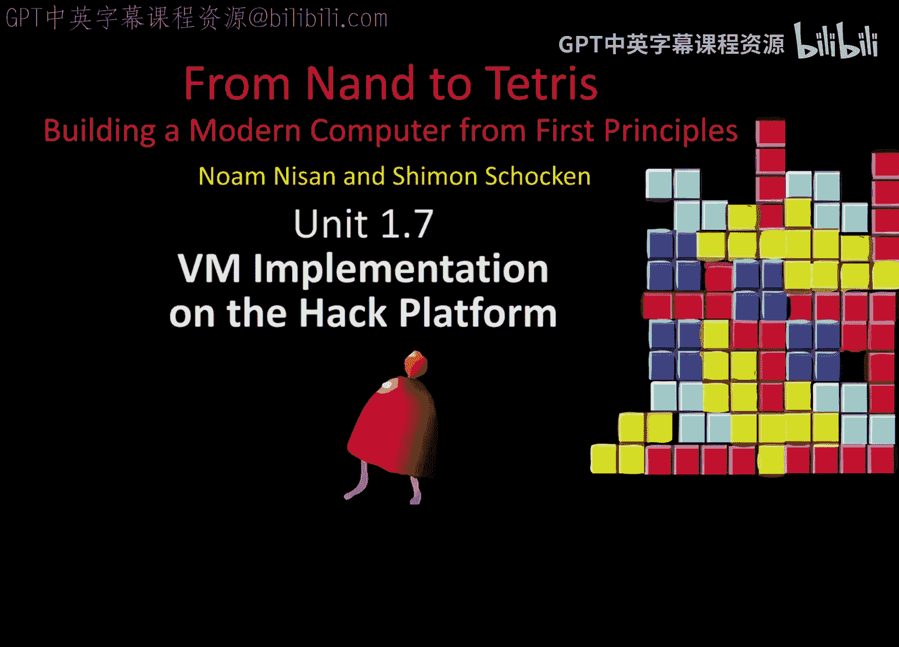

# 020：Hack平台上的虚拟机实现 💻

在本单元中，我们将讨论如何在一个特定的硬件平台——Hack计算机上，实现我们迄今为止介绍的虚拟机抽象。

## 概述

首先，我们来回顾一下什么是虚拟机翻译器。虚拟机翻译器是一个用某种高级语言（如Java或Python）编写的程序。该程序的输入是另一个用虚拟机代码（如`push`等命令）编写的程序。然后，它会解析这个文件，将每条命令分解成各种词法元素（例如`push`、`constant`和整数`2`），接着利用这些词法元素，使用目标平台（在我们的案例中是Hack）的汇编命令来重新表达这些命令。

请注意，右侧是输出文件。我建议你在开发这个翻译器时，每当翻译一条特定命令，就写一条注释来标明这条命令。这将有助于你后续调试虚拟机翻译器的输出。自然地，每条在此上下文中被视为高级语言的虚拟机命令，都将被翻译成若干条汇编命令，正如我们在之前单元讨论翻译时所看到的那样。

如果你想编写一个能将任何给定的法语文本翻译成西班牙语的通用程序，首先了解法语和西班牙语这两种语言会非常有帮助。同样地，如果你想编写虚拟机翻译器，你必须同时精通源语言和目标语言，并且还需要了解如何在宿主计算机上放置各种虚拟数据结构（如栈和段），以及如何将高级命令翻译成汇编命令。

## 源语言与目标语言

基于以上考虑，我们需要处理的源语言是虚拟机语言，它包括算术逻辑命令、内存访问命令、分支命令和函数命令。但在本课程的项目7中，我们将只关注算术逻辑和内存访问命令。在下一个项目（项目8，也是下一个模块的核心）中，我们将完成整个图景，处理分支和函数命令。

我们翻译的目标将是符号化的Hack汇编语言。我们在模块0中学习过这种语言，它主要由两种命令组成：A命令和C命令。这就是将你的虚拟机程序翻译成汇编语言所需的全部。

## 标准虚拟机映射

我们需要了解的另一个概念是目标平台上的“标准虚拟机映射”。让我先展示标准映射，然后讨论为什么我们需要它。

基本上，我们需要做两个决定：如何将虚拟机的数据结构映射到宿主计算机的RAM上，以及如何在宿主语言中表达这些命令。

标准映射为你提供了关于我们建议你如何实现这种映射的各种信息或约定。试想一下，如果我让你实现一个虚拟机翻译器，原则上你可以自由地做任何你想做的事。我可以告诉你，这是RAM，随你怎么用。然而，提出一个特定的标准映射是方便且惯常的做法，这将确保两件事：首先，如果你同意将各个段放在我们建议的RAM位置，那么你将遵循普遍接受的标准，这些标准也被运行在同一台计算机上的其他软件开发工具所接受。如果每个人都遵守相同的规则，这些程序就不会在内存中发生冲突。其次，如果你承诺在RAM上采用某种特定的映射，那么我们就可以编写各种也做出类似假设的测试程序。通过这样做，测试软件的团队可以与实际开发软件的团队分开，这通常是为了进行客观测试而推荐的。

这就是标准映射的目的。

## Hack计算机上的标准映射

以下是虚拟机在Hack计算机上的标准映射。我重复了我们在之前单元讨论过的内容，但我想把它们放在一张幻灯片上，以便你一目了然。

我们使用前5个字来存储段指针。接下来的8个字用作临时段的实现。然后我们有三个通用寄存器。接着是大约250或240个静态变量。从这之后一直到2K的所有剩余内存，将用作存放虚拟机栈的地方。

我们之前提到的所有这些段，都将按照本幻灯片中展示的逻辑映射到这片RAM上。具体细节你可以自行查看。

## 实现映射所需的符号

如果我们想实现这种映射，那么在编写虚拟机翻译器时，我们必须使用某些约定的符号来生成实现虚拟机代码的Hack汇编代码。

具体来说：
*   我们将使用`SP`作为一个特殊标签，代表栈指针。
*   我们将使用`LCL`、`ARG`、`THIS`、`THAT`作为相应内存段的段指针。
*   当我们需要使用一些通用寄存器时，我们将使用`R13`、`R14`、`R15`。
*   最后，如果你还记得，我们在之前的单元中描述了如何使用特殊生成的标签来表示静态变量。`文件名.运行索引`这种格式将代表具有相同运行索引的静态变量。

因此，你的虚拟机翻译器在生成汇编代码时，必须使用这些符号。你需要负责编写能生成这些标签的代码，并明智地使用它们，以实现我们刚刚描述的映射。

最后，我想提一下，在我们将要实现剩余虚拟机命令的项目8中，我们将对这个映射进行一些扩展，并添加一些新的约定。

## 总结

本节课中，我们一起学习了如何将虚拟机翻译器或虚拟机映射到宿主RAM和宿主计算机上。现在，我们终于可以开始讨论如何实际使用高级语言来构建这个程序了。