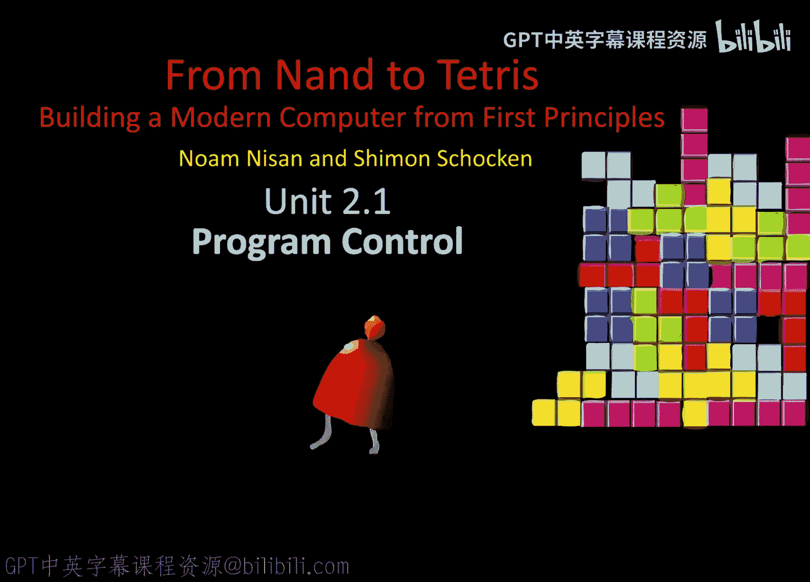
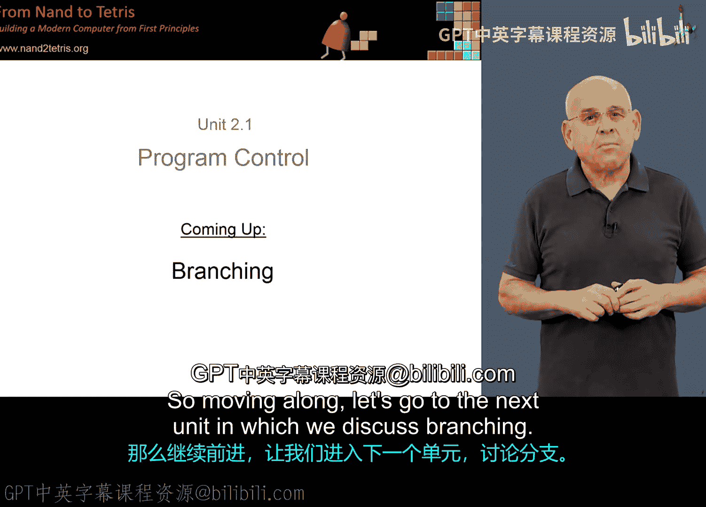

# 024：程序控制 🎮



在本节课中，我们将学习程序控制的核心概念，包括分支和函数调用。这些概念使得程序能够根据条件改变执行路径，并支持代码的模块化与重用。

上一模块我们处理了算术逻辑命令和内存段命令。这些命令提供了有限的编程视角，程序执行路径是预先确定且线性的。本节中，我们将探讨程序控制的概念，通过`if`命令、`goto`命令和函数调用命令，程序的执行流将能够根据条件进行转向。

## 从示例开始

以下是一个高中数学中常见的数学表达式：

```
B² - 4AC
```

同一个表达式可以用高级语言表示如下：

```python
B * B - 4 * A * C
```

高级语言的表达方式几乎与实际数学表达式一样直观。这正是高级语言的优势所在，它允许程序员以接近人类思维的方式编写程序。

这个表达式在数学的某些分支中应用广泛。因此，我们可以将其重构为一个函数，以便在程序中多次使用：

```python
def disc(A, B, C):
    return B * B - 4 * A * C
```

我们称这个函数为`disc`（判别式），这是该表达式在数学中的名称。

## 抽象与扩展

从编程理论的角度看，`square root`、`power`和`disc`都是抽象结构。它们并非基础语言的一部分。无论是Java还是Python，基础语言的语法和命令集都是有限的。然而，程序员可以根据需要发明新的命令，这非常强大。每当需要新功能时，就可以创建它，就像我们刚才创建`disc`函数一样。

随之而来的问题是：这些函数的实现由谁负责？这种做法的美妙之处在于，实现细节与使用细节是分离的。我可以创建新的抽象，并假设在某个时刻会有人实现它们。这个“某人”可能是我自己（在之后的时间），也可能是团队中的其他成员。关键在于，我可以在函数实现之前就开始使用它们，甚至可以假设它们会返回某个值来进行程序调试。这是一种非常优雅的实践方式。

核心观点是：**基础语言可以按需无限扩展**。基础语言本身非常有限，但通过这些扩展，语言可以变得无比复杂。赋予程序员扩展语言功能的能力，这或许是高级语言乃至整个编程领域中最伟大的思想之一。

## 程序控制的另一个方面：分支

除了函数，程序控制的另一个重要方面是分支。以计算判别式为例，出于某些数学原因，我们可能需要先检查`a`是否不等于0，然后才进行计算，否则执行其他操作。此处的逻辑本身并不重要。

如果我将这段代码交给编译器，编译器会生成类似以下的虚拟机（VM）代码：

```
if a != 0 goto COMPUTE
goto ELSE
label COMPUTE
...
label ELSE
...
```

编译器如何实现这种转换，将在第四和第五模块中详细讨论，目前无需担心。但观察生成的代码，我们会发现一系列之前未见过的命令。

这些新命令主要分为两类：
1.  **分支命令**：包括`goto`、`if-goto`和`label`。
2.  **函数命令**：包括`call`、`function`和`return`。

## 本模块的学习目标

本模块中，我们将从两个不同视角探讨这些命令：
1.  **理解抽象**：学习如何在虚拟机语言中进行分支、函数调用和返回。这对于大多数学习者可能是全新的，因为我们需要了解在虚拟机层面实现这些功能的规则。
2.  **学习实现**：学习如何实际实现这些功能，使其真正工作并产生效果。

抽象和实现是两个截然不同但又紧密相关的方面。

## 关键知识点

在学习过程中，我们将掌握一些非常重要的知识点：
*   再次深入学习分支和函数命令的抽象与实现，理解它们的工作原理。
*   我们将花大量时间剖析函数调用与返回的“舞蹈”，这是一个在幕后发生的复杂而迷人的过程。
*   在此过程中，计算机需要为参与“舞蹈”的主要角色——即相互调用和返回的函数——动态分配内存。
*   我们将继续讨论栈处理，并且会比之前更加深入。
*   我们显然还需要处理指针。
*   最后，我们将完成一个非常有趣的编程作业：完整的虚拟机实现。

总而言之，本单元结束后，你将完全理解函数如何安全地相互调用和返回，并完成一个极具收获感的编程作业。

接下来，让我们进入下一节，详细讨论分支。🚀

---



本节课中，我们一起学习了程序控制的基本概念，包括通过函数实现代码抽象与扩展，以及通过分支命令改变程序执行流。我们明确了本模块将从抽象和实现两个角度，深入学习分支与函数调用的机制，为后续构建完整的虚拟机打下基础。