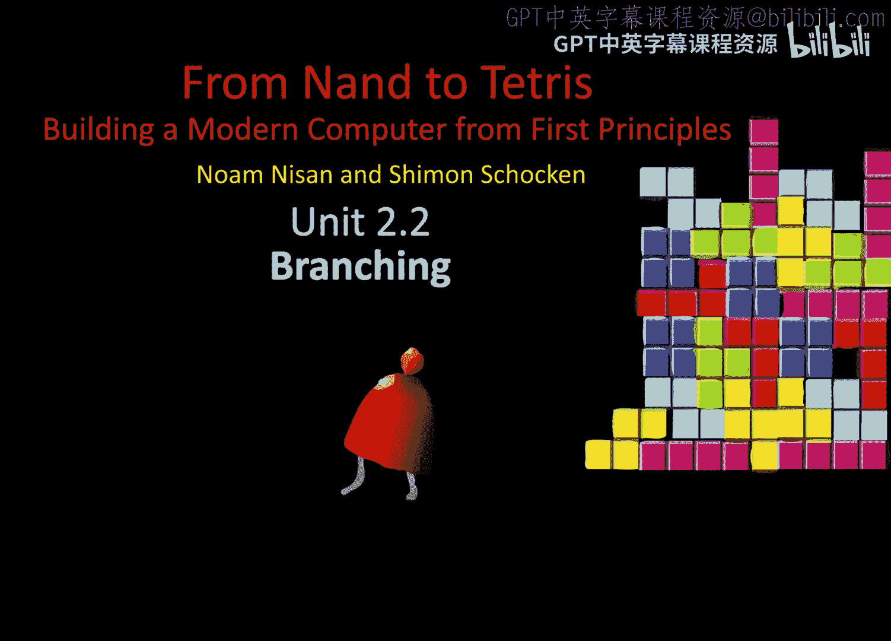

# 025：分支结构 🧭



在本节课中，我们将要学习虚拟机语言中的分支结构。分支结构允许程序改变其线性的执行流程，是实现条件判断和循环等复杂逻辑的基础。

在之前的模块中，我们处理了算术逻辑命令和内存段命令。现在，我们开始处理分支命令。

## 分支结构概述 🔄

分支是一个相对容易理解的概念。在没有分支的情况下，我们的程序是完全线性的，每个命令都在前一个命令之后顺序执行。而有了分支，我们可以在程序的控制流中引入各种非线性路径。程序可以线性执行，然后突然遇到一个 `goto` 指令，跳转到其他指令继续执行。`goto` 指令可以向前跳转，也可以向后跳转。通过向前和向后的跳转，我们就能实现循环。因此，分支结构为我们提供了极大的灵活性。

任何使用过 `if` 语句或 `while` 语句的人，都体验过分支的概念，只是可能没有直接称之为“分支”。

在底层，我们有两种类型的分支：**无条件分支**和**条件分支**。接下来，我们将花几分钟时间讨论这两种分支，并从示例开始。

## 一个高级语言示例 📝

以下是一个高级语言函数的示例，它通过重复加法来计算两个给定值 `X` 和 `Y` 的乘积。

```pseudocode
function multiply(x, y) {
    sum = x
    n = 1
    while (n <= y) {
        sum = sum + x
        n = n + 1
    }
    return sum
}
```

我们将 `X` 放入一个名为 `sum` 的容器中，然后将 `sum` 累加 `X` 共 `Y` 次。为了计数 `Y` 次，我们使用另一个名为 `n` 的变量，它从1开始。这段代码非常直观。

需要指出的是，这种乘法实现方式非常朴素且低效。在后续课程中，我们将展示效率高得多的乘法实现。

## 编译为虚拟机代码 ⚙️

当我们把这个高级代码编译成虚拟机代码时，编译器会生成你在右侧看到的代码。编译器所做的是将这个 `while` 循环用 `goto` 命令重写。为了实现这种重写，编译器还必须创建并生成一些标签，并将它们插入到正确的位置。一个标签放在 `while` 循环开始的地方，另一个标签放在 `while` 循环结束的地方。编译器知道如何完成这一切。

正如在前一单元所说，目前你无需担心编译器如何实现这种“魔法”，因为我们将在课程后期深入探讨。现在，我们只需关注虚拟机代码，看看这些 `goto` 命令是如何被使用的。

## 无条件分支命令：`goto` 🚀

让我们聚焦于 `goto` 命令。在上面的代码中，我们看到了几个 `goto` 的例子。其语法非常简单：

```
goto LABEL
```

你期望计算机跳转去执行紧跟在 `LABEL` 标签后的那条指令。例如，如果你说 `goto LOOP`，那么下一条将被执行的命令就是 `push n`，因为那是紧跟在标签 `LOOP` 之后的命令。

## 条件分支命令：`if-goto` ⚖️

条件分支更有趣，因为它依赖于对某个条件真值的评估。回到高级代码，我们看到那里有一个条件：`while (n <= y)`。在生成的虚拟机代码中，我们看到了命令 `if-goto END_LOOP`。

需要注意的是，每当我们要使用条件 `goto` 命令时，我们必须首先将一个描述该条件的表达式压入堆栈。这个表达式必须在执行 `if-goto` 之前被求值，否则我们将无法知道条件是否满足。

规则是：先压入表达式，当程序运行时，该表达式将被求值，一个特定的真值将保留在堆栈顶部。然后，基于这个真值，`if-goto` 命令将知道跳转是否应该实际发生。

在这个具体例子中，高级代码的条件是 `n <= y`。在生成的代码中，我们看到在 `if-goto` 命令之前有 `push n`、`push y` 和 `gt` 命令。这三个虚拟机命令组合在一起，在虚拟机语言中实现了与 `n <= y` 相同的逻辑。一旦计算机求值了 `push n`、`push y` 和 `gt`，就会得到一个真值，该值将决定条件跳转是否应该发生。

## 标签命令：`label` 🏷️

除了 `goto` 和 `if-goto`，我们还有 `label` 命令。没有它，我们就无法生成所有这些标签。`label` 命令的语法同样简单：

```
label LABEL_NAME
```

它只是标记了代码中的一个位置，供分支命令跳转使用。

## 实现与翻译 🛠️

这三个分支命令（`goto`、`if-goto`、`label`）的实现方式是：当虚拟机翻译器被要求实现或“实现”这些命令时，它必须生成能在汇编语言中产生相同跳转操作的汇编代码。

如果你按照课程模块0的要求复习了汇编语言，你应该知道这个实现应该极其简单。因为汇编语言也有 `goto` 命令，其执行风格和方式与虚拟机语言的 `goto` 命令几乎相同。因此，在这种情况下，将虚拟机分支命令翻译成汇编分支命令是一个相当简单的练习，我们期望你能独立完成。

## 总结 📚

本节课中，我们一起学习了虚拟机语言中的分支结构。

*   我们首先了解了分支的概念，它使程序能够非线性执行。
*   我们通过一个乘法函数的例子，看到了高级循环结构如何被编译成基于 `goto` 的虚拟机代码。
*   我们详细介绍了三种分支命令：
    *   **`goto LABEL`**：实现无条件跳转。
    *   **`if-goto LABEL`**：根据栈顶的真值（非零为真）决定是否跳转，使用前需将条件表达式的结果压栈。
    *   **`label LABEL_NAME`**：在代码中定义一个标签，作为跳转的目标。
*   最后，我们了解到将这些虚拟机分支命令翻译成汇编语言是直接且简单的，因为汇编层面存在类似的分支指令。


在之前的模块中，我们处理了算术和内存访问命令。在当前单元，我们处理了这些分支命令。现在，我们已经准备好开始学习本模块的真正核心：**函数命令**。这将是我们下一单元的内容。