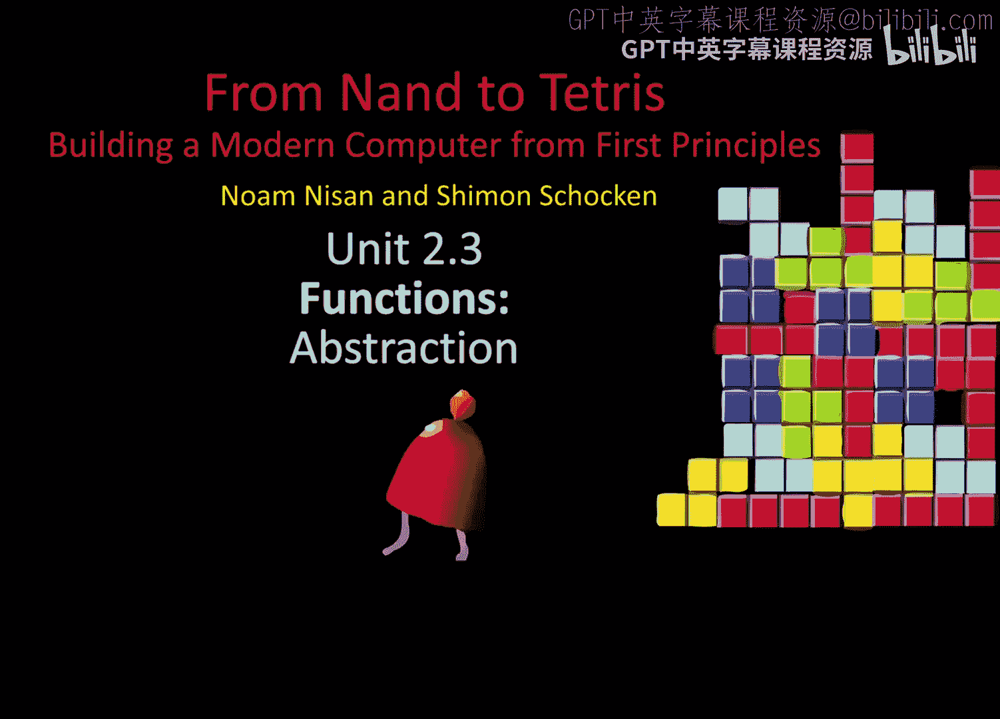

# 026：函数抽象 🧩

在本单元中，我们将开始讨论函数，并从函数的抽象视角入手。这意味着，如果你是一名虚拟机程序员，你将如何在代码中使用函数。

## 概述

众所周知，高级语言可以通过子程序、函数、过程、方法等来扩展功能。你可能好奇这些名称的来源。实际上，不同的编程语言使用不同的术语来描述我们将要讨论的“函数”。我们无需深究这一点，因为每个人都理解函数是什么：它就像一个黑盒，你给它一些参数，按下按钮，函数执行某些操作并返回一个值。这就是函数。同样，由于历史原因，不同语言用不同的名称来称呼这些函数。

现在，转到我们的虚拟机语言。我们已经处理了之前看到的所有命令，现在终于要开始讨论如何使用以及如何实现函数的概念了。

## 函数的作用示例

高级代码可能会包含类似 `sqrt(x - 17 + x * 5)` 的表达式。当编译器翻译这段代码时，会产生以下伪虚拟机代码。

首先，我们必须计算括号内的表达式。具体做法是：`push x`，`push 17`，`subtract`。这将得到 `x - 17` 的结果。接着，`push x`，`push 5`，然后执行一个你尚未见过的操作：`call Math.multiply`。

`Math.multiply` 是一个函数，它位于名为 `Math` 的类中，该类是我们虚拟机所依托的操作系统的一部分。因此，我们的虚拟机被允许与这个操作系统交互。由于乘法不是虚拟机语言的内置操作，我们很幸运地拥有一个知道如何计算两个数字乘积的 `multiply` 方法。我们利用了这个函数的服务。

`multiply` 将对 `x` 和 `5` 进行操作。根据规则，它将用 `x * 5` 的结果替换栈上的 `x` 和 `5`。然后，我可以将乘法的结果与 `x` 的值相加。接着，我可以调用 `square root` 函数，它同样是宿主操作系统 `Math` 库的一部分，依此类推。

## 虚拟机语言的操作类型

我们可以看到，虚拟机语言具有两种类型的操作符。首先是语言内置的固定操作，如 `add`、`subtract` 等，但这类操作的数量有限。如果你想使用其他操作，要么使用别人已经写好的函数（如 `Math.multiply` 和 `Math.sqrt`），要么可以编写自己的函数。

在这方面，你拥有极大的自由，可以随心所欲地创建和使用任意数量的函数。从这个意义上说，虚拟机语言是无限的，你可以随意扩展它，这非常了不起。

## 一个重要观察

应用像 `subtract` 这样的原始操作符，与应用像 `Math.multiply` 或 `Math.sqrt` 这样的抽象函数，具有完全相同的外观和感觉。

在这两种情况下，游戏规则如下，理解这一点非常重要：

如果你想调用一个期望接收三个参数的函数，那么你需要这样做：
1.  将这三个参数压入栈。
2.  调用该函数。
3.  然后，一些“魔法”会发生。
4.  函数的结果将替换你之前压入栈的这三个值。你压入的参数值会消失，取而代之的是该函数的返回值。

如果你按照这个逻辑分析之前的例子，会发现它完全合理。我建议你现在暂停视频，拿出一张白纸，画一个空栈，然后逐步执行每条命令，观察栈如何增长和收缩，直到最终得到正确的计算结果。你可以假设 `x` 的值以使过程更简单，但这并不重要。重要的是理解：调用函数和调用内置命令具有完全相同的外观和感觉。这是语言中一个非常优雅的特性。

## 如何在虚拟机语言中定义函数？

以下是一个高级程序中的函数源代码视图。我们选择重新审视之前模块中使用的乘法函数，这是我们自己的乘法实现。我们将绕过操作系统的 `Math.multiply` 方法，转而使用这个，因为我想让你看到代码。重申一个与当前讨论完全无关的评论：这个 `multiply` 实现非常朴素且低效，而 `Math.multiply` 是一个非常复杂且高效的操作，我们将在本课程最后一个模块开发操作系统时讨论它。

编译器开始工作，将这个高级代码翻译成伪虚拟机代码。你在右侧看到的是最终将实际生成的伪虚拟机代码。我展示它只是为了方便讨论示例，但如你所知，虚拟机程序中没有符号变量，所以真实情况显示在右侧。

这里有一个技术性的观察：函数定义语法以关键字 `function` 开始，然后是函数名 `mult`，接着是一个整数（0、1、2 或其他非负整数）。这个整数告知实现，该函数将使用多少个局部变量。因此，`function mult 2` 意味着这里开始一个名为 `mult` 的函数，它将使用两个局部变量。为什么需要提及局部变量的数量，我们将在下一个单元（而非本单元）理解。

## 代码示例与运行时模拟

我在这里重复了之前看到的 `mult` 函数的虚拟机版本，并添加了行号以便参考。我还想引入一些展示如何使用这个 `mult` 函数的代码。

以下是一个名为 `main` 的函数，它在某个时刻包含了命令 `call mult 2`。注意语法 `call mult 2`。这个语法意味着：我将调用一个函数，我想调用的函数名是 `mult`，随后的数字告知在发起此调用之前有多少个参数被压入了栈。

注意虚拟机程序员在这里做了什么：程序员压入了常数 `8`，然后压入了常数 `5`，接着调用了 `mult`。因此，虚拟机实现知道，我们不仅需要调用 `mult` 函数，还必须将参数 `8` 和 `5` 传递给它，因为我们被告知程序员压入了两个参数到栈上。

在函数调用术语中，调用函数有时被称为“调用者”，被调用函数有时被称为“被调用者”。我将在后续示例中交替使用这些术语。

接下来，我想通过一个运行时模拟来具体说明这段代码是如何实际执行的。

让我们从 `main` 函数的视角开始。我将在几个关键点暂停这个想象的模拟。

执行完第 3 行后会发生什么？让我们看看第 1、2、3 行的代码：我压入了 `3`、`8` 和 `5`。因此，栈将包含 `3`、`8` 和 `5`。然后我们开始执行命令 `call mult 2`。

这是一个相当戏剧性的转折，因为 `main` 函数说我现在必须调用另一个函数。因此，我们必须将 `main` 函数挂起，转去执行这个名为 `mult` 的其他函数。

以下是 `mult` 函数的视图。让我们看看执行完第 0 行后会发生什么。首先，我得到一个空栈（这里的“我”指代当前的 `mult` 函数）。其次，我得到一个参数段，注意这个参数段包含了调用者压入的那两个确切值。我不仅能看见这些值，还知道如何称呼它们：在我的世界里，它们被称为 `argument 0` 和 `argument 1`。第三，我得到两个初始化为 `0` 的局部变量。为什么是两个？因为看函数声明命令：`function mult 2`，所以虚拟机实现为我准备了一个名为 `local` 的段，其中有两个初始化为 `0` 的局部变量。

继续，执行完第 7 行后会发生什么？让我们逐步执行从 0 到 7 的所有命令。我们执行 `push constant 0`，将 `0` 压栈，然后 `pop local 0`。这不太有趣，因为 `local 0` 之前就是 `0`，所以它保持为 `0`。接着，我们将 `1` 压栈并弹出到 `local 1`，所以局部变量段将变成 `0` 和 `1`。然后有一个标签 `loop`。接着，将 `local 1` 压栈（实际上在此之前，参数段保持不变，因为我们没有动它）。现在回到第 6 条命令，我们将 `local 1` 压栈，然后将 `argument 1` 压栈。我们将得到数字 `1` 和 `5`。

然后我们进入整个循环，计算两个给定数字（即参数 `8` 和 `5`）的乘积，得到 `40`（相信我，我检查过这段代码）。根据上一张幻灯片所示的代码，乘积被累加到 `local 0` 中。

那么执行完第 20 行后会发生什么？现在我们已经在这个计算的末尾。`local 0` 包含乘积 `40`。`local 1` 包含我们在高级代码中称为 `n` 的值（你需要回到上一张幻灯片查看）。当 `n` 超过第二个参数（即 `5`）时我们停止。所以 `local 1` 将是 `6`，这就是我们知道停止代码的方式。现在栈包含 `40`，因为我们在第 20 条指令执行了 `push local 0`，这条指令获取 `local 0` 的值并将其放入栈中。

我们这样做是因为我们想将这个值返回给调用者。确实，下一条命令是 `return`。虚拟机实现知道如何处理 `return`。具体来说，当我们说 `return` 时，虚拟机实现会获取被调用者栈顶的值，并执行以下技巧：它取出这个值，并将其放入调用者的栈上，替换之前压入的参数。

现在我们回到 `main` 函数，`mult` 函数已经消失，其所有内存资源都已被回收（这个过程我们尚未看到）。回到 `main` 的视图，我得到了这个结果：我压入了 `8` 和 `5`，调用了 `mult`，得到了 `40`，这正是我期望得到的。然后在 `main` 的第 5 行，我将这两个数字相加，得到 `43`。确实非常棒。

注意 `main` 的抽象视图与实际发生的情况之间的区别：`main` 压入两个参数，说“相乘”，然后得到了结果，接着继续计算，仿佛什么都没发生。但实际上，幕后发生了很多事情。

## 实现视角：如何让抽象指令实际工作？

我们在这里看到的代码与之前完全相同。现在我想从实现的视角来看：为了让这个“魔法”生效，我们必须做些什么？让我们从 `call` 开始，故事就从这里开始。

调用函数是我们正在处理的一个重大事件。在运行时，实现必须为每个函数调用执行以下操作：

以下是实现必须为每次函数调用执行的操作：
1.  **传递参数**：必须以某种方式将参数（也称为实参）从调用者传递给被调用者。我们必须完成这个“握手”。
2.  **确定返回地址**：因为想想看，我们现在要开始一段新的冒险。当这段冒险完成时，我们必须准确地返回到调用者代码中的下一条指令。所以我们必须以某种方式记住这个地址，即记住返回的位置。
3.  **保存返回地址**：当我们说“记住”时，它没有实际意义，我们必须将其保存在内存中的某个地方。
4.  **保存调用者的状态**：状态包括调用者的工作栈、内存段等所有内容。必须保存这一切，以便当我们返回到调用者代码时，能够重新创建 `main` 的私有世界，并像什么都没发生一样继续执行。
5.  **跳转执行被调用函数**：只有在保存了调用者状态（包括返回地址）之后，我们才能允许自己跳转去执行被调用函数。

所有这一切都必须发生，才能实现和服务一个 `call` 命令。

那么 `return` 呢？`return` 也相当复杂。因为作为实现，每当需要执行 `return` 命令时，我必须做以下事情：

以下是实现必须为每次 `return` 执行的操作：
1.  **返回计算值**：必须将被调用函数计算出的值返回给调用者。这里有一个隐含的假设，我现在将其明确：要求被调用函数在返回前总是压入一个值。这是我们游戏规则的一部分：在 `return` 之前，必须将一个值压入栈，这就是返回值。因此实现知道栈顶的值必须是返回值，它知道必须以某种方式将这个值传回给调用者。
2.  **处理返回值与参数**：实际上，实现需要做的是：取出这个返回值，并将其压入调用者的栈顶。但在压入之前，它必须移除参数，正如我之前解释的那样。这甚至比听起来更复杂。
3.  **回收内存资源**：在完成返回值处理后，因为实现是一个“好公民”，它必须回收被调用函数使用的内存段、内存资源、栈等所有“东西”，因为被调用函数现在已经无关紧要了。
4.  **恢复调用者世界**：然后，我们必须恢复或重新创建调用者的世界，包括其保存的工作栈和内存段。
5.  **跳转返回地址**：只有完成这些之后，我们才能跳转到调用者代码中的返回地址，并像什么都没发生一样继续执行。

这就是实现的视角。在接下来的三个单元中，我们将真正让这个实现工作起来。

## 总结

在本节课中，我们一起学习了函数的抽象概念及其在虚拟机语言中的应用。我们探讨了函数如何作为黑盒操作，接收参数并返回结果。通过具体示例，我们观察了函数调用在虚拟机代码中的表现，包括参数传递、局部变量初始化以及返回值处理。我们还从实现者的角度，剖析了支持函数调用和返回所需的关键步骤，如保存状态、确定返回地址和回收资源。理解这些抽象概念是后续实际实现虚拟机函数处理机制的基础。