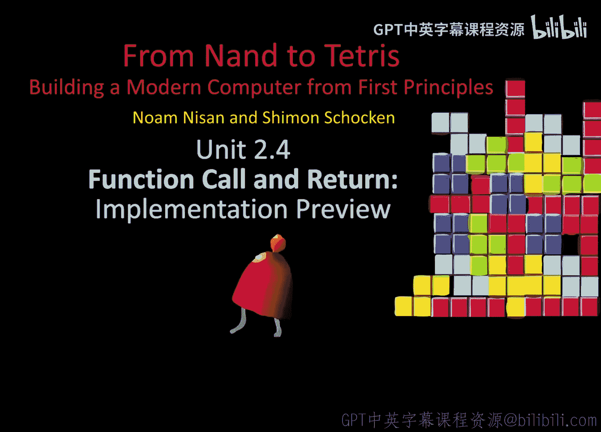
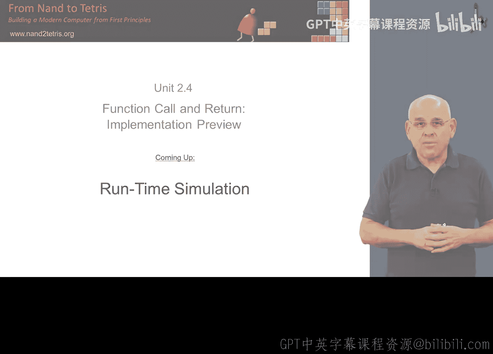

# 027：函数调用与返回实现预览 🧠



在本节课中，我们将要学习函数调用与返回协议是如何在虚拟机层面实现的。这是一个复杂但非常精妙的过程，我们将通过预览、模拟和具体实现三个步骤来深入理解。本节作为预览，将介绍核心概念和整体框架。

## 函数执行与调用链

上一节我们介绍了虚拟机的基本操作，本节中我们来看看如何管理多个函数的执行。一个计算机程序通常由多个函数（或方法）组成。在程序运行的任何时刻，只有一小部分函数处于活动状态。例如，函数 `P` 调用 `bar`，`bar` 调用 `sqrt`，`sqrt` 又可能调用其他函数。我们将这一系列正在执行的函数称为 **调用链**。

从实现的角度看，链上的每个函数都有自己的 **状态**。这个状态包括函数的 **工作栈** 和 **内存段**（如局部变量段、参数段等）。当函数开始执行时，我们需要为其创建这个状态。当函数调用另一个函数时，必须保存当前函数的状态，以便被调用函数返回后能恢复执行。当函数返回时，其状态可以被回收，以释放内存。

## 状态管理与栈数据结构

那么，我们如何保存调用链上所有函数的状态呢？关键在于观察到一个模式：函数调用遵循 **后进先出** 的原则。只有当前正在执行的函数（调用链末端的函数）可以返回。其他函数都在等待它返回。调用链会像这样增长和缩短：

```
P 调用 bar -> bar 调用 sqrt -> sqrt 返回 -> bar 返回 -> P 继续...
```

这种模式是否让你想起了什么？没错，这正是 **栈** 的行为！因此，我们可以利用栈数据结构来保存和恢复所有函数的状态。接下来，我们将说明如何巧妙地使用栈来实现这一点。

## 函数调用过程详解

让我们通过一个具体例子来理解：计算 `17` 和 `212` 的乘积。

从调用者的抽象视角看，过程很简单：
1.  将参数 `17` 和 `212` 压入栈。
2.  执行 `call Mult2 2`（`2` 表示参数数量）。
3.  栈顶的结果就是乘积。

然而，虚拟机实现需要处理大量幕后工作。以下是详细步骤：

### 1. 处理 `call` 命令

当虚拟机遇到 `call functionName nArgs` 命令时，它知道已有 `nArgs` 个参数被压入栈。此时，虚拟机需要：
*   **设置参数指针**：将 `ARG` 段指针指向栈中参数区的基地址。
*   **保存调用者状态（帧）**：调用者的状态，即其 **帧**，包括：
    *   返回地址（调用结束后应返回的代码位置）。
    *   关键内存段的基地址：`LCL`、`ARG`、`THIS`、`THAT`。
    *   （注意：`CONSTANT`、`TEMP`、`POINTER`、`STATIC` 段无需保存，它们不属于单个函数的私有世界）。
*   将这些帧信息（返回地址和段指针）压入栈。
*   **跳转执行**：最后，跳转到被调用函数 `functionName` 的代码开始执行。

### 2. 被调用函数初始化

被调用函数代码的第一条命令通常是 `function functionName nVars`，声明其需要的局部变量数量 `nVars`。虚拟机需要：
*   **初始化局部变量段**：在栈上分配 `nVars` 个位置，并将其初始化为 `0`。
*   **设置局部变量指针**：将 `LCL` 段指针指向这个新区块的基地址。
*   此后，函数可以开始执行，使用自己的局部变量段并操作自己的工作栈。

### 3. 处理 `return` 命令

当被调用函数准备返回时：
1.  它将返回值压入栈顶。
2.  执行 `return` 命令。

虚拟机处理 `return` 命令的步骤是：
*   **传递返回值**：将栈顶的返回值复制到调用者栈帧中 `ARG[0]` 的位置。这样，返回值就替换了原来的第一个参数，符合“用函数返回值替换其参数”的抽象效果。
*   **恢复调用者状态**：
    *   从栈中弹出并恢复调用者保存的 `THAT`、`THIS`、`ARG`、`LCL` 段指针。
    *   将栈指针 `SP` 设置到返回值之后的位置（即 `ARG[0]` 之后），这实际上是调用者工作栈的顶部。
*   **清除被调用者栈帧**：被调用函数的局部变量和工作栈区域现在已不再需要。
*   **跳转返回**：最后，跳转回之前保存的返回地址，调用者从其暂停处继续执行。

## 全局栈与函数块

通过上述机制，整个程序运行时的所有信息都保存在一个 **全局栈** 中。这个栈不仅包含当前函数的数据，还包含整个调用链上所有函数的“世界”。

我们可以将全局栈划分为多个 **块**，每个块代表一个函数的活动记录（激活记录）。对于当前正在运行的函数，其块包含：
*   参数段（由调用者设置）。
*   被保存的调用者帧信息（对当前函数透明）。
*   局部变量段。
*   自己的工作栈。

全局栈则按顺序包含了调用链上所有函数的块。这种设计非常精妙：**同一个栈数据结构，既用于执行程序的所有运算和逻辑操作，也用于支撑整个程序运行所需的幕后管理机制**。

## 总结与展望

本节课中我们一起学习了函数调用与返回协议的实现预览。

*   **抽象视角**：调用函数非常简单：推送参数，执行 `call`，获取结果。
*   **实现视角**：幕后需要大量复杂工作来管理状态、保存帧、初始化内存、传递返回值并恢复现场。这就像魔法背后的大量工程。

正如亚瑟·C·克拉克所说：“任何足够先进的技术都与魔法无异。” 从抽象层面看，函数调用就像魔法；而从实现层面看，则是大量精巧工作的结果。



在接下来的两个单元中，我们将继续深入探讨这些幕后工作，具体模拟这一过程并完成函数调用与返回协议的具体实现。