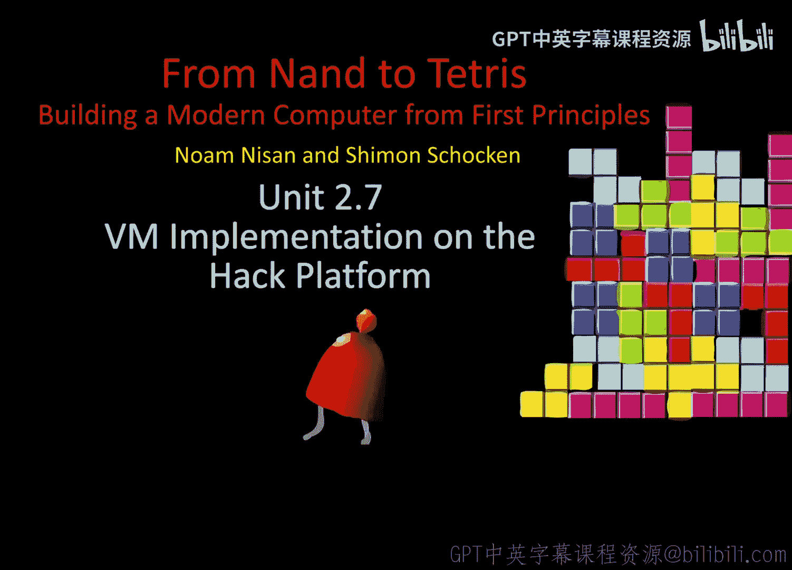
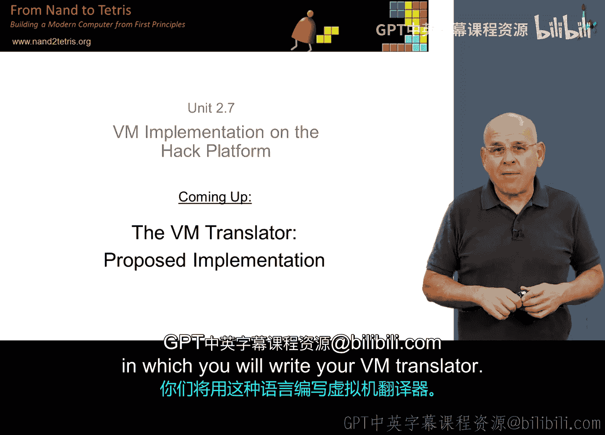

# 030：Hack平台上的虚拟机实现 🖥️



在本单元中，我们将讨论如何在Hack计算机平台上实现虚拟机翻译器。这是本模块的一个转折点，因为在此之前，我们并未限定具体的硬件平台，而是以通用术语描述了如何在任何给定平台上实现虚拟机。现在，我们将具体针对Hack计算机平台进行实现。

## 概述

首先，我们需要了解从高级语言到机器代码的完整翻译流程。这有助于我们理解虚拟机翻译器在整个软件栈中的位置和作用。

## 整体流程

上一节我们介绍了本单元的目标，本节中我们来看看从Jack程序到Hack汇编代码的完整翻译流程。

我们从一个Jack程序开始。该程序存储在一个或多个`.jack`文件中，这些文件位于一个特定的目录（或文件夹）中，我们称此目录为`MyProgram`。接着，我们将Jack编译器应用于整个目录。Jack编译器将生成两个新的`.vm`文件（例如`Foo.vm`和`Bar.vm`）。源程序中的每个方法、构造函数和函数都将被翻译成目标VM代码中的一个VM函数。

这个过程目前无需我们担心，它将在后续构建编译器时详细讨论。但从现在起，VM代码的进一步翻译就是我们的任务了，这正是虚拟机翻译器的职责所在。

虚拟机翻译器将执行一个关键步骤：它将把所有独立的VM函数整合并转换成一个单一的汇编文件。请注意，在从Jack翻译到VM时，我们丢失了构造函数、方法和函数的概念，因为一切都变成了函数。在从VM翻译到汇编时，我们又丢失了函数的概念，现在只剩下一个长长的汇编指令流。我们必须使用汇编语言来捕获源VM代码的语义。

这个虚拟机翻译器正是我们在当前及前一个项目中正在开发的程序。

## 平台约定与启动

既然我们决定在Hack平台上实现，就必须遵守一些特定的约定。第一个约定是关于系统启动的，即计算机如何知道并执行我们的程序。

以下是需要遵循的假设和约定：

首先，必须有一个VM编程约定：在任何VM程序中，必须有一个文件名为`Main.vm`，并且该文件中必须有一个名为`main`的VM函数。Jack编译器会自动处理这一点，因为在Jack语言层面也有类似要求（需要一个名为`Main`的类，其中包含一个名为`main`的函数）。

其次，在虚拟机翻译器的实现中，当虚拟机实现开始运行或被重置时，它必须开始执行一个无参数的操作系统函数`Sys.init`。

因此，VM实现必须从以下代码开始：
```
call Sys.init
```
`Sys.init`函数已在底层实现好，它会去调用`Main.main`，然后进入一个无限循环。这样，程序员编写的程序就能开始运行。

最后，我们需要遵循硬件平台约定，即所谓的“引导代码”。我们必须确保以下代码被存储在目标计算机指令内存的地址0处。

因为Hack计算机（以及世界上大多数计算机）被设计为从指令内存地址0开始执行程序。计算机启动后做的第一件事就是将`SP`设置为256，从而确定堆栈的起始地址，然后调用`Sys.init`。这两件事必须用机器语言（汇编）完成。

此后，虚拟机翻译器将知道如何处理每一条VM命令，一切将顺利运行。

## 内存映射标准

为了生成符合上述所有解释的代码，我们需要在Hack平台上提出一个标准的内存映射方案。我们在上一个模块中解释了为什么需要标准映射，以下是迄今为止我们所做工作的总结。

我们使用Hack的RAM，并按照以下方案存储所有指针（如`SP`、`LCL`、`ARG`、`THIS`、`THAT`）：
*   `SP` -> RAM[0]
*   `LCL` -> RAM[1]
*   `ARG` -> RAM[2]
*   `THIS` -> RAM[3]
*   `THAT` -> RAM[4]

现在，让我们在Hack计算机整个RAM的背景下看待这个映射。Hack的RAM总共包含约32,768个字。我们一直讨论的顶部2K字（地址0-2047）是上图中左侧蓝色的部分，用于堆栈、静态变量等。

RAM中还有其他区域，如堆（Heap）、内存映射I/O和一些未使用空间。就虚拟机实现而言，我们只关心RAM顶部的这2K空间，其他区域将用于虚拟机实现管辖范围之外的其他目的。

## 特殊符号约定

最后，我们需要记录下虚拟机翻译器应使用的所有特殊符号。

首先，在上一个模块中，我们决定使用以下特殊符号来代表指针：
*   `SP`, `LCL`, `ARG`, `THIS`, `THAT`

为了实现在本模块中描述的所有功能，我们还需要使用以下几类特殊符号来生成标签（例如，用于实现函数调用、返回和流程控制）。以下是课程配套书籍中的截图，详细列出了这些约定：

（此处应插入关于`$ReturnAddress`、`$FunctionName`等标签生成约定的描述，但根据原文，这部分非常技术性且不展开讲解，因此教程中仅提示读者可自行查阅相关资料。）

现在，任务就是编写虚拟机翻译器，生成实现VM语言所需的所有代码。在下一个单元，我们将描述如何使用如Java或Python这样的实现语言来实际编写这个翻译器。

## 总结



本节课中，我们一起学习了在Hack平台上实现虚拟机翻译器的关键知识。我们了解了从Jack程序到最终汇编代码的完整翻译流程，掌握了系统启动所必须遵循的硬件与软件约定（如`Main.vm`、`main`函数、`Sys.init`调用和引导代码）。我们还回顾了Hack平台的标准内存映射，明确了虚拟机实现所关心的内存区域。最后，我们知道了实现过程中需要遵循的特殊符号命名约定。这些内容为接下来动手实现虚拟机翻译器奠定了坚实的基础。