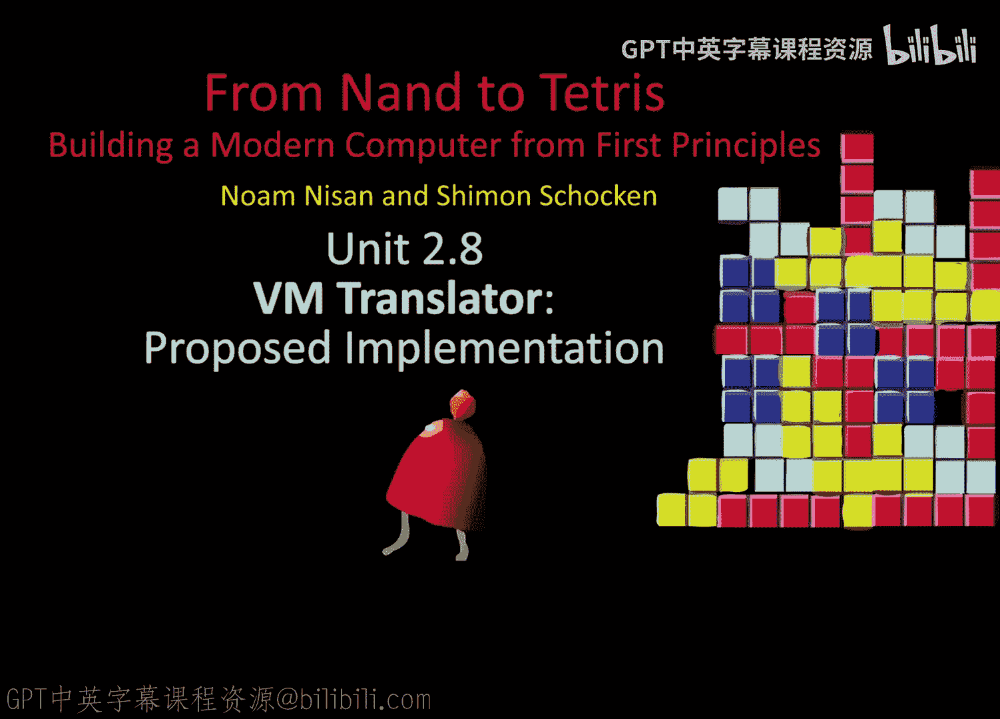
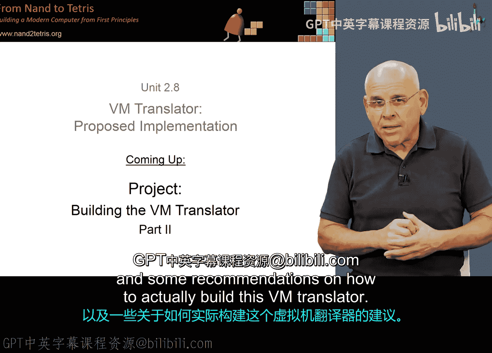

# 031：虚拟机翻译器建议实现方案 🖥️➡️💻

在本节课中，我们将学习如何实现一个完整的虚拟机翻译器。这个翻译器的任务是将虚拟机代码转换为目标平台的汇编代码。我们将基于之前项目中的基础翻译器进行扩展，使其能够处理更复杂的命令和多个源文件。

上一节我们介绍了虚拟机翻译器的基本概念和架构，本节中我们来看看具体的实现方案。

## 概述

虚拟机翻译器是一个程序，它接收虚拟机代码作为输入，并将其翻译成等价的汇编代码。翻译过程是逐行进行的：它读取第一条命令（例如 `push constant 17`），生成实现相同语义的汇编代码，然后继续处理下一条命令（如 `goto loop`），依此类推，直到处理完输入源文件中的所有命令。

我们之前已经编写了一个基础的虚拟机翻译器。在本项目中，我们将扩展这个基础翻译器，使其成为最终的、功能完整的虚拟机翻译器。本质上，我们需要在之前项目编写的程序上增加更多功能。

需要记住的是，我们的**源语言**是虚拟机语言，而生成的**目标代码**是 Hack 汇编代码。在整个过程中，我们必须遵守上一单元中描述的那些特殊符号的使用规范。

## 翻译器架构与流程

以下是描述虚拟机翻译器工作流程的示意图：

在之前的项目中，你编写的翻译器只能处理单个虚拟机文件。而在本项目的一个主要扩展目标，就是让翻译器能够处理**多个**虚拟机文件。因此，你编写的虚拟机翻译器应该能够处理一个包含一个或多个虚拟机文件的目录（如上图所示）。无论如何，它最终都会生成一个单独的汇编文件，其中包含所有被翻译函数的代码序列。

我在这里概述的建议实现方案，包含的模块与上一个项目完全相同：**主模块**、**代码写入器**和**解析器**。让我们依次描述每一个模块。

## 模块详解

### 主模块

主模块接收一个字符串作为输入，这个字符串可以代表一个**单独的文件**，也可以代表一个**目录**（或称文件夹）的名称，该目录中可能包含一个或多个虚拟机文件。输入是这两种情况之一。如果你使用 Java 或 Python 这类语言，它们本身具备判断一个给定字符串是文件还是目录的能力。

程序的输出应该是一个文件名以 `.asm` 结尾的文件，其中包含我们将要生成的汇编代码。

主程序将执行以下过程：
1.  首先，它将构造一个代码写入器对象，用于处理输出文件（此时输出文件还是空的）。
2.  然后，它会判断输入是文件还是目录。
    *   如果输入代表单个文件，它将构造一个解析器来处理这个输入文件。
    *   如果输入是一个目录，它将对该目录中的**每一个**虚拟机文件执行上述操作。
3.  接着，它将进入一个循环，遍历输入文件中的每一条命令，对其进行解析，并将词法元素交给代码写入器以生成汇编代码。

如你所见，这并非对上一个项目所做的复杂扩展。

### 解析器

解析器像往常一样，负责处理或解析单个虚拟机文件。它读取虚拟机命令，将其分解为词法元素，并在此过程中移除所有的空白和注释。这个解析器与我们在上一个项目中开发的解析器**完全相同**，我们不需要修改它。

然而，我们需要确保解析器也能处理本模块引入的新命令，即分支命令和函数命令。如果你遵循了上一个项目的要求，你的解析器应该已经能够处理这些命令。但如果出于某种原因你还没有实现，现在是时候将它们包含进来了。

### 代码写入器

代码写入器是需要进行扩展的主要部分。我们在上一个项目中开发的基础代码写入器的 API 如下图所示：

我们需要向这个 API 添加一些额外的功能。以下是需要添加的方法：

1.  **`setFileName(String fileName)`**：此方法用于通知代码写入器，一个新的虚拟机文件处理即将开始。我们将把该文件的名称作为参数传入。
2.  **`writeInit()`**：此方法负责写入**引导代码**，这些代码将使虚拟机能够按照虚拟机在 Hack 平台上的标准映射开始工作。
3.  **`writeLabel(String label)`**, **`writeGoto(String label)`**, **`writeIf(String label)`**：这三个方法生成汇编代码，分别负责处理虚拟机命令 `label`、`goto` 和 `if-goto`。
4.  **`writeFunction(String functionName, int numLocals)`**, **`writeCall(String functionName, int numArgs)`**, **`writeReturn()`**：这三个方法生成汇编代码，分别知道如何处理相应的虚拟机命令 `function`、`call` 和 `return`。

一旦你完成了这些，你将拥有一个功能完整的虚拟机翻译器，并且实现了一个虚拟机。

## 实现挑战

编写这个虚拟机翻译器最具挑战性的部分，就是编写上述最后六个方法（特别是与函数调用相关的三个）。`writeLabel`、`writeGoto` 和 `writeIf` 这三个方法相对简单，因为生成实现 `if` 和 `goto` 的汇编代码并不复杂。

然而，我们必须为 `function`、`call` 和 `return` 生成汇编代码。在实现这部分时，你必须遵循我们在前几个单元中解释的所有逻辑，以构建那个令人惊叹的“堆栈大教堂”。这个堆栈需要上下移动，以实现函数调用和返回协议。

## 总结

本节课中我们一起学习了最终版虚拟机翻译器的建议实现方案。我们回顾了翻译器的整体工作流程，并详细介绍了主模块、解析器和代码写入器这三个核心组件的职责与扩展点。关键点在于扩展代码写入器，使其能够处理引导代码、程序流控制命令以及完整的函数调用协议。实现函数调用相关的部分是本次项目的核心挑战，需要仔细应用之前所学的堆栈操作和内存映射知识。

本模块到此结束。在下一个模块中，我们将讨论项目材料，并提供一些关于如何实际构建这个虚拟机翻译器的建议。