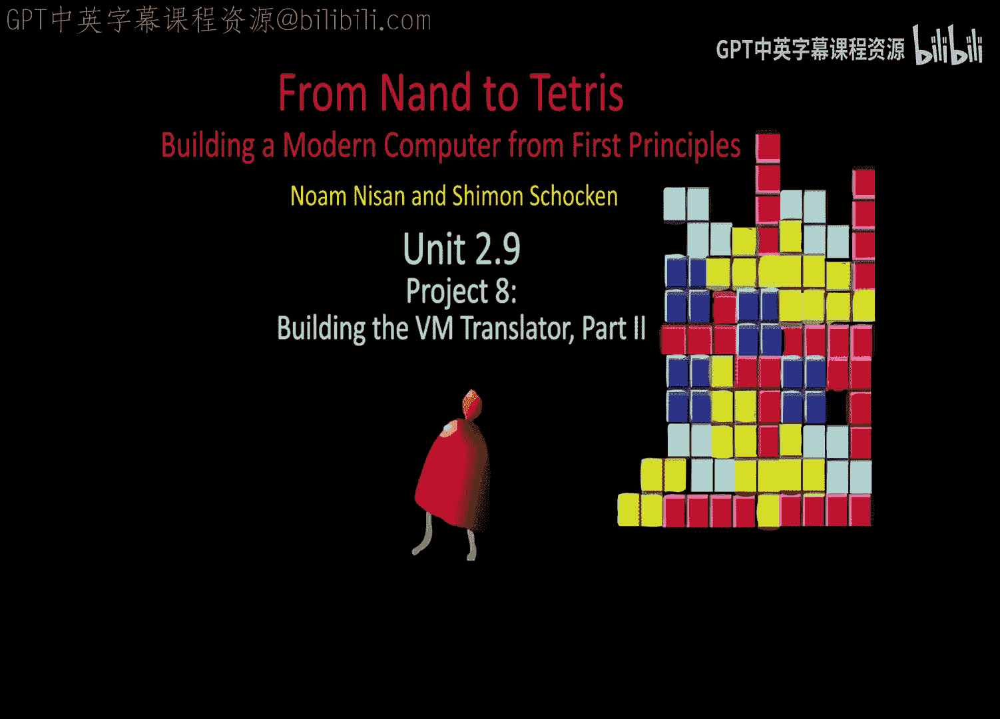

# 032：构建虚拟机翻译器第二部分

## 概述

在本节课中，我们将动手完成虚拟机翻译器的构建。这是本课程的第二个项目，但编号为项目8，以延续《计算机系统要素》第一部分的项目编号体系。我们的目标是构建一个能将虚拟机语言程序翻译成更低级的Hack汇编语言程序的翻译器。这个庞大的开发任务被分为两个独立项目：你已经完成的项目7和我们现在要构建的项目8。每个项目负责处理虚拟机命令的不同子集。本项目的挑战是实现分支和函数命令。

## 项目8的测试方法

为了测试你的虚拟机翻译器，我们将提供一系列虚拟机程序。你需要使用你的翻译器翻译每一个程序，生成用Hack汇编代码编写的低级程序。然后，我们可以在目标平台上执行这段代码，或者使用更友好的CPU模拟器直接运行汇编代码。如果程序执行结果与虚拟机代码的原始意图一致，则测试通过。我们提供了详细的测试脚本和对比文件，测试过程管理完善，你只需专注于编写功能正确的虚拟机翻译器。

## 测试程序集

在你的计算机上，如果你已经下载了Nand2Tetris软件套件，可以在项目8文件夹中找到两个目录：`ProgramFlow` 和 `FunctionCalls`。每个目录都包含几个子目录。

### 程序流测试

以下是程序流测试的步骤简介：

1.  **基本循环测试 (`BasicLoop`)**
    首先，我们建议你启动虚拟机模拟器，使用提供的 `BasicLoopVME.tst` 测试脚本加载虚拟机程序并稍作运行。这有助于理解程序意图。接着，使用你的翻译器将其翻译成默认名为 `BasicLoop.asm` 的汇编文件。最后，在CPU模拟器中加载并运行 `BasicLoop.tst` 脚本，该脚本将执行生成的代码，并将其输出与提供的对比文件进行比较。

    `BasicLoop.vm` 程序旨在将数字1到 `argument 0` 累加，并将结果压入堆栈。其核心逻辑是一个简单的循环，用于测试你的翻译器处理 `label` 和 `if-goto` 命令的能力。

2.  **斐波那契数列测试 (`FibonacciSeries`)**
    接下来，我们看看斐波那契数列测试文件。该程序旨在计算斐波那契数列的前 `argument 0` 个元素，并将这些值存入从 `argument 1` 指定地址开始的RAM中。同样，有一个测试脚本 `FibonacciSeries.tst` 会初始化参数并运行翻译后的代码。

    此程序涉及操作 `pointer` 和 `that` 等虚拟内存段，其具体语义目前无需深究。重要的是，它用于测试你的翻译器处理 `label`、`goto`、`if-goto` 以及许多其他虚拟机命令的能力。

### 函数调用测试

完成分支命令的测试后，我们现在转向测试处理函数的能力，这通常在实现翻译器时更具挑战性。

1.  **简单函数测试 (`SimpleFunction`)**
    `SimpleFunction.vm` 程序执行一个简单且无实际意义的计算并返回结果。其测试脚本会初始化内存段并执行代码。这个测试旨在检验你的翻译器处理 `function` 和 `return` 命令的能力。这是一个相对简单的测试，因为不涉及函数调用。

2.  **斐波那契元素测试 (`FibonacciElement`)**
    在 `FibonacciElement` 目录中，我们首次看到同一个目录下有多个虚拟机文件（`.vm`）。根据约定，当目录中有多个虚拟机文件时，你的翻译器需要翻译整个目录，并生成一个名为 `FibonacciElement.asm` 的单一输出文件。

    *   `Main.vm` 包含一个名为 `Fibonacci` 的函数，它递归地计算斐波那契数列的第n个元素。
    *   `Sys.vm` 包含一个名为 `Sys.init` 的函数。按照约定，虚拟机实现启动时应调用 `Sys.init`。在这个测试中，`Sys.init` 被用来调用测试函数（例如，用参数4调用 `Main.Fibonacci`），然后进入无限循环。

    这个测试综合检验了 `function`、`return`、`call` 命令的处理，以及虚拟机翻译器是否正确初始化和处理内存段（特别是堆栈指针）并调用 `Sys.init`。

3.  **嵌套调用测试 (`NestedCall`)**
    我们的同事Mark Armbrust指出，在 `SimpleFunction` 和 `FibonacciElement` 测试之间存在一个过大的测试跨度。因此，他开发了 `NestedCall` 测试来填补这一空白。如果你的 `SimpleFunction` 测试通过但 `FibonacciElement` 失败，建议使用此测试来更好地定位翻译器中的问题。该测试附有Mark编写的详细HTML文档。

4.  **静态变量测试 (`StaticsTest`)**
    最后一个测试是静态变量测试。同样，它包含多个虚拟机文件，需要翻译整个目录。

    *   `Class1.vm` 包含 `Class1.set` 和 `Class1.get` 函数，操作其静态变量 `static 0` 和 `static 1`。
    *   `Class2.vm` 包含逻辑几乎相同的 `Class2.set` 和 `Class2.get` 函数。
    *   `Sys.vm` 中的 `Sys.init` 依次调用 `Class1.set`、`Class2.set`、`Class1.get` 和 `Class2.get`。

    这个测试旨在确保不同文件的静态段被正确且独立地处理。执行后，堆栈上应得到结果 `-2` 和 `8`（分别对应 `6-8` 和 `23-15`）。

## 所需工具与资源

你需要以下工具和资源来完成项目8：

*   **测试程序与对比文件**：位于项目目录中。
*   **参考书籍**：书中第8章以紧凑的形式涵盖了本模块的所有内容。
*   **项目7用到的资源**：与项目7所需的工具和资源完全相同。

## 总结

本节课我们一起学习了项目8的具体内容。我们概述了测试虚拟机翻译器的方法，并逐一介绍了用于测试分支命令（`BasicLoop`, `FibonacciSeries`）和函数命令（`SimpleFunction`, `FibonacciElement`, `NestedCall`, `StaticsTest`）的各个程序集及其测试目标。通过完成这些测试，你将最终构建出一个功能完整的虚拟机翻译器。祝你在项目8中顺利成功，我们下个单元再见。