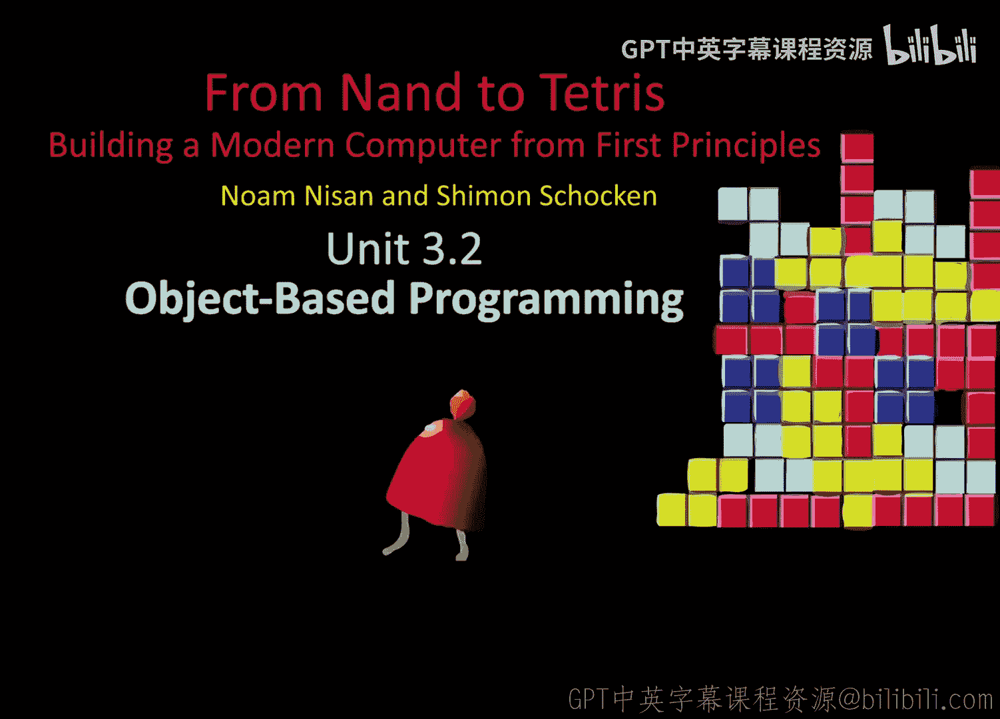

# 035：基于对象的编程



在本节课中，我们将要学习基于对象的编程。我们将通过一个具体的例子——实现一个分数类——来探讨如何设计和使用对象，并了解对象在内存中的表示方式。

## 概述

上一节我们介绍了简单的过程式编程。本节中，我们将讨论基于对象的编程。我们将创建一个名为 `Fraction` 的类，它允许我们以高精度进行分数运算。通过这个例子，我们将学习对象的构造、方法调用和销毁。

## 对象设计：分数类 API

首先，我们需要设计一个分数类的应用程序接口。这个API定义了分数对象能提供的服务。

以下是分数类的基本功能框架：

```java
class Fraction {
    // 构造函数：创建一个新的分数
    constructor Fraction new(int a, int b)

    // 访问器：获取分子
    method int getNumerator()

    // 访问器：获取分母
    method int getDenominator()

    // 方法：将当前分数与另一个分数相加
    method Fraction plus(Fraction other)

    // 方法：释放该分数对象占用的内存资源
    method void dispose()

    // 方法：在屏幕上打印当前分数
    method void print()
}
```

当然，一个完整的分数类还可以包含减法、乘法、除法、求倒数等功能。但本课程的重点是语言设计与实现，而非编程本身，因此我们仅展示核心概念。

## 客户端代码示例

了解了API后，我们来看看如何使用它。客户端代码存在于另一个独立的Jack类中。

以下是一个客户端程序示例，它计算 2/3 与 1/5 的和：

```java
class Main {
    function void main() {
        var Fraction a, b, c; // 声明三个Fraction类型的引用变量

        let a = Fraction.new(2, 3); // 创建分数 2/3
        let b = Fraction.new(1, 5); // 创建分数 1/5
        let c = a.plus(b);          // 将两个分数相加

        do c.print(); // 打印结果：13/15
        do c.dispose();
        do a.dispose();
        do b.dispose();
        return;
    }
}
```

执行此程序后，我们将在屏幕上得到正确的结果 **13/15**。

## 抽象与实现分离原则

这里我们再次遇到了本课程中反复强调的**抽象-实现分离原则**。分数类的使用者完全不需要知道分数在内部是如何实现的。他们只需将分数视为一个黑盒，并通过其公开的API来使用服务。

然而，总有人需要实现这个抽象。接下来，我们就从应用开发者切换到类实现者的角色，看看如何构建 `Fraction` 类。

## 实现分数类

设计一个类时，首先要确定需要存储哪些数据。对于分数，我们需要两个整数：分子和分母。

### 字段与访问器

我们在类中定义两个整型字段来存储这些数据，它们类似于Java的成员变量或C#的属性。

```java
class Fraction {
    field int numerator;   // 分子
    field int denominator; // 分母
    ...
}
```

在Jack语言中，从类外部访问字段值的唯一方式是通过访问器方法。这是一种良好的编程实践，在Jack中更是必须的。

以下是两个访问器方法的实现：

```java
// 返回当前分数的分子
method int getNumerator() {
    return numerator;
}

// 返回当前分数的分母
method int getDenominator() {
    return denominator;
}
```

### 构造函数

构造函数用于创建新的对象。它接收两个参数，用于初始化分子和分母，并自动对分数进行约分。

```java
// 构造函数：创建新分数并约分
constructor Fraction new(int x, int y) {
    let numerator = x;
    let denominator = y;
    do reduce(); // 调用约分方法
    return this; // 返回新创建对象的基地址
}
```

关键字 `this` 是对当前对象的标准引用，在内部它代表对象在内存中的基地址。Jack的构造函数必须显式返回 `this`。

### 约分方法与GCD函数

`reduce` 方法是一个典型的操作当前对象字段的方法。它通过计算分子和分母的最大公约数来约分分数。

```java
// 方法：约分当前分数
method void reduce() {
    var int g;
    let g = Fraction.gcd(numerator, denominator); // 调用GCD函数
    if (g > 1) {
        let numerator = numerator / g;
        let denominator = denominator / g;
    }
    return;
}
```

`gcd` 函数是一个静态函数，它不操作特定对象，类似于Java中的静态方法。这里实现了经典的欧几里得算法。

```java
// 函数：计算两个整数的最大公约数（欧几里得算法）
function int gcd(int a, int b) {
    var int r;
    while (~(b = 0)) {
        let r = a - (b * (a / b)); // 求余运算
        let a = b;
        let b = r;
    }
    return a;
}
```

### 加法方法

`plus` 方法将当前分数与另一个分数相加，基于小学数学原理，并返回一个新的分数对象。

```java
// 方法：将当前分数与另一个分数相加
method Fraction plus(Fraction other) {
    var int sumNum, sumDen;
    let sumNum = (numerator * other.getDenominator()) + (other.getNumerator() * denominator);
    let sumDen = denominator * other.getDenominator();
    return Fraction.new(sumNum, sumDen); // 创建并返回新的分数对象
}
```

### 打印与销毁方法

`print` 方法以“分子/分母”的格式在屏幕上打印当前分数。

`dispose` 方法至关重要，因为Jack语言没有垃圾回收机制。它通过调用宿主操作系统的例程来释放对象占用的内存，是良好编程习惯的体现。

```java
// 方法：打印当前分数
method void print() {
    do Output.printInt(numerator);
    do Output.printString("/");
    do Output.printInt(denominator);
    return;
}

// 方法：释放当前对象占用的内存
method void dispose() {
    do Memory.deAlloc(this); // 调用操作系统函数，传入对象基地址
    return;
}
```

## 对象在内存中的表示

程序员通常将对象可视化为包含其字段的块，并通过引用（变量名）来访问它们。例如，创建分数 2/3 和 1/5 后，心理模型如下：

```
a -> [ numerator: 2, denominator: 3 ]
b -> [ numerator: 1, denominator: 5 ]
```

然而，在系统底层，对象是在内存中实现的。RAM的一部分被划定为**堆**，用于存储对象和数组。变量 `a` 和 `b` 本身存储在**栈**上，其值是对象在堆中内存块的基地址（指针）。

例如：
*   变量 `a` 的值可能是一个地址，如 `15087`。访问该地址，会找到存储分子 `2` 的内存字，下一个字存储分母 `3`。
*   变量 `b` 存储另一个地址，指向代表分数 `1/5` 的内存块。

这种表示的建立依赖于编译器与宿主操作系统的协作。当编译构造函数时，编译器会插入对操作系统内存分配例程的调用。同样，`dispose` 方法会调用操作系统的内存释放例程。这些底层机制将在课程后续部分详细讨论。

## 总结

本节课中我们一起学习了基于对象的编程。我们通过实现一个完整的 `Fraction` 类，深入探讨了以下核心概念：
*   如何设计类的API。
*   如何编写客户端代码来使用对象。
*   **抽象与实现分离**的重要原则。
*   类的具体实现，包括**字段**、**访问器**、**构造函数**、**方法**和**函数**。
*   Jack语言中 `this` 关键字的意义和构造函数的显式返回要求。
*   对象在内存中的真实表示方式，以及栈和堆的区别。
*   在没有垃圾回收机制的语言中，**显式内存管理**（`dispose` 方法）的必要性。


这个简洁的分数类示例展示了基于对象编程的强大表现力。在接下来的单元中，我们将看到更多优雅的面向对象编程范例，并继续深入探讨支撑这些范例的语言设计和基础设施。