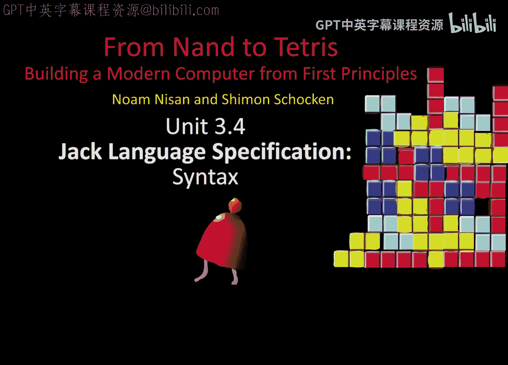

# 037：语法 🧩

在本节课中，我们将学习Jack编程语言的语法规范。我们将通过之前见过的编程示例，从纯语法的角度来解析代码的构成元素。

上一节我们介绍了Jack语言的整体框架，本节中我们来看看其具体的语法构成。我们将以平均计算程序为例，其代码本身在本单元中仅作为语法分析的素材。

## 空白与注释

首先，我们来看代码中的空白部分，包括注释和空格。在Jack语言中，注释有三种类型，我们在之前的单元中已经讨论过，这里为了完整性再次列出其规则。

以下是Jack语言中注释的规则：
*   **行内注释**：以 `//` 开头，直到行尾。
*   **多行注释**：以 `/*` 开头，以 `*/` 结尾。
*   **API文档注释**：以 `/**` 开头，以 `*/` 结尾，通常用于生成文档。

## 关键字

接下来，我们讨论关键字。在上述示例代码中，我们看到了多个关键字在起作用。Jack语言总共约有20个关键字，它们可以分为不同的类别。相比之下，Java语言有大约60到70个关键字，因此在数量级上，两者都属于比较简单的语言。

以下是Jack语言的关键字分类：
*   **标准关键字**：例如 `class`、`function`、`void`、`while`。
*   **非标准关键字**：例如 `var`、`let`、`do`。这些关键字是为了简化编译器的编写而特意引入的，你将在课程的下一个模块中体会到这一点。

## 符号

每个Jack程序（或其他任何语言的程序）都包含许多符号。这些符号用于不同的目的。

以下是符号的主要用途：
*   **分组符号**：例如 `{`、`}`、`(`、`)`、`[`、`]`。
*   **其他用途符号**：例如 `;`、`,`、`.`、`+`、`-`、`*`、`/`、`&`、`|`、`<`、`>`、`=`、`~`。

## 常量

Jack语言有能力描述常量。在我们的示例中，可以看到两种常量。

以下是Jack语言支持的常量类型：
*   **整数常量**：例如 `5`、`12`。
*   **字符串常量**：例如 `"The average is: "`。
*   **布尔常量**：`true` 和 `false`。
*   **空常量**：`null`。

## 标识符

最后，我们来看标识符。标识符实际上是任何程序的主体部分。在这个例子中，大部分代码都是由标识符构成的。😊

标识符是程序员在创建变量、类和方法时发明的名称。这些名称需要遵循特定的命名规则。需要再次指出的是，Jack和Java本身都是非常简单的语言。这些语言之所以强大（尤其是Java），在于程序员可以自由地创建属于自己的完整世界，这个世界通常由类、方法和API组成。程序员编写的大部分代码，实际上就是他们在设计这些API时所创造的“小语言”。我们在示例中看到的 `Keyboard.readInt()` 等就是如此。所有这些“小语言”都由程序员发明的标识符构成，因此想出好的标识符名称至关重要，它能使你的代码更具可读性。

## 总结

本节课中，我们一起学习了Jack编程语言的语法元素，包括空白与注释、关键字、符号、常量和标识符。在下一单元，我们将讨论Jack语言中可用的数据类型。

