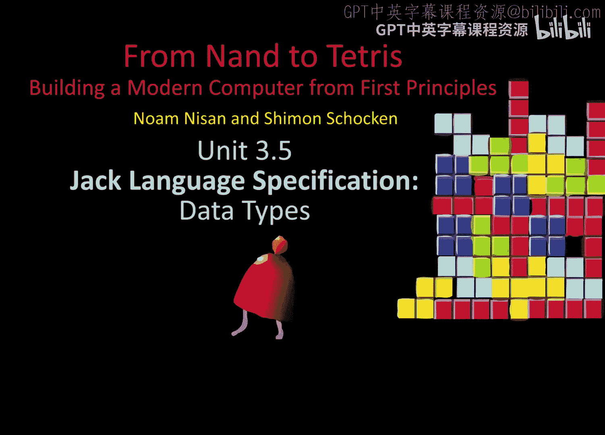
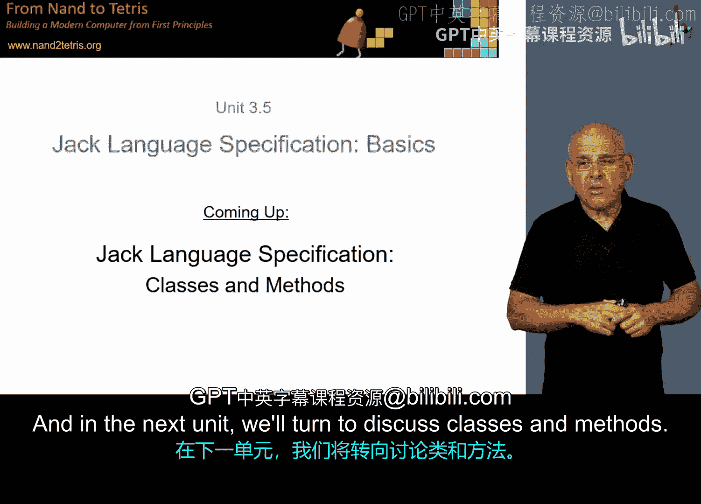

**《从零开始构建现代计算机2》：单元3-5：Jack语言规范：数据类型** 🧱

在本节中，我们将学习Jack编程语言支持的数据类型。我们将了解其基本类型、类类型，以及该语言独特且强大的类型转换规则。

---

在上一单元，我们讨论了Jack语言的语法。本节中，我们来看看Jack程序允许创建和操作哪些类型的数据。照例，我们先从一个例子开始。

这是一段Jack代码，其具体功能并不重要。让我们聚焦于这三条语句，程序员在其中创建了一个名为 `a` 的数组、一个名为 `length` 的整数变量，以及另外两个名为 `I` 和 `sum` 的整数变量。

由此我们看到，Jack语言首先有三种**基本类型**：
*   **`int`** 数据类型：可保存0到32767范围内的值。
*   **`boolean`** 类型：值为 `true` 或 `false`。
*   **`char`** 类型：本质上是使用Unicode（或ASCII）字符集表示字符的数字。在本课程使用的字符子集中，两者是相同的。

你可能会问，如果 `int` 值只能是非负数，如何在Jack中表示负数？你可以在值前加上负号 `-`，但这并非一个常量，而是一个**表达式**，我们对紧随其后的非负值应用了负号运算符。因此，从程序员的角度看，使用负数与使用正数一样简单，但其实现稍微复杂一些。

接下来，我们还有**类类型**。例如，在这段代码中，我们看到变量 `a` 的类型是 `Array`。类类型要么来自Jack操作系统（如 `String` 和 `Array`），要么是用户创建的。这里的“用户”指的是编写Jack的程序员，他们可以设计诸如 `Fraction`、`List`、`Stack` 等类，并自由创建这些数据类型的变量。

因此，与其他基于对象的高级语言类似，Jack同时拥有基本类型和类类型。

接下来，我想演示Jack中可能相当“狂野”的类型转换。

首先，**字符和整数可以根据需要随意相互转换**。这与其他语言中的做法很相似。
*   如果有一个名为 `c` 的字符变量，我可以写 `c = 65;`，其中65是一个整数值，这将根据ASCII码给我字符 `'A'` 的表示。
*   同样，我可以创建一个名为 `s` 的字符串，用双引号将大写字母A赋值给 `s`。如果我想将其转换为字符，则必须使用操作系统函数 `charAt`，通过调用 `s.charAt(0)` 来实现。这有点繁琐，因为理想情况下我们可能希望直接写 `c = "A";`，但Jack语言不支持这种写法。这可能会给需要进行大量字符串和字符处理的人带来一些不便，但它会使编译器的编写变得更容易。当我们开发编译器时，会感谢这些让步。

其次，**整数可以赋值给引用变量，此时它被视为一个内存地址**。考虑这段代码：我们创建了一个名为 `arr` 的数组，然后写 `arr = 5000;`。这看起来有点疯狂，因为 `arr` 本应是一个数组。然而，Jack语言支持这种赋值。如果你这样做，基本上是告诉系统数组 `arr` 应该从基地址5000开始。因此，如果你之后写 `arr[100] = 17;`，编译器生成的代码将使RAM位置 `5000 + 100`（即5100）的值变为17。如你所见，这种转换相当奇特和狂野，如果使用不当可能造成混乱，因为它允许程序员控制RAM并随意操作。然而，这些技巧在我们后续开发操作系统时将再次被证明极其有用。

此外，**对象可以轻松转换为数组，反之亦然**。例如：
1.  我创建一个 `Fraction` 类型的对象 `x`。回想一下，`Fraction` 对象有两个字段：`numerator`（分子）和 `denominator`（分母）。
2.  我创建一个名为 `arr` 的数组，将其构造为长度为2。
3.  然后我写 `arr[0] = 2;` 和 `arr[1] = 5;`。
4.  接着我做了一件奇怪的事：`x = arr;`。现在，`x`（一个`Fraction`对象）指向了 `arr` 数组。
5.  完成此操作后，我可以写 `x.print();`。这将调用 `Fraction` 类的 `print` 方法作用于 `x`。即使 `x` 指向一个数组，它也会将此数组视为一个 `Fraction`，从而将其打印为 `2/5`。

这再次是一种相当狂野的类型转换，但完全合理，因为在内部，数组和对象的处理方式几乎相同。这就是为什么在Java和C#等语言中，你可以轻松地将对象序列化为数组等等。在Jack中，这种关系更加明确和清晰。

---

本节课中，我们一起学习了Jack语言的数据类型。总结来说，我们可以得出结论：Jack拥有一套相当**基础的基本类型集**（只有三种，而Java有八种）。我们本可以轻松添加更多，但从教学价值考虑认为没有必要。

同时，Jack语言也是**弱类型**的。事实上，它非常弱类型。任何变量都可以赋值给任何其他变量，而不管其类型如何。一方面，这听起来像是一场混乱；另一方面，它提供了一些非常有趣的“黑客”可能性，我们后续肯定会加以利用。我们本可以轻易施加各种限制，不允许进行某些操作，但我们决定不为此烦恼。

这就是Jack的类型系统。在下一单元，我们将转向讨论类和方法。