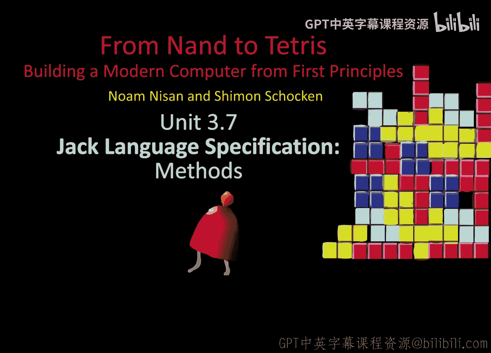

# 040：方法 🧩



在本单元中，我们将全面探讨Jack语言中“方法”相关的所有规范。这包括变量、子程序调用、数组、字符串等核心概念。我们将以尽可能清晰的方式，逐一解析这些构成Jack程序的基本元素。

## 概述

上一节我们介绍了类的基本概念，并提到类以子程序声明结尾。本节中，我们将深入探讨这些子程序，即方法（包括构造函数、方法和函数）的详细规范，以及与之相关的变量、表达式、语句等语言要素。

## 子程序：构造函数、方法与函数

Jack语言使用“子程序”这一统称来描述三种类型的方法：构造函数、方法和函数。它们目的不同，但声明语法完全相同。
*   **构造函数**：用于创建新对象。
*   **方法**：用于操作当前对象（`this`）。
*   **函数**：类似于C语言中的函数，不操作特定对象，仅提供计算服务。

所有子程序都必须有返回类型，并且必须返回一个值。即使是`void`类型的子程序，也需要显式地使用`return;`语句，这相当于`return null;`的简写。在其他语言中，编译器可能会隐式地处理这一点，但在Jack中需要程序员显式写出。

## 构造函数的特殊规则

构造函数是享有特殊规则的方法，专门用于创建对象。
*   一个类可以有0个、1个或多个构造函数。
*   构造函数的常用名称是`new`。如果有多个构造函数，可以使用更具描述性的名称，如`newOne`、`newTwo`。
*   构造函数的返回类型**必须**是其所属类的类名。
*   构造函数必须返回一个值，且该值必须是该类的一个对象。

## 变量类型

Jack程序中有四种变量，以下是它们的简要说明：
*   **静态变量**：类级别的变量，类中的所有子程序都可以访问。
*   **字段变量**：同样是类级别的变量，类中的所有方法和构造函数可以访问，但函数不能访问（因为函数不理解对象的概念）。
*   **局部变量**：在子程序内部声明和使用的变量。
*   **参数变量**：本质上与局部变量相同，但其值可以从外部传入，用于向类内传递参数。

所有变量都必须先声明类型，然后才能使用。Jack是一种弱类型语言，这意味着在大多数情况下，可以将一个变量赋值给另一个变量，而无需过多考虑它们的类型是否严格匹配。

## 语句

Jack语言提供了五种基本语句，以下是它们的用途：
*   **`let`**：用于赋值。
*   **`if`**：用于条件判断。
*   **`while`**：用于循环。
*   **`do`**：用于调用一个方法（仅为了其副作用，不关心返回值）。
*   **`return`**：用于从子程序中返回。

## 表达式

表达式是构成程序计算的基本单元。一个Jack表达式可以是以下任何一种形式：
*   一个常量（如 `17`）。
*   一个变量名或关键字`this`。
*   一个数组索引访问（如 `temperature[15]`）。
*   一个子程序调用（如 `Math.sqrt(17)`）。
*   一个带一元运算符（`-` 或 `~`）的表达式（如 `-sqrt(17)`）。
*   两个表达式通过二元运算符（`+`, `-`, `*`, `/`, `&`, `|`, `<`, `>`, `=`）连接（如 `x + 17`）。
*   一个放在括号内的表达式（如 `(x + 17) * y`）。

## 子程序调用

子程序调用的语法在不同语言中可能有所不同，但Jack遵循通用规则：调用时提供的参数数量和类型必须与被调用子程序签名中定义的完全匹配。理解这一点对于正确使用API至关重要。

## 字符串

字符串在Jack中是对象，它们是操作系统`String`类的实例。以下是字符串使用的示例：

```jack
var String s;
var char c;
let s = "hello world"; // 编译器会将此“语法糖”转换为底层的构造和赋值代码
let c = s.charAt(0); // 从字符串中提取单个字符
```

字符串可以通过`new String`显式构造并逐个添加字符，但更常见且方便的方式是直接使用双引号赋值。这种简化写法被称为“语法糖”，它隐藏了底层的复杂性。要了解所有字符串操作，请查阅操作系统中的String API。

## 数组

数组在Jack中也是对象，它们是操作系统`Array`类的实例。Jack的数组是弱类型的，并且始终是一维的。以下是一个示例：

```jack
var Array arr;
var String helloWorld;
let helloWorld = "hello world";
let arr = Array.new(4);
let arr[0] = 12;      // 整数
let arr[1] = false;   // 布尔值
let arr[2] = 314/100; // 分数
let arr[3] = helloWorld; // 字符串
```

如示例所示，同一个数组的不同元素可以包含完全不同的数据类型。如果需要多维数组，可以通过“数组的数组”来实现。

## Jack语言的特性总结

在开始用Jack编写程序（如本模块的最终项目）之前，需要了解其一些独特特性：

1.  **赋值前缀**：所有赋值语句都必须以`let`关键字开头。忘记使用会导致编译错误。
2.  **方法调用前缀**：如果调用一个方法仅为了其副作用（不关心返回值），必须使用`do`关键字。如果方法返回值并用于赋值，则使用`let`。
3.  **语句体括号**：即使语句体内只有一条语句，也必须用花括号`{}`括起来。例如：`if (x) { return a; }`。这是一种良好的编程实践。
4.  **显式返回**：所有子程序都必须以`return`语句结束。在其他语言中，编译器可能隐式添加，但在Jack中必须显式写出。
5.  **无运算符优先级**：Jack语言**没有定义**运算符的优先级。表达式`2 + 3 * 4`可能被计算为`20`（从左到右），而不是`14`。要确保运算顺序，**必须使用括号**，例如`2 + (3 * 4)`。
6.  **弱类型系统**：Jack是一种比工业级语言弱得多的类型语言。这赋予了程序员通过指针直接操控底层硬件的强大能力（在课程中非常有用），但同时也极不安全，可能导致程序崩溃。在本课程中，这被视为一个理想特性，因为它将整个软硬件系统变成了一个开放的实验室。

## 总结


本节课中，我们一起学习了Jack语言中关于方法的完整规范。我们详细探讨了构造函数、方法和函数的区别，了解了四种变量类型、五种基本语句以及表达式的构成规则。我们还特别介绍了字符串和数组的使用方式，并总结了Jack语言的一些关键特性，如必须使用`let`和`do`前缀、语句体必须加括号、没有运算符优先级等。掌握这些规范是接下来使用Jack语言进行编程和项目开发的基础。下一单元，我们将讨论在Hack平台上编写Jack程序和应用的艺术与实践。