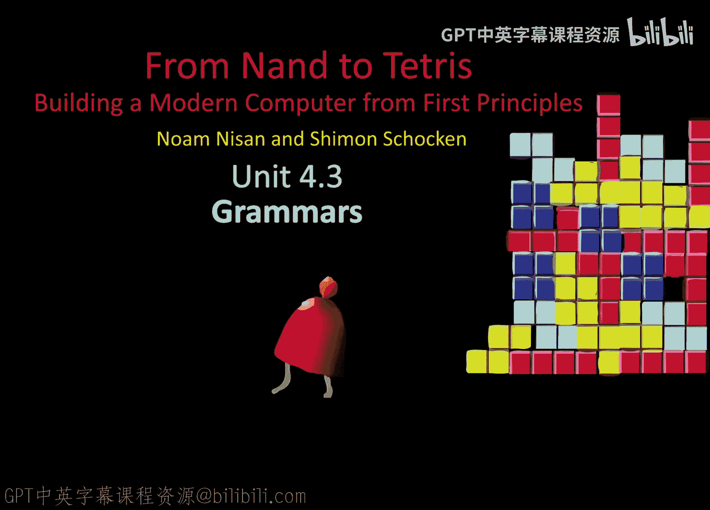

# 047：文法 🧩



在本节课中，我们将要学习文法的概念。文法定义了如何将有效的单词（即词法单元）组合成有意义的句子或程序语句。理解文法是进行语法分析的基础。

在上一单元，我们讨论了词法分析，并建立了将程序视为一系列词法单元的概念能力。现在，你可能会同意，仅仅拥有一组有效的词法单元，并不一定意味着我们拥有一个有效的文本或程序。例如，在英语中，考虑以下一组词法单元：“Red drives a he”。这毫无意义，尽管每个词法单元本身都是合法的英语单词。然而，它们的顺序不正确。如果说“He drives a red car”，一切就变得清晰明了。因此，不仅词法单元本身重要，它们的顺序也至关重要。

定义词法单元如何合法组合的规则集合，就称为文法。从技术上讲，文法是一组规则，每条规则定义了一种模式，指示如何将词法单元串联起来，以构成底层语言中有意义的句子或语句。

## 文法示例：英语子集

以下是一个英语语言的子集文法示例。在这个文法中，我们有句子。每个句子由一个名词短语后跟一个动词短语构成。

*   **句子** → **名词短语** **动词短语**
*   **名词短语** → **限定词**? **名词**
*   **动词短语** → **动词** **名词短语**
*   **名词** → `dog` | `school` | `dinner` | `Dina` | ...
*   **动词** → `went` | `ate` | `said` | ...
*   **限定词** → `the` | `my` | `a` | ...

这个文法具有递归性。这个子集足够丰富，可以接受诸如“Dina went to school”、“She said”、“The dog ate my homework”等输入。例如，分析“The dog ate my homework”：
1.  “The”是限定词，“dog”是名词，它们构成一个**名词短语**。
2.  “ate”是动词，“my homework”是另一个**名词短语**，它们构成一个**动词短语**。
3.  因此，我们有一个**名词短语**后跟一个**动词短语**，根据此文法，这是一个合法的句子。

## 文法的规则类型

观察这个文法，可以发现它由一组规则构成。这些规则可以分为两大类：
*   **终结符规则**：规则的右侧仅由常量（即具体的词法单元）构成。
*   **非终结符规则**：规则的右侧包含其他规则的名称，也可能包含常量。

一个文法就是由终结符规则和非终结符规则组成的集合。这个观察在我们后续的工作中会很有用。

## 聚焦Jack语言文法

现在，让我们将注意力转向Jack语言的文法。本课程不是关于一般计算语言学，而是关于编译。因此，我们关注Jack程序的文法。

一个Jack程序由一系列语句构成。我们聚焦于Jack语言的一个子集，其中包含三种可能的语句：`if`、`while`和`let`。以下是该子集的文法定义：

*   **`statements`** → **`statement`**\*
*   **`statement`** → **`ifStatement`** | **`whileStatement`** | **`letStatement`**
*   **`ifStatement`** → `if` `(` **`expression`** `)` `{` **`statements`** `}`
*   **`whileStatement`** → `while` `(` **`expression`** `)` `{` **`statements`** `}`
*   **`letStatement`** → `let` **`varName`** `=` **`expression`** `;`
*   **`expression`** → **`term`** ( **`op`** **`term`** )?
*   **`term`** → **`varName`** | **`constant`**
*   **`varName`** → 一个不以数字开头的字符串
*   **`constant`** → 任意十进制数字
*   **`op`** → `+` | `-` | `*` | `/` | `&` | `|` | `<` | `>` | `=`

以上构成了Jack语言一个子集的完整文法。现在我们可以开始考虑各种输入，并判断它们是否符合此文法。

## 文法分析示例

以下是几个输入示例及其是否符合文法的分析：

1.  **输入**：`let x = 100;`
    *   **分析**：以`let`开头，符合`letStatement`模式。`x`是有效的`varName`。接着是`=`符号。`100`是`constant`，因此是`term`，进而构成`expression`。最后是`;`。所有部分都匹配`letStatement`规则。**结论：接受**。

2.  **输入**：`let x = x + 1;`
    *   **分析**：`let x =` 部分同上。`x + 1`中，`x`是`term`，`+`是`op`，`1`是`constant`（即`term`），因此`x + 1`匹配`expression`规则（`term` `op` `term`）。**结论：接受**。

3.  **输入**：`while ( n < limit )`
    *   **分析**：以`while`开头，符合`whileStatement`模式。接着是`(`。`n < limit`可以分析为`expression`。接着是`)`。然而，`whileStatement`规则要求后面必须有`{` `statements` `}`，但输入在此处结束。**结论：拒绝（语法错误）**。

4.  **输入**：
    ```
    if (key = 81) {
        let exit = true;
        do Output.printString("Bye");
    }
    ```
    *   **分析**：这是一个`ifStatement`。括号内的`key = 81`是`expression`。花括号`{}`内包含两个`statement`（一个`letStatement`和一个`do`语句，虽然`do`不在我们当前子集但原理相同），这符合`statements`（零个或多个`statement`）的定义。**结论：接受**。

5.  **输入**：`let x = 5 * (y + 3);`
    *   **分析**：你可以尝试自行分析。它同样符合`letStatement`的规则，因为`5 * (y + 3)`是一个合法的`expression`。**结论：接受**。

## 语法分析的作用

**语法分析**就是判断给定输入是否符合特定文法的艺术与科学。请注意，在这个确认过程中，我们同时也揭示了输入的全部语法结构，因为我们分析了输入如何对应规则的各个组成部分。通过这样做，我们构建了输入底层的语法结构树。

顺便一提，我们的大脑正是以某种神秘的方式（尽管越来越可被理解）在做类似的事情。当我们听到一个句子时，我们会尝试将其与我们大脑中固有的、通过一生语言学习形成的模式进行匹配。我们的大脑拥有这种理解句子的卓越能力，即使句子不完全符合语法。如果没有这种能力，世界上所有的诗人都会失业。但是，计算机程序和编译器没有这种卓越的能力。当你处理编译器时，输入必须完美匹配文法。如果有任何不符，编译器就会报错并提示“语法错误，你必须修复你的程序”。

本节课中我们一起学习了文法的基本概念，包括其定义、规则类型（终结符与非终结符），并通过英语和Jack语言的例子了解了如何使用文法来判断输入的有效性。语法分析是编译过程中的关键步骤，它确保程序在结构上是正确的。


下一单元，我们将讨论**语法分析树**的概念，这是一种我们用来描述输入语法结构的数据结构。