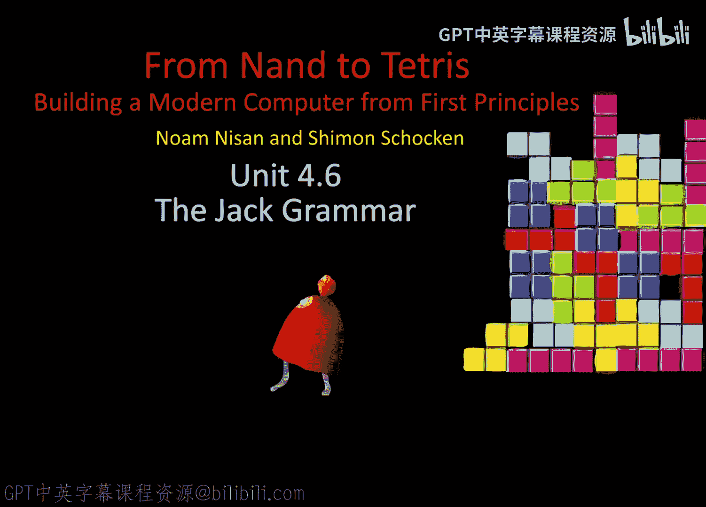

# 050：Jack文法 🧩



在本单元中，我们将深入探讨Jack编程语言的文法。我们将学习如何形式化地描述Jack语言的结构，并理解这些文法规则如何指导我们后续构建语法分析器。

---

## 文法符号定义 📝

上一节我们介绍了文法和语法分析的一般概念。本节中，我们来看看Jack文法所使用的具体符号表示法。

以下是描述Jack文法时使用的符号规则：

*   **字面量**：用黑色字体和引号表示，例如 `"class"`。这表示输入中必须原样出现的特定词法单元。
*   **元语言**：所有非字面量的绿色部分，是我们为描述Jack文法而发明的描述符。
*   **分组**：使用圆括号 `()` 对词法单元进行分组。
*   **选择**：使用竖线 `|` 表示在多个选项中选择一个。
*   **可选**：使用问号 `?` 表示某个元素出现零次或一次。
*   **重复**：使用星号 `*` 表示某个元素出现零次或多次。

这些简单的规则足以描述编程语言的结构。

---

## Jack文法全貌 🗺️

掌握了符号规则后，我们现在可以完整地展示Jack文法。它看起来可能有些复杂，但这只是因为我们将整个语言压缩到了一张幻灯片上。实际上，整个文法非常简洁，分为四个主要部分。

### 1. 词法元素

Jack程序由以下基本的词法单元（或称为“原子”）构成：

*   **关键字**：例如 `class`， `constructor`， `function`， `method`， `field`， `static`， `var`， `int`， `char`， `boolean`， `void`， `true`， `false`， `null`， `this`， `let`， `do`， `if`， `else`， `while`， `return`。
*   **符号**：例如 `{`， `}`， `(`， `)`， `[`， `]`， `.`， `,`， `;`， `+`， `-`， `*`， `/`， `&`， `|`， `<`， `>`， `=`， `~`。
*   **整数常量**：例如 `123`， `0`， `4567`。
*   **字符串常量**：例如 `"Hello, World!"`。
*   **标识符**：由字母、数字和下划线组成的序列，且不以数字开头，例如 `myVariable`， `_temp`， `Screen12`。

### 2. 程序结构

一个Jack程序由一个或多个类组成，每个类被单独存储、处理和编译。

以下是类的结构定义：
```
class ::= ‘class’ className ‘{‘ classVarDec* subroutineDec* ‘}’
```
*   `class` 是关键字。
*   `className` 是一个标识符。
*   `{` 和 `}` 是必须的符号。
*   `classVarDec*` 表示零个或多个类变量声明。
*   `subroutineDec*` 表示零个或多个子程序声明。

类变量声明的规则如下：
```
classVarDec ::= (‘static’ | ‘field’) type varName ( ‘,’ varName )* ‘;’
```
例如，`static int x, y, z;` 符合此规则。

类型定义如下：
```
type ::= ‘int’ | ‘char’ | ‘boolean’ | className
```
Jack只有三种基本类型（`int`， `char`， `boolean`），也支持类名作为类型。

子程序声明的规则如下：
```
subroutineDec ::= (‘constructor’ | ‘function’ | ‘method’) (‘void’ | type) subroutineName ‘(‘ parameterList ‘)’ subroutineBody
```
子程序可以是构造函数、函数或方法，可以返回`void`或某种类型。

参数列表是可选的：
```
parameterList ::= ((type varName) ( ‘,’ type varName )*)?
```
`?` 表示整个参数列表可能出现零次或一次。

### 3. 语句

Jack程序包含多种语句，以下是语句的总体和具体定义：
```
statements ::= statement*
statement ::= letStatement | ifStatement | whileStatement | doStatement | returnStatement
```
以下是各类语句的规则：
*   **赋值语句**：`letStatement ::= ‘let’ varName ( ‘[‘ expression ‘]’ )? ‘=’ expression ‘;’`
*   **条件语句**：`ifStatement ::= ‘if’ ‘(‘ expression ‘)’ ‘{‘ statements ‘}’ ( ‘else’ ‘{‘ statements ‘}’ )?`
*   **循环语句**：`whileStatement ::= ‘while’ ‘(‘ expression ‘)’ ‘{‘ statements ‘}’`
*   **过程调用语句**：`doStatement ::= ‘do’ subroutineCall ‘;’`
*   **返回语句**：`returnStatement ::= ‘return’ expression? ‘;’`

### 4. 表达式

表达式是文法中相对复杂的部分，其定义如下：
```
expression ::= term (op term)*
```
表达式由一个`term`（项）开头，后面可以跟零个或多个由运算符`op`连接的`term`。

使表达式变得复杂的是`term`规则本身：
```
term ::= integerConstant | stringConstant | keywordConstant | varName | varName ‘[‘ expression ‘]’ | subroutineCall | ‘(‘ expression ‘)’ | unaryOp term
```
`term`可以是整数常量、字符串常量、关键字常量、变量名、数组访问、子程序调用、括号表达式或一元运算表达式。

处理表达式的挑战在于，当遇到一个标识符（变量名）时，它可能代表多种情况（简单变量、数组元素、子程序调用等）。为了确定具体是哪一种，语法分析器需要“向前看”下一个词法单元。这是Jack语言中唯一需要LL(2)分析能力的地方，其他部分都是LL(1)的。

---

## 文法与语法分析器的关系 🔗

我们给出完整的Jack文法，是因为它将作为我们编写语法分析器的“配方”。

语法分析器将由一组编译例程构成，几乎对应文法中的每一个非终结符规则。每个分析例程将根据对应规则的右侧部分来编写，负责生成所需的XML输出，并在此过程中调用其他分析例程。这体现了文法与依其运作的语法分析器之间紧密的关系。

---

## 总结 📚


本节课中我们一起学习了Jack编程语言的完整文法。我们了解了用于描述文法的符号系统，并将文法分解为四个主要部分：词法元素、程序结构、语句和表达式。我们特别注意到，表达式中`term`规则的处理相对复杂，因为遇到标识符时需要“向前看”一个词法单元来确定其具体角色。理解这些文法是后续动手构建Jack语法分析器的关键基础。在下一个单元，我们将开始讨论如何编写这个分析器本身。