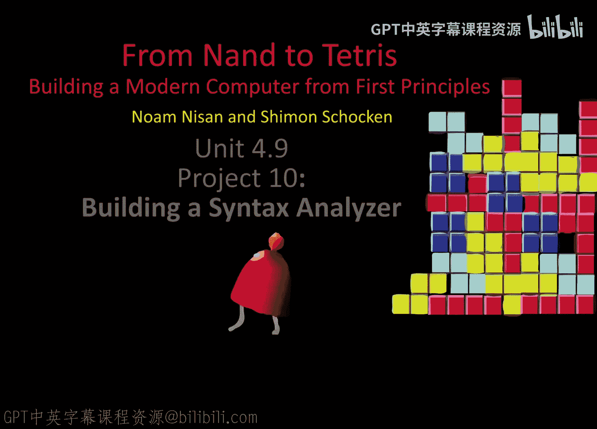
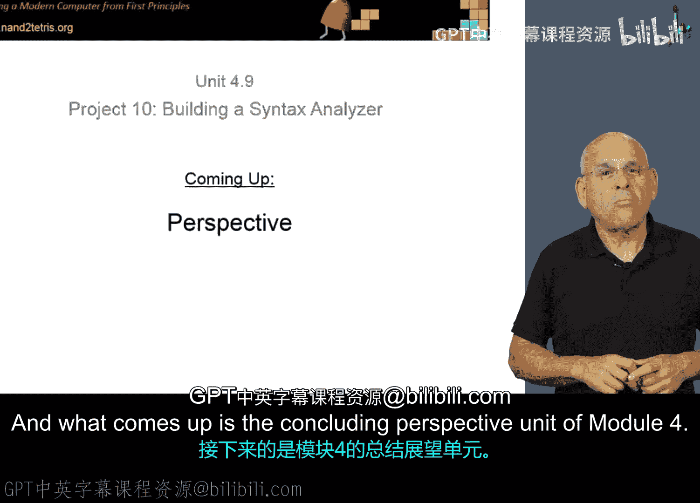

# 053：项目10 - 构建语法分析器 🛠️

在本节课中，我们将动手实践，开始开发我们一直讨论的语法分析器。

## 概述

我们正在开发一个Jack编译器，本模块的重点是编译器的语法分析器部分。我们面临的挑战是将此模块与系统的其余部分分开进行单元测试。为此，在项目10中，我们决定让语法分析器生成XML代码。通过查看此XML代码，无论是通过肉眼分析还是使用其他技术，我们都能判断语法分析器是否真正理解了源代码。这就是我们需要开发的程序。

## 项目要求

我们将在Jack语言的背景下进行开发。要求是开发一个语法分析器，能够翻译项目10目录中提供的所有Jack程序。对于每个这样的Jack文件，分析器应生成一个单独的XML输出文件，反映该Jack文件的语法结构，并且此XML文件应与我们提供的对比文件完全相同。

以下是验证输出的方法：
*   测试程序和对比文件位于您计算机的项目目录中。
*   您可以使用我们提供的名为`TextComparer`的实用程序，将您的输出与我们的对比文件进行比较。`TextComparer`是一个比较两个文本文件的工具，它会忽略空白字符的差异。
*   另一种检查XML输出是否合理的方法是将其加载到浏览器（如Chrome或Firefox）或能够处理编程语言的文本编辑器中。这些工具可以帮您查看生成的XML结构，并判断其是否组织良好。

您需要选择一种编程语言来创建语法分析器，本课程目前接受Java和Python。此外，建议您查阅教材，其中有一整章专门介绍语法分析，您可以找到一些有用的信息。

## 实现计划

首先，我们将开发一个**分词器**，这是一个定义明确且相对简单的任务。然后，我们将继续开发**编译引擎**。我们使用“编译引擎”这个术语来描述一个使用我们之前开发的分词器服务的语法分析器。

我们将分两个阶段开发这个编译引擎：首先构建一个相对简单的基础程序，然后将其扩展为一个功能完整的语法分析器。

## 开发分词器

让我们从分词器开始。我们以一些源代码开始，最终希望得到类似右侧的XML输出。

现在，我们在这里右侧看到的XML示例与之前单元中看到的略有不同。以下是区别：
*   我们决定用名为`<tokens>`和`</tokens>`的开始和结束标签包装整个XML文件。这样做是因为，如果您要将此文件加载到浏览器中以获得美观的结构化视图，浏览器期望看到一个定义良好、有开始和结束标签的XML文件。
*   您还会注意到，字符串常量（如源代码中的单词“negative”）在XML中显示时没有双引号。这是正确的处理方式。您的语法分析器不应输出双引号，而应原样输出字符串常量。
*   最后，您会注意到某些特殊字符（如 `<`、`>`、`"`、`&` 和 `%`）以特殊方式处理。由于它们在HTML中有特殊含义，为了避免浏览器解析错误，我们使用替代字符集（例如用 `&lt;` 代表 `<`）。使用此约定后，当您将文件加载到浏览器中时，就能正确看到这些字符。

那么，如何构建这个分词器呢？我们建议您遵循单元48中描述的API。请记住，本模块中的所有内容（分词器和语法分析器）本质上都是文本处理挑战。因此，您可以自由使用编程语言提供的所有字符串处理和正则表达式功能。

## 开发语法分析器

上一节我们介绍了分词器，本节中我们来看看如何开发语法分析器（或称整体Jack分析器）。这里有一个Jack代码示例，我们需要将其分析或翻译成右侧所示的XML。

我们如何做到这一点呢？我们在这个模块中已经讨论过，但基本上我们建议您从编写一个**基础编译引擎**开始，它能处理除表达式之外的所有内容。因为表达式处理起来有些棘手，所以我们倾向于单独处理它们。之后，我们再添加对表达式的处理。为了支持这种分阶段开发策略，我们将提供测试文件，使您能够分别对每个步骤进行单元测试。

以下是您的语法分析器在项目10中应处理的测试文件示例。我将突出显示此Jack文件中的表达式。如您所见，每个程序都包含许多表达式。

我们将为您提供此文件的两个版本：第一个是完整测试版本。但我们还提供了另一个版本，称为**无表达式版本**。在此版本中，我们将每个表达式替换为此方法作用域内的一个变量名。例如，我们不写 `y + size < 254`，而只写 `x`。这里`x`有意义，因为它恰好是此类中的一个字段，因此可以被所有方法全局识别。同样，我们不写 `size = size + 2` 这个复杂表达式，而是替换为 `size = size`。

我们的任务是创建这些文件，您无需关心我们是如何做到的。但结果是，这个文件比原始文件更简单，因为它没有复杂的表达式。因此，它适合测试一个能处理除表达式之外所有内容的语法分析器。这就是这些文件的目的。

基本上，当您查看这些程序的无表达式版本时，您会注意到它们在语义上没有意义，甚至有些奇怪。但从语法上讲，它们是完全有效的，因此它们达到了测试目的。我们很高兴地使用它们来测试语法分析器的基础版本。一旦您的语法分析器可以处理这些无表达式文件，您就可以继续完成也能处理表达式的完整版本。

## 处理表达式

这就是构建语法分析器的总体计划。现在，我想在本单元结束时谈谈如何处理表达式。

回顾Jack语法，在语法分析方面有问题的部分是这里突出显示的`term`规则。问题是，当当前标记是一个变量名（或某个标识符）时，它可能是一个像`x`这样的变量名，也可能是一个像`x[18]`这样的数组条目，或者是一个像`x.doSomething()`这样的子程序调用。解决我们处于哪种可能性的唯一方法是**向前查看下一个标记**。我们必须保存当前标记，然后向前查看下一个标记。一旦我们掌握了这两个标记，我们就拥有了决定如何处理它以及从中生成何种XML所需的所有信息。

好的，这是您在开发完整版语法分析器时必须注意的一个细节。

那么，子程序调用呢？看起来子程序调用在语法中是一个单独的规则，确实如此。但由于各种原因，我们决定子程序调用不由单独的编译方法处理，而是作为处理`term`的一部分来处理子程序调用规则的右侧逻辑。当您开发语法分析器时，您会发现这个建议会使代码更容易编写。因此，不会有`compileSubroutineCall`方法，子程序调用逻辑将作为处理`term`的一部分来处理。

## 总结

本节课中我们一起学习了构建Jack编译器语法分析器的路线图。我们正在开发一个Jack编译器，在本模块中我们开发了编译器的语法分析器。在下一个模块中，我们将开发一个代码生成器，两者结合将实现Jack语言编译器的完整功能。

这就是我们讨论如何处理项目10的单元，接下来是模块4的总结展望单元。