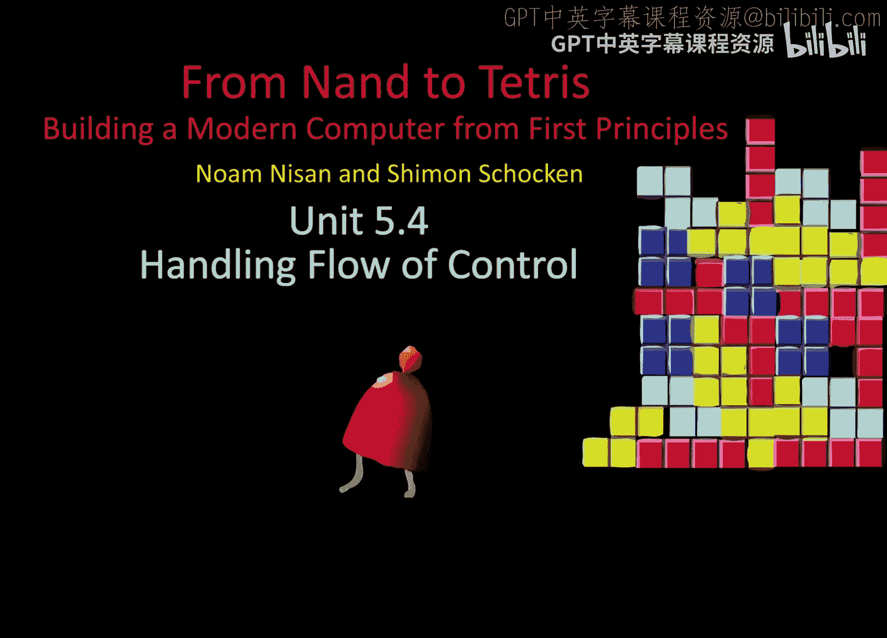

# 058：处理控制流 🚦



在本节课中，我们将要学习如何将高级语言中的控制流语句（如 `if` 和 `while`）翻译成虚拟机语言。这是编译器构建过程中的一个核心挑战。

## 概述

控制流语句决定了程序的执行路径。在 Jack 语言中，主要有五种语句：`let`、`while`、`if`、`return` 和 `do`。其中，`while` 和 `if` 语句的翻译最具挑战性，因为它们涉及条件判断和代码跳转。我们将重点探讨如何利用虚拟机语言中的三个分支命令——`label`、`goto` 和 `if-goto`——来实现这些控制流结构。

## 处理 `if` 语句

上一节我们介绍了控制流翻译的总体挑战，本节中我们来看看如何具体处理 `if` 语句。

`if` 语句在 Jack 语言中的通用结构如下：
```jack
if (expression) {
    // statements 1
} else {
    // statements 2
}
```

为了生成代码，我们首先在概念上将其转换为一个流程图。关键步骤是将条件表达式的结果取反。这样，代码生成会变得更简单、更紧凑。

以下是生成虚拟机代码的步骤：
1.  生成计算表达式值的代码，结果被推入栈顶。
2.  使用 `if-goto` 命令：如果栈顶值（表达式结果）为 `true`（非零），则跳转到标签 `L1`。
3.  使用 `goto` 命令：无条件跳转到标签 `L2`。
4.  在代码流中插入标签 `L1`，后面跟随 `else` 分支的语句代码。
5.  在代码流中插入标签 `L2`，后面跟随 `if` 分支结束后的代码。

编译器会自动生成这些唯一的标签（如 `L1`、`L2`），确保整个翻译过程是确定性的。

## 处理 `while` 语句

理解了 `if` 语句的翻译后，我们再来看看 `while` 循环的处理。它在某种程度上比 `if` 更简单。

`while` 语句的通用结构是：
```jack
while (expression) {
    // statements
}
```

我们同样可以为其构建一个流程图：首先对表达式求值并取反，如果结果为 `true`，则跳出循环；如果为 `false`，则进入循环体执行语句，执行完毕后跳回开头重新评估表达式。

生成的虚拟机代码如下：
1.  插入一个标签，例如 `L1`，作为循环的入口点。
2.  生成计算表达式值的代码。
3.  对结果取反，使用 `if-goto L2`：如果结果为 `true`，则跳转到 `L2`（循环结束）。
4.  生成循环体内语句的代码。
5.  使用 `goto L1` 跳回循环开始处，重新评估条件。
6.  插入标签 `L2`，标记循环结束后的位置。

同样，所有标签都由编译器自动生成和管理。

## 处理复杂情况

我们已经掌握了单个 `if` 和 `while` 语句的翻译。然而，实际程序要复杂得多，我们需要考虑两个额外的细节。

**1. 生成唯一标签**
一个程序通常包含多个控制流语句。编译器必须确保为每个语句生成的标签是全局唯一的，避免跳转目标冲突。这可以通过使用递增的计数器（如 `L1`， `L2`， `L3`...）或结合作用域信息来轻松实现。

**2. 支持嵌套结构**
控制流语句可以相互嵌套，例如 `while` 循环内部包含 `if` 语句，`if` 语句内部又包含另一个 `while` 循环，形成“望远镜”式的代码结构。

幸运的是，我们之前设计的编译器采用了高度递归的编译策略。这意味着编译一个语句时，如果其内部包含其他语句，编译器会自然地递归调用自身来处理它们。因此，嵌套结构的支持是内置的，无需额外处理。

## 能力总结与反思

到目前为止，我们已经掌握了编译一个简单过程式语言所需的核心技术：
*   **处理变量**：在模块的第一个单元中已介绍。
*   **处理表达式**：通过代码生成器算法实现。
*   **处理控制流**：即本节课所学内容。

综合这些能力，我们已经可以为类似 C 语言子集的简单语言编写一个功能完整的编译器。这是一个值得骄傲的成就。

然而，我们也需要认识到以下几点：
*   我们开发的编译器只翻译到**虚拟机语言**这一中间层，而非直接到机器语言。这缩短了编译器需要跨越的“距离”。
*   编译过程之所以如此优雅和易于管理，很大程度上得益于我们之前建立的**虚拟机抽象层**。编译器编写者只需生成 `push`、`pop`、`label`、`goto` 等虚拟机命令，而无需关心它们底层是如何实现的，因为这些已在之前的项目和模块中完成。

这充分体现了**模块化软件工程**的巨大优势：通过分层和抽象，复杂系统的构建变得可控、清晰且高效。

## 总结


本节课中我们一起学习了如何将高级语言中的 `if` 和 `while` 控制流语句翻译成虚拟机代码。我们掌握了其通用的代码生成模式，并讨论了如何处理多语句和嵌套语句的复杂情况。至此，我们已具备了构建一个简单编译器所需的主要技术组件。在下一单元，我们将进入一个更有趣的领域：学习如何处理面向对象代码中对象的创建与操作。