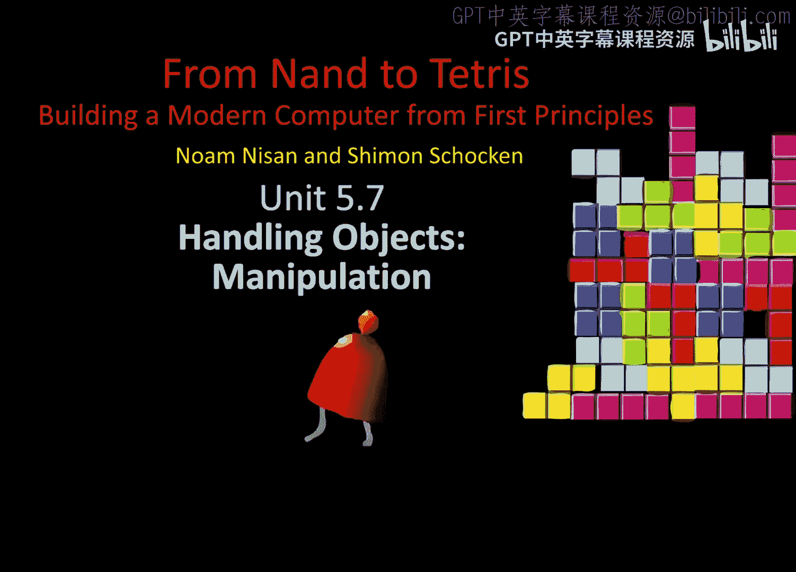

# 061：操作



在本节课中，我们将学习如何编译面向对象代码中的方法调用和方法本身。我们将看到，编译器如何将高级的、面向对象的语法（如 `p1.distance(p2)`）转换为底层的、过程式的虚拟机指令。

## 概述

上一节我们介绍了对象的构造，本节中我们来看看如何操作对象。对象操作主要涉及两方面：首先，我们需要知道如何编译调用方法的客户端代码；其次，我们需要讨论如何编译方法本身的代码。

## 方法调用的编译

当我们在高级语言中调用一个对象的方法时，例如 `p1.distance(p2)`，其语法遵循面向对象哲学：先指定要操作的对象，再指定方法名，最后提供参数。然而，底层的虚拟机语言并不理解对象。因此，编译器的核心挑战是将这种面向对象的表达方式转换为过程式的表达方式。

以下是通用的转换技术：
1.  将方法调用所操作的对象作为第一个**隐式参数**压入栈。
2.  将方法调用中显式提供的所有参数压入栈。
3.  调用对应的方法。

以 `p1.distance(p2)` 为例，其编译后的核心逻辑是：
```
push p1    // 将对象 p1（即其基地址）作为第一个参数
push p2    // 将显式参数 p2 作为第二个参数
call Point.distance // 调用方法
```
这里“推送对象”实际上是指推送该对象在内存中的**基地址**，该地址存储在对应的变量（如 `p1`）中。

## 方法本身的编译

现在，让我们将注意力转向方法本身的编译，以 `Point` 类中的 `distance` 方法为例。方法被设计为操作**当前对象**（在大多数语言中用 `this` 关键字表示）。为了访问当前对象的字段（如 `x`, `y`），我们需要正确地设置 `this` 指针。

以下是编译一个方法（如 `distance`）的关键步骤：
1.  **建立符号表**：编译方法声明和局部变量声明时，不生成实际代码，而是创建子程序级的符号表，记录 `this`（作为参数0）和所有参数、局部变量。
2.  **锚定 this 指针**：生成代码，将传入的当前对象的地址（即参数0）设置到 `pointer 0`，从而让 `this` 段指向正确的内存位置。
    ```
    push argument 0
    pop pointer 0
    ```
3.  **编译方法体**：根据符号表，使用 `this 0`, `this 1` 等访问对象字段，使用 `argument 1`, `local 0` 等访问参数和局部变量，并生成对应的运算指令。
4.  **返回值处理**：方法结束时，必须通过 `return` 命令返回一个值。对于有返回值的方法，返回值应位于栈顶。

## 处理 Void 方法

Void 方法（不返回值的方法）的编译与普通方法类似，但有一个重要区别：根据虚拟机规范，**所有被调用的子程序都必须返回一个值**。

因此，编译 void 方法时：
1.  在方法结尾，我们需要推送一个**虚拟值**（例如 `push constant 0`），然后执行 `return`。
    ```
    // 在 void 方法（如 print）的结尾
    push constant 0 // 推送一个虚拟返回值
    return
    ```
2.  在**调用方**，编译器必须生成额外的指令来清理这个无用的返回值，以保持栈的整洁。
    ```
    call Point.print // 调用 void 方法
    pop temp 0       // 丢弃无用的返回值
    ```

这是一个约定：void 方法返回一个虚拟值，而调用方负责将其从栈中弹出。

## 总结


本节课中我们一起学习了对象操作的核心编译技术。我们了解到，编译器通过将对象作为隐式首参数传递，将面向对象的方法调用桥接到了过程式的底层。在编译方法时，关键步骤是锚定 `this` 指针以访问对象字段。此外，无论是普通方法还是 void 方法，都必须遵守底层的返回值约定。掌握了这些，你就理解了计算机在幕后如何处理对象，为我们接下来学习数组的处理打下了基础。