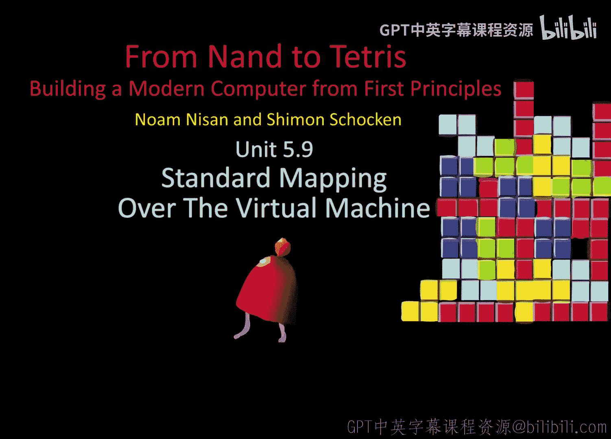
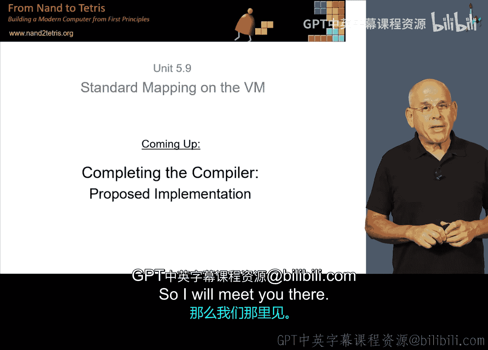

# 063：虚拟机上的标准映射 🗺️

在本单元中，我们将讨论一组约定。建议J语言编译器的开发者遵循这些约定。我们将这组约定统称为“虚拟机上的标准映射”。

## 概述

首先，让我们回顾一下整体架构。我们正在开发一个编译器，这个编译器是两层的。首先，我们将代码从Jack高级语言编译到虚拟机代码，然后再将虚拟机代码编译到目标平台。第二部分已在模块1和2中完成，而本模块及前一个模块则负责填补Jack语言与虚拟机之间的鸿沟。因此，出于实际目的，我们可以忽略虚拟机代码以下的所有细节，专注于将Jack程序翻译成虚拟机代码。

现在思考一下，当你编写Jack、Java或C++程序时，你会创建各种实体，例如类、函数、构造函数、方法等。然而，当你需要将这些实体翻译到虚拟机层面时，结果看起来会完全不同。在虚拟机层面，我们不知道什么是对象，也不知道什么是构造函数。我们只有栈和虚拟内存段，必须设法将每一个高级构造映射到虚拟机的现实上。如何实现这一点，我们已在本模块中讨论过。现在，我想总结并整合所有从高级语言映射到虚拟机层面时必须遵循的规则。我们通过一份称为“虚拟机平台标准映射”的文档或标准集来实现这一点。

顺便提一下，如果你想为其他语言（如Java、C++等）创建编译器，那么对于每一种语言和编译器，都需要一份不同的标准映射文档，因为每种语言都有不同的构造，尽管许多地方非常相似。在本课程中，我们专注于Jack语言，因此我们将讨论如何将Jack映射到虚拟机。

## 文件与子程序映射约定 📁

一个Jack程序由一个或多个类组成，每个类有唯一的名称。每一个类文件都将被翻译成一个具有相同文件名的虚拟机文件。在此过程中，源代码中的每一个子程序都将被翻译成虚拟机层面的一个函数。

因此，每个子程序对应一个函数，每个文件对应一个虚拟机文件。

请注意，一个拥有k个参数的Jack构造函数或函数，将被编译成一个同样操作k个参数的虚拟机函数。在示例中，我们看到`new`是一个构造函数，在Jack层面有一个参数，在虚拟机层面也将有一个参数。同样的情况也适用于函数`buzz`。

那么方法呢？方法的情况稍微复杂一些。一个拥有k个参数的Jack方法，将被编译成一个操作`k+1`个参数的虚拟机函数。在这个例子中，`bar`方法在Jack层面只有一个参数`x`，但在虚拟机层面将有两个参数。我们稍后会详细阐述这一点，实际上我们在本模块早期讨论对象操作时已经提到过。

观察图表，你会发现一个有趣的现象：子程序的类型（无论是构造函数、方法还是函数）在翻译过程中“丢失”了。因为在到达虚拟机层面时，所有内容都将被映射为函数。因此，我们必须通过某些约定来捕获构造函数、函数和方法的语义，例如刚才讨论的“方法比源代码多一个参数”的规则。关于这一点，我们后面还有更多要说的。

## 变量映射 🧮

在Jack语言中，我们有四种变量：局部变量、参数变量、静态变量和字段变量。每一种都有特定的处理方式。

*   **局部变量**：某个Jack子程序的局部变量被映射到虚拟内存段`local`。例如，如果`x`和`y`是你的子程序中声明的头两个局部变量，那么`x`将被映射到`local 0`，`y`将被映射到`local 1`。后续的变量将依次映射到`local 2`、`local 3`等。
*   **参数变量**：处理方式完全相同。第一个参数映射到`argument 0`，第二个映射到`argument 1`，依此类推。
*   **静态变量**：被映射到与当前编译文件关联的虚拟内存段`static`。映射方式类似：第一个静态变量映射到`static 0`，第二个映射到`static 1`，依此类推。
*   **字段变量**：当前对象的字段变量处理如下。首先，我们必须假设`pointer 0`已经指向了这个对象（当前子程序生成的代码会完成这件事）。如果已经完成，那么这个对象的第`i`个字段在虚拟机层面就映射到`this i`。例如，如果`x`是一个属性或字段，它将映射到`this 0`；如果`y`也是一个属性，它将映射到`this 1`，依此类推。

## 数组处理 📊

对于数组，我们提出以下约定。如果你试图访问任何数组条目`arr[i]`，你应该这样做：

1.  首先，将`pointer 1`设置为该条目的地址，即`arr + i`。
2.  完成这个初始“锚定”后，你就可以通过访问`that 0`来简单地访问该条目。

无论`i`是18还是312，你总是将`pointer 1`指向它，然后访问`that 0`。我们发现这是在编译器中处理数组最简单的方法。

## 编译子程序的约定 🔧

在Jack中，我们有三种子程序：方法、构造函数和函数。让我们分别讨论每一种。

### 编译方法

编译Jack方法时，编译器必须确保生成的代码**首先将`this`虚拟内存段的基地址设置为`argument 0`**。这是因为我们有一个非常重要的约定：方法的调用者会在调用该方法之前，将方法要操作的对象地址作为第一个参数压入栈。因此，当方法开始运行时，它需要操作当前对象。我们通过将`this`设置为`argument 0`的内容来实现这个抽象。一旦完成，我们就可以如前所述，将`this 0`、`this 1`、`this 2`等作为当前对象字段的占位符来引用，这非常方便且合理。

### 编译构造函数

编译构造函数时，我们首先必须在内存中为要创建的对象分配空间。完成之后，我们将这个新内存块的基地址设置为`this`段。通过这样做，我们再次建立了对该对象的访问，然后就可以使用`this 0`、`this 1`、`this 2`等来执行构造函数可能想做的任何事情。例如，构造函数通常喜欢将对象字段设置为各种初始值，现在它们可以做到了，因为我们已经建立了对新构造对象的访问。

在返回之前，请记住，构造函数的虚拟机代码还必须记得将新构造对象的基地址返回给调用者。考虑到这一点，我不确定我们是否必须在标准映射中特别说明这一点，因为在Jack层面，我们已经要求构造函数必须总是返回`this`。由于在Jack层面有这个要求，编译器会自动生成处理`return this`的代码，因此我们也不必在这里提及。不过，在这里提及这个重要约定也无妨。

### 编译无返回值函数/方法

无返回值函数和方法在Jack层面不返回值。然而，在虚拟机层面，它们必须返回一个值，因为这是虚拟机函数的要求。既然必须返回点什么，我们决定，如果遵循我们的标准映射，我们要求返回`constant 0`。顺便提一下，无返回值子程序的调用者必须记住它调用的是一个无返回值子程序，因此当子程序返回时，它要做的第一件事就是丢弃栈顶元素（即包含`constant 0`的那个值）。我们接下来会讨论如何处理子程序调用。

## 处理子程序调用的约定 📞

当我们编译一个典型的子程序调用（如`subroutineName(arg1, arg2, ...)`）时，调用者必须将参数压入栈，然后调用子程序。即执行`push arg1`、`push arg2`等，然后`call subName`。

如果这个子程序是一个**方法**，那么调用必须记住，它要做的第一件事是压入一个对方法要操作的对象的引用，然后才继续压入`arg1`、`arg2`等，并调用该方法。你看，一切是如何连接起来的：一旦你这样做了，从被调用方法的角度看，当前对象的地址就成为了我们之前讨论的`argument 0`的值。

至于调用**无返回值子程序**，它在Jack中不返回值，但在虚拟机层面会返回一个我们约定为`constant 0`的虚拟值。因此，在子程序返回后，子程序调用的编译代码必须弹出并忽略这个返回值。

## 处理常量 🔢

Jack中有三个常量：`null`、`false`和`true`。以下是它们的处理方式：
*   `null` 和 `false` 映射到 `constant 0`。
*   `true` 映射到 `constant 1`。

对于 `-1`，我们可以简单地生成先压入`1`再执行`neg`命令的代码，这将有效地将`-1`置于栈顶。

## 类与子程序 🏗️

基本的Jack操作系统被实现为一组八个虚拟机类，名称如`Math.vm`、`Memory.vm`等。我们将在课程的下一个（也是最后一个）模块6中详细讨论并实现这些类。所有操作系统类文件必须与编译器生成的虚拟机文件位于同一目录中。因此，在目录层面，你的应用程序文件和操作系统文件没有区别，它们都被视为一个大的虚拟机文件集合。因此，你的代码中的任何虚拟机函数都可以调用这些操作系统类中的任何虚拟机函数。

## 特殊操作系统服务 ⚙️

显然，如果你编写Jack编译器，必须记住以下几点：
1.  **乘法命令**：必须通过调用`Math.multiply`来处理。
2.  **除法命令**：必须生成调用`Math.divide`的代码。
3.  **字符串常量**：使用构造函数`String.new`和所需字符串的长度来创建。
4.  **字符串赋值**：例如 `x = "NAND"`，这个由四个字符组成的字符串，通过四次调用`String.appendChar`来处理。编译器必须再次提供这种抽象。
5.  **对象构造**：需要在RAM中为新对象分配空间。因此，在构造函数的某个地方，我们必须调用`Memory.alloc`。所需的大小将根据我们要创建的对象中的字段数量推导出来。因为在Jack中一切都是16位的，所以字段数量与容纳此对象所需的RAM字数或RAM位置数量之间存在一一对应的关系。
6.  **对象回收**：使用操作系统函数`Memory.deAlloc`来处理。

以上就是Jack编译器开发者在编写针对我们虚拟机的编译器时，需要牢记在心的所有内容。

## 总结

在本单元中，我们一起学习了Jack语言到虚拟机的“标准映射”。我们详细探讨了如何将Jack程序中的文件、子程序（方法、构造函数、函数）、各类变量（局部、参数、静态、字段）、数组以及常量映射到虚拟机层面的对应表示。我们还了解了编译不同类型子程序时必须遵循的特定约定，以及如何处理子程序调用和利用操作系统提供的特殊服务。这些约定是构建一个正确、高效的Jack编译器的基石。在下一个单元，我们将讨论如何实际构建这个编译器，以及我们推荐遵循的API结构。