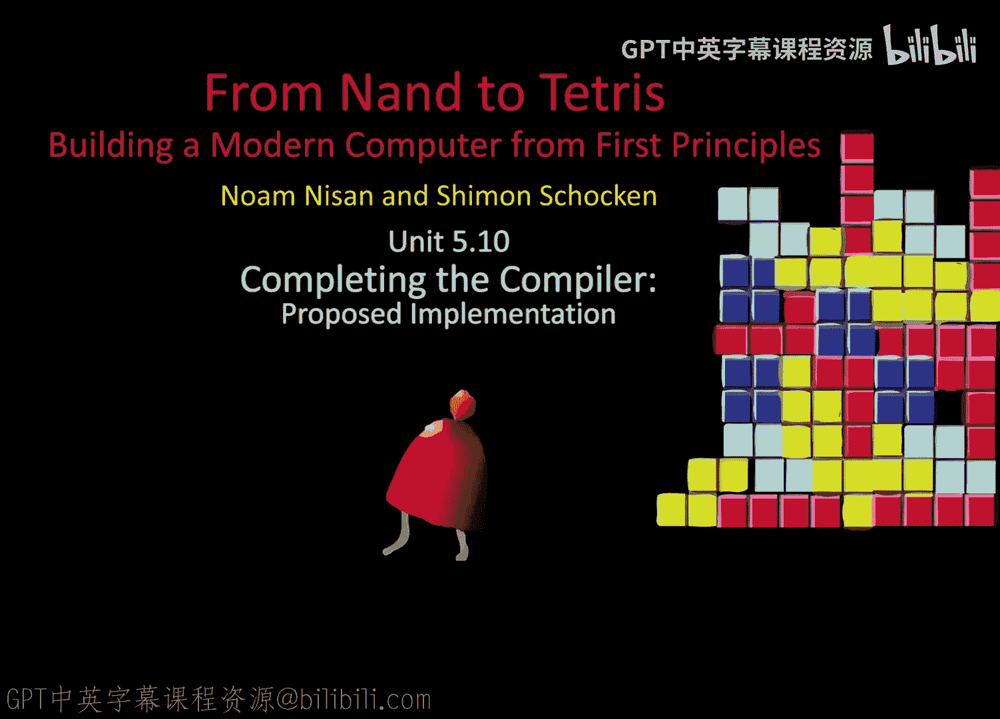
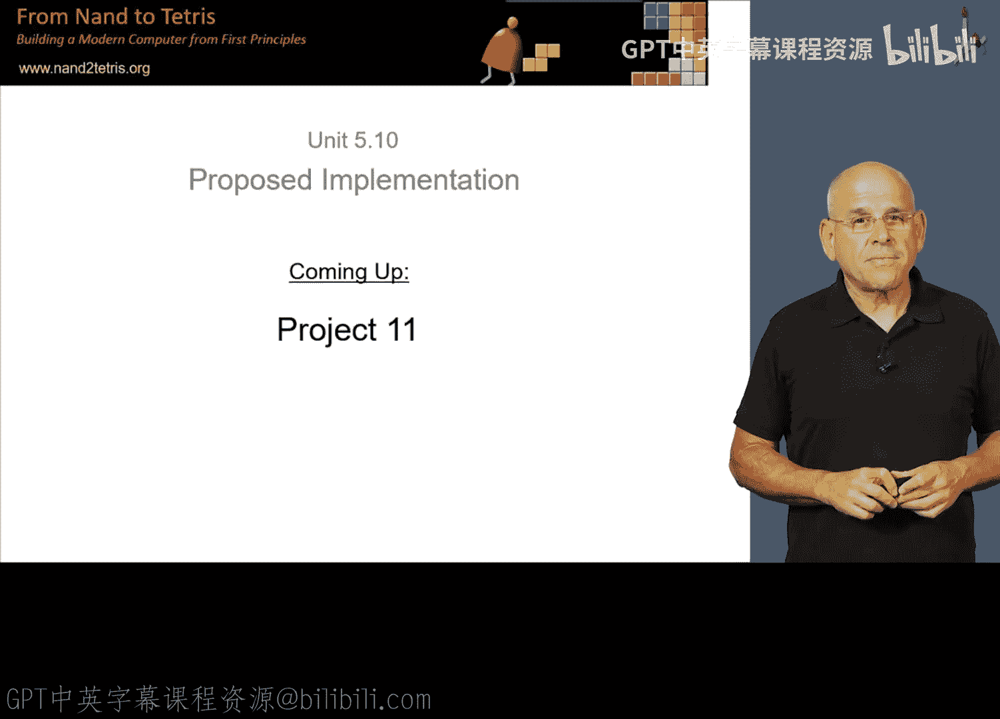

# 064：编译器完整实现建议方案 🛠️



在本单元中，我们将讨论如何实际构建编译器。我们将基于之前单元中介绍的标准VM映射约定，逐步讲解编译器的整体架构和实现模块。

## 概述

在之前的项目10中，我们编写了一个生成XML代码的语法分析器。现在，我们需要将这个软件改造为一个生成VM代码的程序，即我们的Jack编译器。我们将分步进行，并基于五个独立的模块来构建编译器的软件架构。

## 编译器整体架构

以下是编译器的整体架构和路线图。编译器将包含五个主要模块：Jack编译器（主程序）、Jack分词器、符号表、VM写入器和编译引擎。本单元我们将重点讨论符号表和VM写入器。

## Jack编译器类

Jack编译器是驱动整个编译过程的主程序。它的用户级功能如下：如果输入是一个`.jack`文件，编译器将生成一个同名的`.vm`文件；如果输入是一个目录名，编译器将为该目录中的每个`.jack`文件生成一个对应的`.vm`文件。

对于每个源`.jack`文件，编译器会创建一个Jack分词器对象来处理输入，并创建一个输出的`.vm`文件。然后，编译器使用符号表、编译引擎和VM写入器来生成VM代码，并将其写入输出文件。

## Jack分词器

Jack分词器模块在项目10中已经开发完成，我们可以直接使用，无需为完整规模的编译器进行修改。

## 符号表

符号表是一个新模块，用于跟踪程序中的各种符号或变量。在Jack语言中，主要有类级别的变量（字段和静态变量）和子程序级别的变量（参数和局部变量）。

### 符号表示例

考虑以下`Point`类的示例：

```java
class Point {
    static int pointCount;
    field int x, y;
    method int distance(Point other) {
        var int dx, dy;
        // ... 方法体
    }
}
```

*   **类级别符号表**：跟踪`x`、`y`（字段）和`pointCount`（静态变量）。这些变量在整个类中可见。
*   **子程序级别符号表**：跟踪`other`（参数）和`dx`、`dy`（局部变量）。这些变量仅在`distance`方法内可见。

编译器最多只需要两个符号表：一个类级别符号表和一个子程序级别符号表。每当开始编译一个新类时，类级别符号表被初始化；每当开始编译当前类中的一个新子程序时，子程序级别符号表被重置。

### 符号表API

符号表类（例如用Java实现）应提供以下方法：

*   **构造函数**：`SymbolTable()` - 创建一个新的空符号表。
*   **开始子程序**：`startSubroutine()` - 重置子程序级别符号表，开始一个新的子程序作用域。
*   **定义符号**：`define(String name, String type, String kind)` - 向当前作用域的符号表添加一个新符号。`kind`可以是`STATIC`、`FIELD`、`ARG`或`VAR`。
*   **变量计数**：`varCount(String kind)` - 返回当前作用域中已定义的指定`kind`的变量数量。
*   **查询方法**：
    *   `kindOf(String name)` - 返回指定名称符号的`kind`。
    *   `typeOf(String name)` - 返回指定名称符号的`type`。
    *   `indexOf(String name)` - 返回指定名称符号在其作用域和种类内的索引号（从0开始）。

### 实现建议

符号表抽象结构可以使用经典的数据结构**哈希表**来实现。我们可以使用一个哈希表表示类作用域，另一个哈希表表示子程序作用域。开始编译新的子程序时，后一个哈希表被清空重置。

**一个重要提示**：在编译无错误的Jack代码时，任何在子程序符号表和类符号表中都找不到的符号，必定代表一个子程序名或类名。这个提示在编写编译器时非常有用。

## VM写入器

VM写入器的任务是生成VM代码并将其写入输出的`.vm`文件。

### VM写入器API

VM写入器类应提供以下方法：

*   **构造函数**：`VMWriter(String outputFile)` - 创建一个新的输出文件/准备写入。
*   **写入Push命令**：`writePush(String segment, int index)` - 生成一条`push segment index` VM命令。
*   **写入Pop命令**：`writePop(String segment, int index)` - 生成一条`pop segment index` VM命令。
*   **写入算术命令**：`writeArithmetic(String command)` - 生成一条算术/逻辑VM命令，如`add`、`sub`、`eq`等。
*   **写入标签**：`writeLabel(String label)` - 生成一条`label label` VM命令。
*   **写入Goto命令**：`writeGoto(String label)` - 生成一条`goto label` VM命令。
*   **写入If-Goto命令**：`writeIf(String label)` - 生成一条`if-goto label` VM命令。
*   **写入Call命令**：`writeCall(String name, int nArgs)` - 生成一条`call name nArgs` VM命令。
*   **写入Function命令**：`writeFunction(String name, int nLocals)` - 生成一条`function name nLocals` VM命令。
*   **写入Return命令**：`writeReturn()` - 生成一条`return` VM命令。
*   **关闭**：`close()` - 关闭输出文件。

这个模块相对简单，但从软件工程角度看很重要，因为它封装了所有与生成编译器输出相关的活动。

## 编译引擎

编译引擎从Jack分词器获取输入，并利用VM写入器将输出写入文件。它被组织为一系列`compileXxx()`例程，其中`Xxx`是Jack语言中的一个语法元素（例如`compileClass()`、`compileSubroutine()`、`compileWhile()`等，大约有15个）。

这些例程之间的约定是：每个`compileXxx()`例程应该从输入中读取`Xxx`构造，将输入恰好推进到`Xxx`之后，并发出实现`Xxx`语义的VM代码。如果该元素是表达式的一部分，那么发出的VM代码应计算其值并将其置于VM栈顶。

编译引擎的API与项目10中编写语法分析器时使用的API完全相同。然而，在本项目中，我们需要将这个生成XML代码的API，改造为生成可执行VM代码的API。

## 总结



在本单元中，我们一起学习了完整Jack编译器的建议实现方案。我们回顾了编译器的整体架构，并详细介绍了其核心模块：Jack编译器（主驱动）、Jack分词器（已就绪）、符号表（用于管理变量作用域和属性）、VM写入器（用于生成VM代码）以及编译引擎（负责语法分析和代码生成的核心逻辑）。下一单元（项目11概述）将提供逐步指南，教你如何实际执行和测试从生成XML代码到生成可执行VM代码的转变。