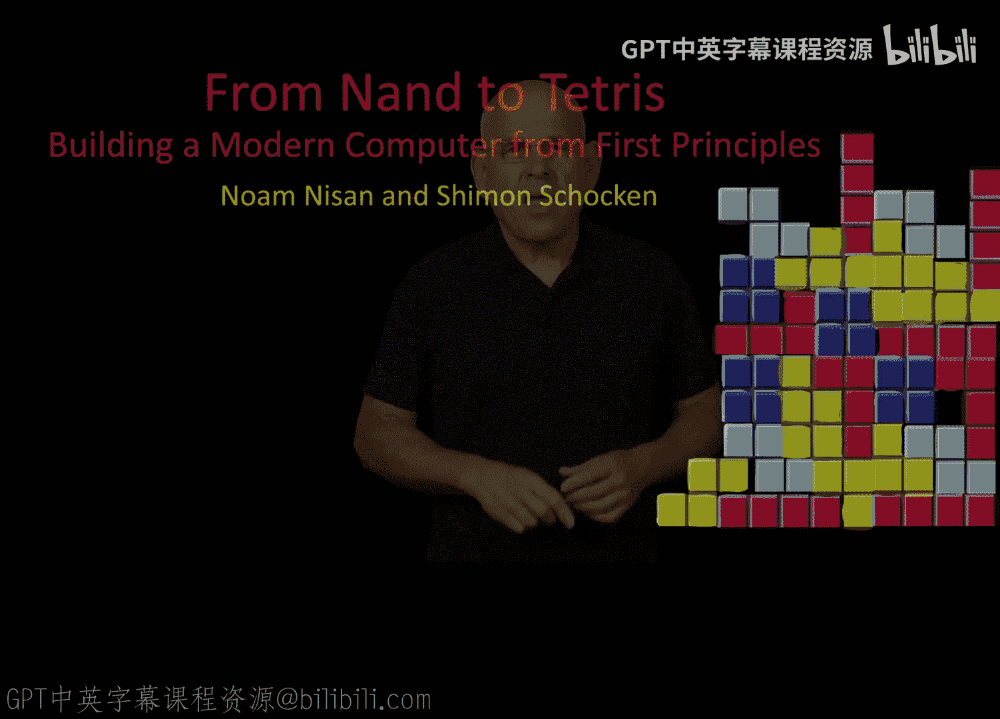

# 066：视角 🧠

在本节课中，我们将探讨代码生成单元的一些常见问题，包括Jack语言的简化特性、将其扩展为更复杂语言的挑战，以及编译器优化的概念。

---

## Jack语言的简化特性

上一节我们介绍了代码生成的基本原理，本节中我们来看看Jack语言为何相对简单。Jack语言的设计包含了几项关键简化，这使得为其编写编译器的工作量大大减少。

以下是Jack语言的主要简化之处：

*   **缺乏类型系统**：所有数据值都是16位，任何类型的值都可以赋值给任何其他类型的变量。这允许编译器几乎完全避开处理类型问题带来的麻烦。
*   **不支持继承**：所有方法调用都可以在编译时静态处理。而在支持继承的语言（如Java）中，编译器必须在运行时解析方法调用，这被称为**动态绑定**或**后期绑定**。
*   **没有公共字段**：从类外部访问字段的唯一方式是通过程序员必须编写的访问器方法。

所有这些简化使得为Jack语言进行代码生成，比工业级语言的编译器要简单得多。

---

## 扩展Jack语言的挑战

了解了Jack语言的简化之处后，本节我们来看看将其扩展为更复杂语言（如Java或Python）的难度。一些扩展需要大量的代码生成工作，而另一些则相对直接。

以下是扩展Jack语言可能涉及的方面：

*   **需要大量工作的扩展**：支持**继承**、**多态**和**动态绑定**需要大量的编译工作。
*   **相对直接的扩展**：
    *   添加`for`循环和`switch`等控制结构。
    *   在现有三种类型之外添加更多数据类型。
    *   允许将字符常量直接赋值给`char`类型变量（目前Jack程序员必须使用字符串函数，这很繁琐）。

总的来说，扩展一门语言需要两项独立的活动：
1.  语言设计者必须谨慎地扩展语言的**语法**。
2.  编译器编写者必须扩展**语法分析器**和**代码生成器**以适应这些变化。

好消息是，大多数这些扩展是彼此独立的，可以通过对现有语法分析器和代码生成器进行相对局部和简单的修改来实现。

---

## 编译器优化的意义

在讨论了语言扩展之后，我们转向另一个核心话题：编译器优化。编译器本身的效率并不重要，重要的是它能生成**高效且优化**的低级代码。

例如，考虑Java中的高级语句 `x++`。

*   一个简单的编译器可能将其翻译成 `push x`, `push 1`, `add`, `pop x` 这样的虚拟机命令，最终可能产生约50行机器码。
*   一个优化的编译器则会识别出这是一个简单的变量递增操作，并直接将其翻译成两条机器指令：`@X` 后跟 `M=M+1`（在Hack平台上）。

生成尽可能紧凑、使用最少时钟周期和硬件资源的代码，是代码生成和编译器一个非常吸引人的特性。我们在本模块开发的虚拟机翻译器并未进行此类优化。

尽管如此，我们开发的代码生成器虽然未经优化，但仍然代表了一项复杂且实质性的工程成就。完成它的开发后，你应该为自己的成就感到自豪——你刚刚完成了一个面向对象的、类Java语言的编译器。

---

## 总结

本节课中我们一起学习了：
1.  Jack语言通过**缺乏类型系统**、**不支持继承**和**没有公共字段**等特性实现了简化。
2.  将Jack扩展为更复杂的语言，有些方面（如支持继承）挑战巨大，而有些方面（如添加新控制结构）则相对直接。
3.  **编译器优化**的核心目标是生成高效的低级代码，而非优化编译器自身，这是我们未来可以探索的方向。

本模块（模块5）到此结束。在下一个模块中，我们将使用Jack语言开发一个操作系统。