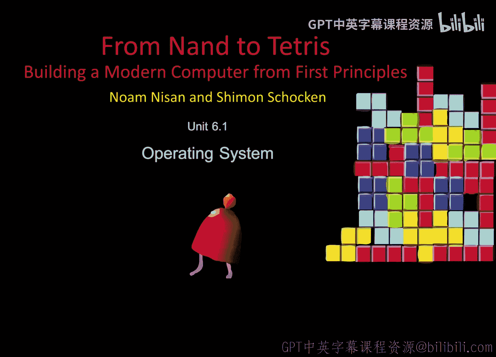
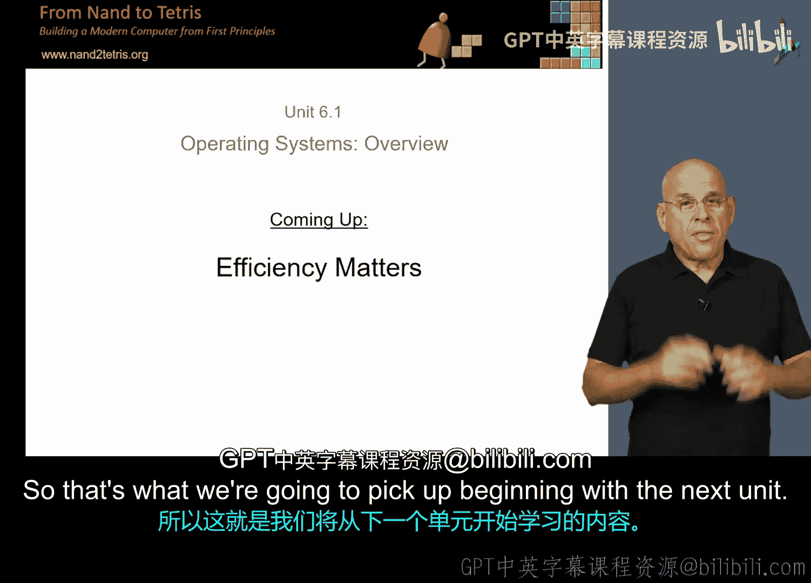

# 067：操作系统概述 🖥️

在本节课中，我们将要学习操作系统的核心概念、其必要性以及我们将在本模块中构建的Jack操作系统的蓝图。

## 课程概述

欢迎来到模块6，这是Nand2Tetris第二部分的最后一个核心模块。我们将讨论关于操作系统的众多不同方面。这个模块让我想起在印度餐厅享用的一顿丰盛晚餐，我们将品尝到许多色彩和风味各异的小菜，相信你会非常享受。

回顾我们的课程全景图，我们现在正处于操作系统模块的位置。没有操作系统在后台提供支持，就无法编写高级程序。操作系统的目标是弥合高级编程与程序赖以执行的底层硬件之间的诸多鸿沟。弥合这些鸿沟并描述这个操作系统，正是本模块的全部内容。

## 为什么需要操作系统？

世界上存在许多操作系统，这里展示了一些广为人知的系统图标。此外，还有一个不那么知名但我们将在本模块中开发的操作系统——Jack操作系统。

那么，为什么我们首先需要操作系统呢？请看这段用Jack语言编写的高级代码。你会发现，这段代码中多次调用了本类中不存在的方法。这些方法很可能存在于其他类中，例如Keyboard、Output、Math。这些类实际上属于Jack语言附带的**标准类库**。

这不是我们发明的。每一种现代高级语言都配备了一个支持它的标准库，Java、C#、Python、C++ 等都是如此。因此，当你开发一种高级语言时，该语言的用户会期望获得一个支持它的标准库。

## 操作系统的视角

从高级程序员的角度来思考操作系统，可以将其视为属于某个标准库的一组类。高级程序员期望获得各种数学计算功能的实现，例如**平方根**。他们期望获得数据结构方面的支持，如字符串、栈、数组等。

程序员期望能够以高级、抽象和便捷的方式与输入设备（如键盘、鼠标，甚至麦克风）进行交互。同样，程序员也期望能够使用一些便捷的API和接口在屏幕上输出文本或图形。因此，作为操作系统的开发者，我们有义务支持所有这些必要的抽象。

## 系统服务

此外，操作系统还应提供各种面向系统的服务，这些服务可能比我们刚才讨论的更偏向底层。

*   **内存管理**：我们必须能够管理主机内存（这里指的是RAM）。否则，当高级程序员想要创建新对象和新数组时，我们将无法帮助编译器完成。
*   **存储管理**：如果我们有海量存储设备（如硬盘、闪存等），我们也必须管理这些存储。为此，我们还需要一些**文件系统抽象**，至少需要支持文件，最好还能支持文件夹和子文件夹等。这些都是人们通常认为理所当然的东西，但显然是需要有人去实现的抽象。
*   **设备驱动**：我们需要开发各种**驱动程序**，这些程序用于在高级程序和低级外围设备（包括键盘、屏幕、鼠标以及绘图仪、打印机等各种你想连接到计算机的设备）之间进行协调。显然，你需要能够与这台计算机对话，因此必须有人实现诸如**命令行界面**和**窗口系统**等功能。
*   **多任务处理**：如今，很多人都希望同时做很多事情，例如写邮件、聊天、写博客、发评论、发布各种消息。为了做到这一点，我们需要为计算机配备**多任务处理**能力，使其能够同时运行多个程序。
*   **网络与安全**：如今没有人是一座孤岛，我们期望计算机能够通过网络与世界上的其他计算机交互。为此，我们必须有软件来协调和控制这些通信。一旦有了通信，我们还必须考虑**安全性**。

因此，我们必须支持所有这些服务，而承担这一重任的“某人”就是操作系统。由此可见，编写操作系统是一项庞大的工程。

## Jack操作系统蓝图

在本课程中，我们不会开发一个功能齐全的操作系统，但会开发一个足够有趣且具有挑战性的系统。它将首先包括你在左侧看到的所有内容，即所有语言扩展。我们还将开发系统服务中的内存管理部分，并在一定程度上开发一些I/O设备驱动程序。其他所有内容将作为可选项目留待未来工作，作为我们Nand2Tetris课程的后续。

以下是我们的Jack操作系统的全貌，它由八个类组成，让我简要介绍一下每一个：

*   **Math类**：提供各种数学运算。Java的Math类有大约60或70个数学函数（尽管许多函数是重载的，所以实际数量更少）。我们提供这个选择，显然如果需要可以添加更多。
*   **Memory类**：这个类很经典，因为它包含任何操作系统中都存在的一些基本操作：`peek`、`poke`、`alloc`、`deAlloc`。这些词现在可能没有意义，但很快你就会明白它们的重要性。
*   **Screen类**：提供一个允许你在屏幕上绘制图形的类，可以画线、圆、一些多边形。我们将广泛使用它，实际上我们在之前的一些项目中已经使用过了。
*   **Output类**：我们将广泛使用另一个类`Output`，以便在屏幕上输出文本。
*   **Keyboard类**：通过这个类，我们可以与使用键盘的用户进行交互。
*   **String类**：字符串处理类，与Java的String类和C#中使用的类非常相似。我们将开发所有这些功能。
*   **Array类**：这在Jack中有些独特，因为在Jack中，数组不像在其他一些语言中是语言的原始部分。相反，我们决定使用操作系统来实现数组。通过这样做，数组变得与对象非常相似。实际上，Java和C#中也是如此，但我们没有时间深入探讨。这对高级程序员是隐藏的。
*   **Sys类**：包含一些有用的服务。

这就是我们的操作系统。要知道，有些人就是以开发操作系统为生的。

## 理论与实践

这些人基本上分为两类。首先是**理论家**，他们是算法和数据结构的专家。他们根据我们这里提到的需求，设计出各种巧妙的算法和数据结构，旨在高效地实现这些需求。然后是另一类人，他们将这些伟大的想法付诸实践，用C++、C等语言编写程序来实现这些数据结构和算法。

在本课程中，我们将同时采用这两种视角。在本模块的后续单元中，每个单元都将以一些理论讨论开始，探讨在算法和数据结构方面需要什么。然后，单元的后半部分将实际使用Jack语言实现这些想法。因此，Jack操作系统是用Jack语言编写的，就像Unix操作系统是用C语言编写的一样。我们还需要一些引导能力，这也将是本模块的一部分。

## 本模块的收获

本模块有许多值得学习的要点，这里只列出了其中几个。我们将深入学习应用计算机科学中这些超级重要的兴趣领域，并且将从高层次和低层次两个角度去学习。在本模块结束时，你将对这些内容有深入骨髓的理解。

我们将如何做到这一点呢？这个模块是一个绝佳的机会，让我和Noam可以向你们介绍一些用于管理资源、在屏幕上绘制图形等的优美算法。为了实现这些算法，我们还将向你们介绍巧妙编程的艺术，并给你们一些关于如何控制围绕软件的宿主平台的想法。当然，我们还将提供大量关于如何使用我们可用的所有工具来实际构建它的实现技巧。这就是我们的计划。

## 关于效率的说明

在结束本单元之前，我想简单谈谈效率问题。到目前为止，在本课程中，我们允许自己在效率方面有些“马虎”。我们不太担心效率，只希望事情能运行起来，不在乎它们是快是慢。但当涉及到开发操作系统时，效率至关重要。因为我们开发的算法将服务于在这些算法之上所做的一切。如果某个服务运行得不够快，那么所有运行在该服务之上的应用程序都会变得迟缓。反之，如果你能在底层优化某些东西，那么所有使用它的人都会视你为大英雄。因此，在操作系统层面，我们不能再对效率问题一无所知，我们必须非常聪明地设计程序的运行方式。这就是我们从下一个单元开始将要学习的内容。

## 课程总结

本节课中我们一起学习了操作系统的核心作用，它作为高级程序与底层硬件之间的桥梁，提供了必要的抽象和服务。我们概述了Jack操作系统的八个核心组件，并理解了开发操作系统需要兼顾算法理论与工程实践。最后，我们认识到在操作系统开发中，效率是至关重要的考量因素。