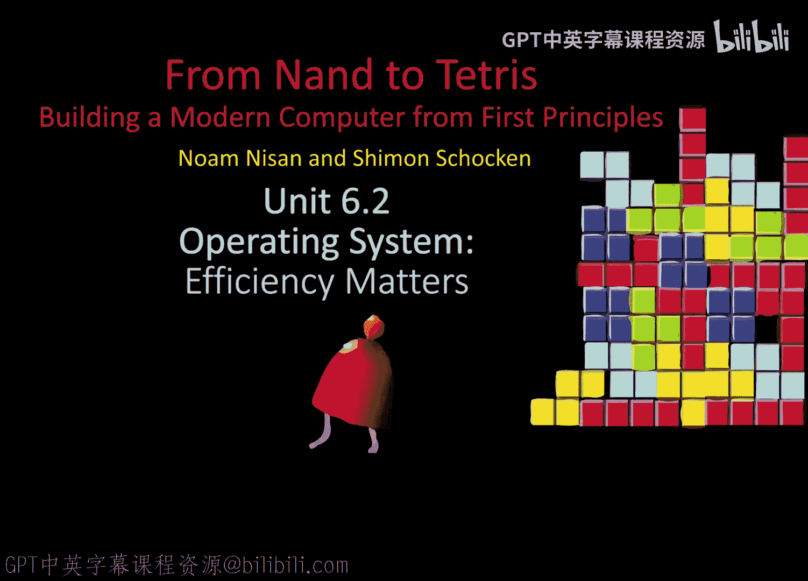
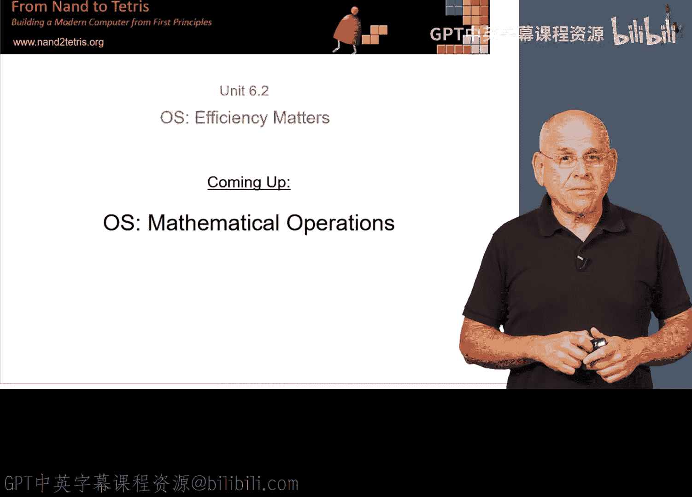

# 068：效率问题 ⚙️



在本单元中，我们将探讨操作系统设计中的一个核心议题：效率。我们将以乘法运算为例，分析不同算法的效率差异，并理解为何在底层系统软件中，高效的实现至关重要。

## 概述 📋

正如上一单元所述，我们决定以效率问题的讨论来开启操作系统模块。效率之所以重要，是因为操作系统中的基础服务（例如数学运算）将被无数应用程序乃至操作系统自身的其他部分频繁调用。因此，位于软件层次结构底层的服务，其效率越高，对上层服务的支持就越稳固。以乘法、除法、平方根等运算为例，它们必须足够高效。

## 乘法运算的客户端视角 👁️

在Jack编程中，你可以通过 `x * y` 这样的语法进行乘法运算。编译器足够智能，能够理解星号（`*`）代表调用底层操作系统 `Math` 类中的 `multiply` 方法，并自动将 `419 * 5003` 转换为 `Math.multiply(419, 5003)`。因此，无论使用哪种语法，最终都需要 `Math` 类来提供乘法功能。

## 算法一：重复加法

以下是第一种可能的乘法实现方案，它基于“重复加法”的思想：将 `x` 累加 `y` 次。

> **注意**：从本单元开始，为了专注于算法本身而非语法细节，我们将使用类似Python的缩进来表示代码块，而不再使用Jack语言的花括号和分号。

```python
def multiply(x, y):
    sum = 0
    while y > 0:
        sum = sum + x
        y = y - 1
    return sum
```

### 算法分析

该算法的运行时间完全由 `y` 的值主导。循环将执行 `y` 次。在计算机科学中，我们通常从最保守的角度评估算法，即考虑**最坏情况**。

假设 `n` 是我们可能需要相乘的 `y` 的最大值。那么，在最坏情况下，该算法将进行 `n` 次迭代。每次迭代大约需要执行10次机器级操作（具体数字可能因编译等因素而变化）。因此，总操作数约为 `10 * n`。无论常数是10、20还是40，起主导作用的都是 `n`，所以该算法的运行时间与 `n` 成正比，即 **O(n)**。

如果 `n` 是一个非常大的数，这个算法的运行速度会非常慢。

## 算法二：基于二进制位运算的乘法

现在，让我们考虑第二种解决方案，它基于我们在小学学过的竖式乘法原理，但采用了更适合计算机实现的二进制形式。

例如，计算 `27`（二进制 `11011`）乘以 `9`（二进制 `1001`）：
1.  将乘数 `x`（`11011`）写下。
2.  根据乘数 `y`（`1001`）的每一个二进制位（从最低位到最高位），将 `x` 左移相应的位数后写下。若该位为 `1`，则此行的值有效；若为 `0`，则此行值为 `0`。
3.  将所有有效行的结果相加，得到最终乘积。

一个更系统化的算法描述如下：

```python
def multiply_fast(x, y):
    sum = 0
    shifted_x = x
    W = 16  # 假设字长为16位（在Jack中）
    for i in range(0, W):
        if (y & 1) == 1:        # 检查y的最低位是否为1
            sum = sum + shifted_x
        shifted_x = shifted_x + shifted_x  # 左移一位（相当于乘以2）
        y = y >> 1               # 将y右移一位，检查下一个比特位
    return sum
```

### 算法分析

这个算法有一个非常优良的特性：它的运行时间不依赖于输入数字 `n` 的大小，而是依赖于数字的二进制表示位数 `W`。

*   在Jack中，`W=16`。
*   在现代计算机中，`W` 可能是 64 或 128。
*   表示一个数字 `n` 所需的位数大约是 **log₂(n)**。

因此，该算法的运行时间与 `W` 成正比，即 **O(W)** 或等价于 **O(log n)**。`W` 是一个固定的常数（如16、64），所以无论 `n` 是百万、十亿还是万亿，算法都只进行固定次数的循环（如16次、64次）。

此外，该算法只涉及**加法**和**移位**这两种非常基础且高效的操作。移位操作在二进制中非常简单（例如，左移一位等价于该数自己加自己）。

## 对数级运行时间的威力 💪

为了理解 **O(log n)** 的效率有多高，让我们看一些具体例子。

下表对比了线性时间 **O(n)**（假设系数为10）和对数时间 **O(log n)** 在不同输入规模 `n` 下的运行时间（迭代次数）：

| 输入大小 (n) | O(n) ~ 10n | O(log n) ~ 10 * log₂(n) |
| :--- | :--- | :--- |
| 1,024 | 10,240 | 100 |
| 1,048,576 | 10,485,760 | 200 |
| 1,073,741,824 | 10,737,418,240 | 300 |

从图表上看，随着 `n` 的增长，线性函数（红色）急速上升，而对数函数（蓝色）则缓慢增长，渐近有界。

**对数运行时间的一个关键特性是**：当输入规模 `n` **翻倍**时，算法所需的迭代次数**仅增加 1 个单位**。这是一个非常卓越的特性，具有深远的实际意义。

### 现实世界的例子：网络搜索

你们都在使用搜索引擎在互联网上查找信息。所有搜索引擎的核心都使用了各种版本的**二分查找**算法，该算法的运行时间就是 **O(log n)**。

这意味着什么？
假设互联网上有 **10亿** 个可搜索项，找到一个特定项需要大约 **300** 次迭代（假设常数因子为10）。
*   如果明天互联网规模**翻倍**到20亿项，找到一项需要 **310** 次迭代。
*   如果规模再次**翻倍**到40亿项，则只需要 **320** 次迭代。

可以看到，即使互联网的规模爆炸式增长，搜索时间也仅以对数速度缓慢增加，永远不会变得过大。这生动地展示了**对数级运行时间算法的强大威力**。因此，在计算机科学中，无论是理论还是应用领域，设计出对数级运行时间的算法总是令人欣喜的。

## 总结 🎯

在本单元中，我们围绕**效率**这一主题展开讨论，并以乘法运算为例，比较了线性时间 **O(n)** 算法与对数时间 **O(log n)** 算法的巨大差异。我们了解到，对于操作系统这类底层、基础的服务，采用高效的算法（如基于位运算的乘法）至关重要，因为它会被上层大量调用，其效率直接影响整个系统的性能。对数级算法因其“输入翻倍，耗时仅增一”的卓越特性，在处理大规模数据时具有无可比拟的优势。



在下一单元，我们将以此为基础，继续探讨其他数学运算（如除法、平方根）的高效实现。