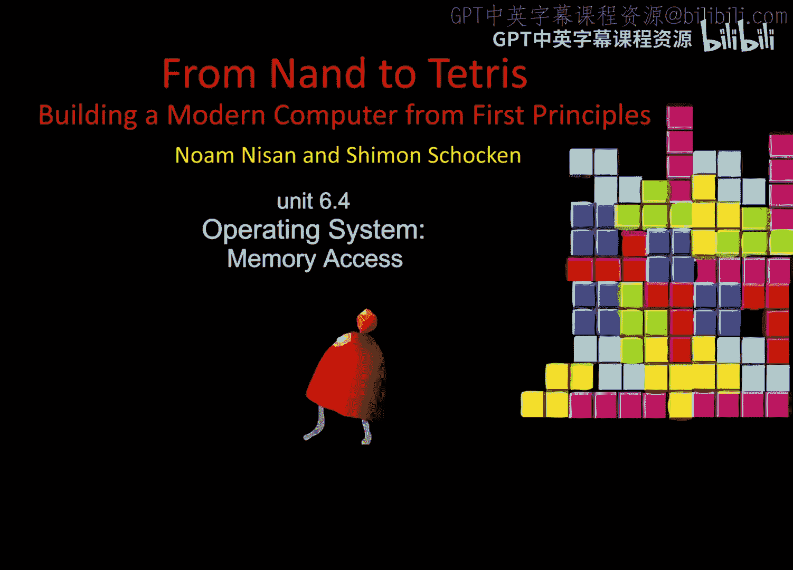

# 070：内存访问 🧠



在本节课中，我们将学习操作系统如何管理内存，特别是如何通过两个基础操作——`peek`和`poke`——来实现对内存的直接访问。我们将从理解需求开始，探讨解决方案，并最终了解如何在Jack语言中实现这些功能。

## 内存管理的需求与解决方案

上一节我们介绍了操作系统在程序与硬件之间扮演的桥梁角色。本节中，我们来看看内存访问的具体需求。

程序运行在宿主计算机的RAM上。然而，高级语言（如Jack）编写的程序并不直接操作RAM，而是通过变量、对象和数组等抽象概念来间接访问。同样，应用程序需要从键盘读取输入或向屏幕输出内容，而无需关心这些操作在硬件层面的具体实现。

操作系统的作用，就是提供一座桥梁，连接高级程序与底层硬件。屏幕和键盘等设备正是通过内存映射技术实现的，这些映射区域也位于RAM中。因此，所有操作最终都归结为对RAM中特定比特位的读写。

## 核心内存操作：Peek与Poke

为了实现对RAM的直接访问，操作系统提供了底层的`peek`和`poke`服务。基于这些基础原语，操作系统可以构建出更高级的功能（如读取和打印），从而为高级程序员提供他们期望使用的抽象接口。

以下是这两个核心操作的定义：

*   **`peek`**：此函数旨在返回RAM中指定地址的值。
    *   **公式/代码描述**：`value = Memory.peek(address)`
*   **`poke`**：此函数接收一个地址和一个值，并将该值设置到RAM的对应地址中。
    *   **公式/代码描述**：`Memory.poke(address, value)`

例如，假设地址`19003`中存储着数字`7`。
*   执行代码 `let x = Memory.peek(19003);` 后，变量`x`的值将变为`7`。
*   执行代码 `Memory.poke(19003, -1);` 后，该地址的内容将变为二进制补码表示的`-1`（即16个`1`）。

## 在Jack中实现内存访问

现在我们已经理解了`peek`和`poke`的功能，本节中我们来看看如何在Jack语言中实现它们。关键在于如何让Jack程序能够访问整个RAM空间。

首先，让我们考虑一个直观但行不通的方案。

### 一个行不通的方案

一个天真的想法是：在内存类中创建一个名为`Ram`的数组，其大小与整个RAM（32768个单元）相同。

```jack
// 这是一个行不通的方案
class Memory {
    static Array Ram;
    ...
}
```

这个方法会失败，原因有二：
1.  Jack编译器会尝试在堆中分配这个巨大的数组，但堆空间不足以容纳它。
2.  即使能分配，通过这种方式创建的数组也无法访问屏幕、键盘等硬件内存映射区域。

### 可行的实现方案

虽然上述方案失败了，但它引导我们找到了正确的解决方案。以下是可行的实现方法。

我们在`Memory`类中创建一个静态数组`Ram`，但关键在于其初始化方式。某些操作系统类拥有不向用户公开的`init`函数，用于内部初始化和簿记工作。我们可以在`Memory.init`函数中执行以下特殊赋值：

```jack
class Memory {
    static Array Ram;

    function void init() {
        let Ram = 0; // 关键步骤：将数组变量指向地址0
    }
    ...
}
```

这个语句 `let Ram = 0;` 看起来很奇怪，因为它将数组当作一个普通变量来赋值。然而，这恰恰是我们需要的技巧。由于Jack是一种弱类型语言，编译器允许这样的操作。

这个技巧之所以有效，是因为它将数组`Ram`的基地址设置为`0`。此后，在程序中任何地方，当我们执行 `Ram[address] = value` 时，实际上访问的是RAM中地址为 `0 + address` 的位置。这样，我们就通过高级语言获得了一个通往整个RAM的“后门”。

当然，这种强大的能力也意味着责任。系统程序员（如操作系统开发者）必须清楚自己在做什么，因为错误的操作可能会破坏栈、堆等关键内存区域。

## 实现Peek与Poke

有了`Ram`数组这个强大的工具，实现`peek`和`poke`函数就变得非常简单。它们本质上只是一两条语句的封装，你可以尝试自己思考如何实现。

## 总结与展望

本节课中，我们一起学习了操作系统内存管理的基础。我们了解了程序为何需要操作系统作为与RAM硬件交互的桥梁，并重点探讨了实现直接内存访问的两个核心底层操作：`peek`（读取内存）和`poke`（写入内存）。更重要的是，我们学习了一个在Jack语言中访问整个RAM空间的巧妙技巧——通过初始化将数组指向地址`0`。


现在，我们已经为`Memory`类打下了基础。掌握了`peek`和`poke`之后，我们就可以在下一单元继续讨论更高级的内存管理功能：`alloc`（内存分配）和`deAlloc`（内存释放）。