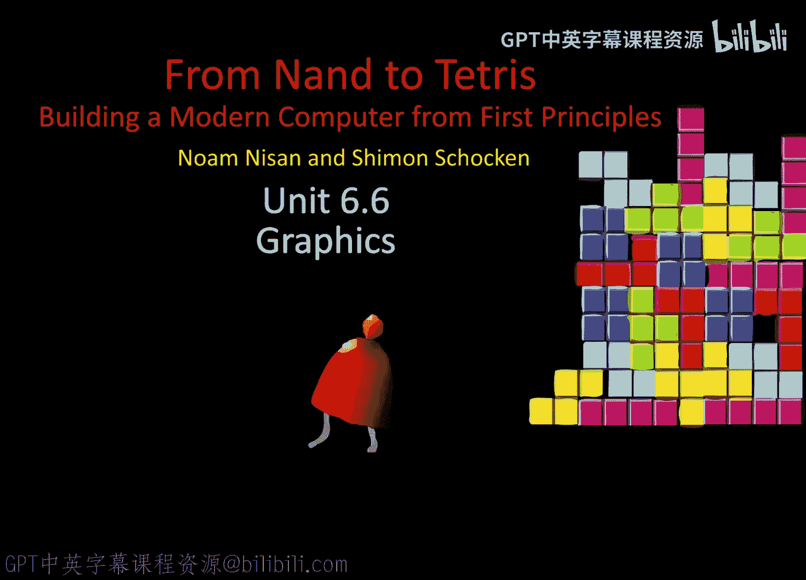

# 072：图形处理 🖥️



在本单元中，我们将学习图形处理的基本概念，并重点介绍如何实现Jack操作系统中用于处理图形操作的`Screen`类。我们将探讨一个图形库，该库提供了在屏幕上绘制图形和像素的几种基本操作。

## 概述

首先，我们将介绍图形的基本概念，特别是两种主要的图形表示技术：位图和矢量图形。接着，我们将深入探讨如何在我们的操作系统中实现最基础的图形操作——绘制单个像素。

## 图形表示技术

上一节我们介绍了本单元的学习目标，本节中我们来看看两种核心的图形表示技术：位图和矢量图形。

请看这两幅看起来相同的图片，它们都是唐老鸭试图理解计算机工作原理的图案。如果我们移除计算机并开始放大图像，一个显著的差异就会显现出来：右侧的图像放大后效果不佳，而左侧的图像则可以完美缩放。

这种差异源于两种不同的图形存储技术。左侧的图像使用**矢量图形**管理，而右侧的图像是**位图**的一个例子。接下来，我们将讨论每种技术的优点，并特别关注矢量图形。

### 位图 (Bitmap)

位图是一种直接的图形存储方式。它将屏幕上的每个像素映射为一个二进制值。

以下是绘制一个杯子的屏幕部分示例。在Jack语言（或Hack计算机）中，我们只有黑白两色（尽管可以轻松添加颜色）。杯子通过打开和关闭像素来绘制。

对应的位图文件会存储这个图像。对于每个白色像素，存储`0`；对于每个黑色像素，存储`1`。这样就得到了一系列数字，它们共同建立了图形与二进制数字之间的一一对应关系。

**核心概念**：位图存储的是每个像素的颜色值。
```
像素颜色值 = 0 (白) 或 1 (黑)
图像数据 = [像素1值, 像素2值, 像素3值, ...]
```

### 矢量图形 (Vector Graphics)

矢量图形存储的不是像素数据，而是一系列描述如何绘制图形的指令。

同样是那个杯子，矢量图形文件可能包含以下指令：首先，从坐标(30)到(110)画一条线，形成杯子的顶部。然后，利用一个大矩形，从(31)到(95)画一个矩形，这样一条指令就描述了大约35个像素。接着，继续画几条线来完成杯子的绘制。

**核心概念**：矢量图形存储的是绘制命令。
```
绘制命令列表 = [
    drawLine(30, 110),
    drawRectangle(31, 95),
    ...
]
```

### 技术对比

以下是两种技术的主要优缺点：

*   **文件大小**：矢量图形文件通常更小，因为它存储的是指令而非每个像素的数据。
*   **缩放性**：矢量图形可以完美缩放。只需按比例调整指令中的坐标参数，即可在任何分辨率下获得清晰的图像。位图缩放则会出现锯齿，需要复杂的插值算法，效果往往不理想。
*   **适用性**：在拥有多种屏幕尺寸（手机、相机、笔记本电脑、平板电脑）的世界里，矢量图形的可缩放性极其重要。此外，矢量图形可以随时转换为位图。

总而言之，矢量图形是一项非常重要的发明，我们的操作系统也将使用它。

## 基础绘图操作

在了解了图形表示的基础后，本节我们将聚焦于实现图形操作所需的三个基本原语。

我们将要探索的三个基本绘图操作是：
1.  绘制单个像素
2.  绘制一条线
3.  绘制一个圆

我们将从绘制像素开始。需要说明的是，绘制像素是位图和矢量图形都需要的操作，它是最基础、最原始的操作。在此基础上，我们可以创建位图或矢量图形。

## 绘制像素的实现原理

现在，让我们深入了解绘制单个像素是如何在硬件和软件层面实现的。

首先需要回顾，在构建Hack计算机时，我们分配了一段特定的内存区域来表示屏幕。我们取用了8K（8192个）寄存器，称之为**屏幕内存映射**。

约定如下：如果我们要在屏幕上绘制像素，只需在内存映射中打开或关闭某些特定位，图像就会“自动”显示在屏幕上。其工作原理是，硬件实现了一个称为**屏幕刷新**的机制。每秒多次，计算机会自动例行刷新，读取内存映射中的所有位，并将其提交到物理屏幕上对应的像素点。

例如，假设我们想在屏幕上绘制坐标为(450, 200)的像素。在Jack中，我们可能会使用这样的命令：`Screen.drawPixel(450, 200)`。这个操作将由操作系统，特别是`Screen`类来实现。

当`drawPixel`例程被调用以绘制这个特定像素时，它会进行以下计算：
1.  确定需要操作的内存字（word）的地址。
2.  确定在该16位字中，需要操作的是哪一位（bit）。

屏幕是二维空间（宽512像素，高256像素），而RAM是一维的16位字数组。两者之间的映射关系是直接的。

通过数学计算，我们可以找到操作字地址的公式：
```
wordAddress = baseAddress + (y * 32) + (x / 16)
```
其中，`baseAddress`是屏幕内存映射的基地址，`x`和`y`是像素坐标。

然后，我们执行以下步骤：
1.  从RAM中该地址读取当前的16位值。
2.  将该值的第`(x % 16)`位设置为当前颜色（1或0）。
3.  将修改后的16位值写回RAM的同一地址。

你可能会问，为什么需要先读取再写入，而不是直接操作特定位？原因有二：
1.  计算机必须以固定大小的数据块（如16位或64位）进行操作，无法直接操作单个位。因此，必须读写整个字来修改其中的一个位。
2.  该字中可能已经绘制了其他相邻像素。通过先读取整个字，然后只修改目标位而不影响其他位，我们可以安全地更新像素，避免破坏周围的图像。

通常，我们会使用位操作（如OR运算）来设置特定位，然后将结果写回内存。

**核心操作流程**：
```
// 1. 计算目标字地址
address = Screen.baseAddress + (y * 32) + (x / 16)
// 2. 读取当前字的值
currentWord = Memory.peek(address)
// 3. 计算掩码并设置特定位
mask = 1 << (x % 16)
newWord = currentWord | mask // 假设是“画黑点”（置1），清空则用AND操作
// 4. 将新值写回内存
Memory.poke(address, newWord)
```

值得注意的是，`Screen`类中的`drawPixel`子程序会调用`Memory`类中的`peek`和`poke`子程序。这种操作系统模块间的相互依赖关系是非常典型的。

## 总结


本节课中我们一起学习了图形处理的基础。我们比较了位图和矢量图形两种技术，了解了矢量图形在文件大小和可缩放性方面的优势。我们深入探讨了在Hack计算机平台上绘制单个像素的实现原理，包括屏幕内存映射的概念、像素坐标到内存地址的换算，以及通过读取-修改-写入流程来安全更新像素值的方法。在下一单元，我们将在此基础上学习如何绘制一条线。