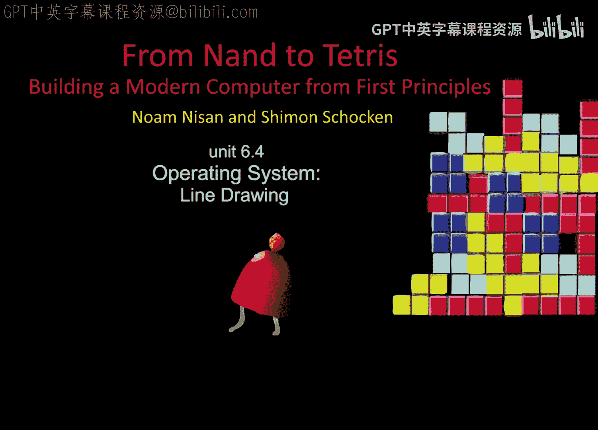
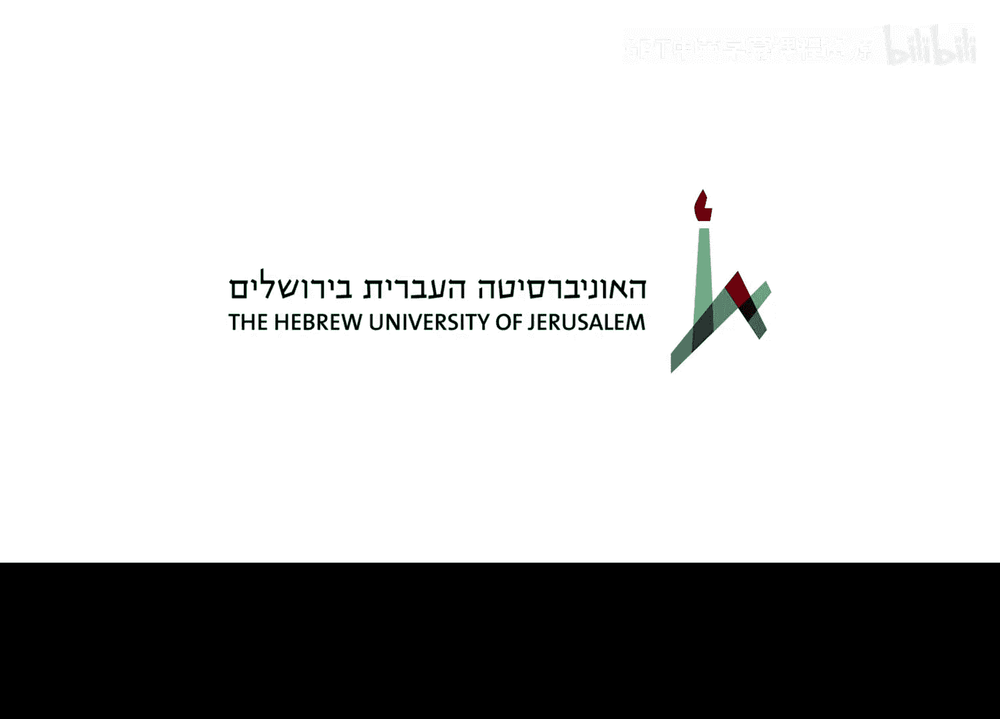

# 073：线段绘制 🖌️



在本节课中，我们将学习如何绘制线段。上一节我们介绍了矢量图形和位图图形，并讨论了矢量图形的优点。我们决定实现三个图形基元：绘制单个像素、绘制线段以及绘制圆形。本节我们将从绘制像素出发，学习如何使用绘制像素功能来绘制线段，以及如何利用绘制线段功能来绘制圆形。

## 线段绘制的动机

矢量图形的一个优点是，所有图形都由简单的代数语句控制。例如，我们可以将一组多边形分解为若干子图像，每个子图像都使用矢量图形绘制。以绘制鸟喙为例，我们可以通过连续绘制多条线段来构成这个多边形。

图像绘制是一系列线段绘制操作的集合。因此，线段绘制的速度至关重要。如果绘制速度慢，整个图形渲染过程就会变得迟缓，无法实现流畅的动画或视频播放。所以，我们需要尽可能快地绘制这些线段。

## 线段绘制算法详解

让我们通过一个示例网格来深入探讨线段绘制的细节。首先，我们做一个简化假设：只关注向东北方向延伸的线段。

假设我们要绘制从点 `(x1, y1)` 到点 `(x2, y2)` 的线段。由于我们只能控制像素的开关，因此只能通过近似的方式来绘制这条线段。在每次迭代中，我们只能选择向右或向上移动一个像素，以避免在线上产生空洞。

以下是绘制线段的基本算法：

1.  我们使用变量 `A` 和 `B` 来分别记录当前已向右和向上移动的像素数。初始时，`A = 0`，`B = 0`。
2.  在每次迭代中，我们绘制像素 `(x + A, y + B)`。
3.  然后，我们决定是向右移动（`A` 增加 1）还是向上移动（`B` 增加 1）。
4.  循环条件为：只要 `A < dx` 且 `B < dy`，就继续绘制。

决定向右还是向上的关键在于比较当前路径的斜率与目标线段的斜率。具体来说，我们比较 `B/A` 与 `dy/dx` 的大小。如果 `B/A > dy/dx`，说明当前路径过于陡峭，应向右移动以降低斜率；否则，应向上移动以提高斜率。

然而，这个比较涉及除法运算，计算成本较高。为了优化，我们可以进行如下转换：

比较 `B/A > dy/dx` 等价于比较 `A * dy < B * dx`。我们引入变量 `diff = A * dy - B * dx`。初始时 `diff = 0`。判断条件 `B/A > dy/dx` 就变成了判断 `diff < 0`。

当 `A` 增加 1 时，`diff` 增加 `dy`；当 `B` 增加 1 时，`diff` 减少 `dx`。这样，整个算法就简化为只包含加法和减法的操作，极大地提高了效率。

优化后的算法伪代码如下：
```
初始化 A = 0, B = 0, diff = 0
当 A < dx 且 B < dy 时，循环：
    绘制像素 (x + A, y + B)
    如果 diff < 0：
        A = A + 1
        diff = diff + dy
    否则：
        B = B + 1
        diff = diff - dx
```

这个算法的运行时间仅取决于需要绘制的像素数量，是目前最高效的线段绘制算法之一。

## 使用线段绘制圆形

现在我们已经知道如何使用绘制像素来绘制线段，接下来看看如何利用线段绘制功能来绘制圆形。

要绘制一个圆形，我们需要至少三个输入参数：圆心坐标 `(x, y)` 和半径 `r`。在像素化的计算机屏幕上，我们无法绘制完美的圆形，只能通过近似来实现。

一种方法是绘制一个实心圆。我们可以通过绘制一系列水平线段来填充圆形区域。具体来说，对于从 `-r` 到 `r` 的每一个垂直偏移量 `dy`，我们计算对应的水平线段的起点和终点 x 坐标，然后绘制这条线段。

对于每个 `dy`，线段的 y 坐标都是 `y + dy`。起点和终点的 x 坐标可以通过勾股定理计算得出：
```
x1 = x - sqrt(r^2 - dy^2)
x2 = x + sqrt(r^2 - dy^2)
```
然后，我们调用绘制线段函数，绘制从 `(x1, y+dy)` 到 `(x2, y+dy)` 的线段。对所有 `dy` 执行此操作后，就得到了一个实心圆。

如果只需要绘制圆形的轮廓，我们可以修改算法：对于每个 `dy`，不绘制整条线段，而是只绘制两端的像素，即分别绘制像素 `(x1, y+dy)` 和 `(x2, y+dy)`。

## 实现注意事项

到目前为止，我们讨论的都是理想化的算法。在实际实现时，需要考虑一些细节。

对于 `drawPixel` 函数，它需要使用 `peek` 和 `poke` 操作来读写内存。此外，需要操作 16 位值中的特定位，这可以通过位运算来实现。

对于 `drawLine` 函数，需要进行几处修改：
1.  我们的算法基于原点在左下角的坐标系，但计算机图形学中屏幕原点通常在左上角。因此需要调整算法以适应左上角原点。
2.  算法只处理了向东北方向的线段。实际上，线段可能有八个方向（东、南、西、北、东北、东南、西北、西南）。需要扩展算法以处理所有情况。
3.  水平和垂直线段可以作为特例处理，因为它们的绘制可以更高效，而这类线段在绘制矩形等图形时非常常见。

对于 `drawCircle` 函数，需要注意计算中的溢出问题。如果限制半径 `r` 不大于 181，通常可以避免溢出。这使得图形库在一定程度上依赖于硬件屏幕的大小。

屏幕类的其他函数相对简单，相信你可以运用自己的判断力来实现它们。

## 总结



本节课我们一起学习了计算机图形学中的核心绘制功能。我们首先探讨了高效的线段绘制算法，该算法通过巧妙的数学转换，将耗时的除法运算优化为快速的加减法运算。接着，我们学习了如何利用线段绘制功能来构建实心圆和圆形轮廓。最后，我们讨论了在实际编码实现这些功能时需要注意的细节，如坐标系转换、方向处理以及性能优化。掌握这些基础图形的绘制方法，是构建更复杂图形应用的关键第一步。