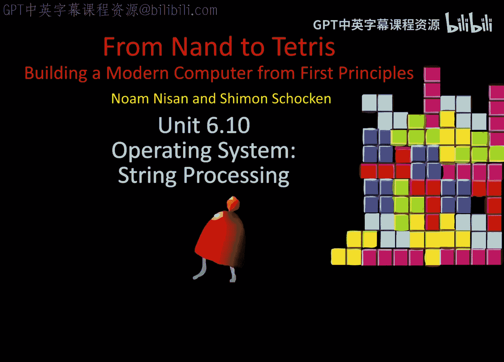
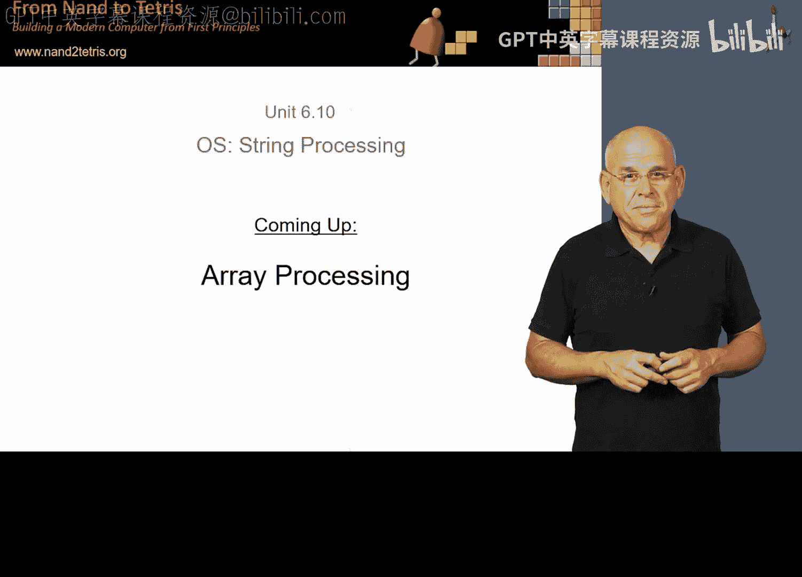

# 076：字符串处理 🧵



在本单元中，我们将学习如何在Jack操作系统中处理字符串。字符串是编程中用于表示文本数据的基本结构。我们将通过一个名为`String`的类来了解其创建、操作和转换。

## 概述

Jack操作系统使用一个名为`String`的类来处理字符串。这个类提供了一系列方法，允许我们创建字符串、获取其长度、访问和修改特定位置的字符，以及在字符串和整数之间进行转换。理解这些操作对于构建更复杂的程序至关重要。

## String类API

以下是`String`类的主要方法，它们构成了我们与字符串交互的接口：

*   **`new`**: 构造函数，用于创建一个具有给定最大长度的新空字符串。
*   **`dispose`**: 析构函数，用于销毁字符串对象并回收其内存资源。
*   **`length`**: 访问器，返回当前字符串的实际长度。
*   **`charAt`**: 返回当前字符串中给定索引位置的字符。
*   **`setCharAt`**: 将当前字符串中给定索引位置的字符设置为指定的字符。
*   **`appendChar`**: 将指定字符追加到当前字符串的末尾。
*   **`eraseLastChar`**: 删除当前字符串的最后一个字符。
*   **`intValue`**: 假设当前字符串的字符都是数字，则返回其对应的整数值。
*   **`setInt`**: 将给定的整数值转换为字符串表示形式。
*   **`newLine`**: 返回换行符的ASCII码值。
*   **`backSpace`**: 返回退格符的ASCII码值。
*   **`doubleQuote`**: 返回双引号的ASCII码值。

这个API的设计借鉴了其他面向对象语言中字符串类的常见功能，旨在提供直观且强大的字符串操作能力。

## 客户端视角

为了理解这些方法如何被使用，让我们从客户端程序的角度来看几个例子。

以下是创建和操作字符串的客户端代码示例：

```
var String s;
var int x;

let s = String.new(6); // 创建一个最大长度为6的空字符串
do s.appendChar(97);   // 追加字符‘a’ (ASCII 97)
do s.appendChar(98);   // 追加字符‘b’ (ASCII 98)
do s.appendChar(99);   // 追加字符‘c’ (ASCII 99)
do s.appendChar(100);  // 追加字符‘d’ (ASCII 100)
let x = s.length();    // 此时 x = 4
```

另一个例子展示了整数与字符串之间的转换：

```
var String numStr;
let numStr = String.new(5);
do numStr.setInt(314); // 将整数314转换为字符串“314”
let x = numStr.intValue(); // 此时 x = 314
let x = x * 2;          // 此时 x = 628，展示了数值计算与字符串的不同
```

关键点在于区分**整数值**（如二进制表示的314）和**字符串**（如由字符‘3’、‘1’、‘4’的ASCII码组成的序列）。

## 核心算法：整数与字符串互转

`setInt`和`intValue`方法是实现中最具挑战性的部分。下面我们来看看它们背后的算法。

### 整数转字符串算法

这个算法的目标是将一个整数（如123）转换为其字符表示形式（“123”）。

**算法步骤（递归实现）**：
1.  获取输入整数的最后一位数字：`lastDigit = value % 10`。
2.  将该数字转换为对应的ASCII字符。
3.  如果 `value < 10`，则递归结束，返回该字符。
4.  否则，将输入整数缩短：`remainingValue = value / 10`。
5.  递归调用算法处理 `remainingValue`，并将当前步骤得到的字符追加到递归结果的末尾。

通过递归，我们从最低位到最高位依次处理每一位数字，并在递归返回时拼接成完整的字符串。

### 字符串转整数算法

这个算法的目标是将一个数字字符串（如“123”）转换回整数值（123）。

**算法步骤（迭代实现）**：
1.  初始化结果 `result = 0`。
2.  从左到右遍历字符串中的每个字符。
3.  对于每个字符：
    *   将其ASCII码转换为对应的整数值 `digit`（例如，字符‘1’的ASCII码49转换为数字1）。
    *   更新结果：`result = result * 10 + digit`。
4.  遍历结束后，`result` 即为最终的整数值。

这个过程模拟了我们将数字字符串“读”成一个整数的过程。

## 实现要点

了解了算法之后，我们来看看如何在Jack中实现`String`类。

**内部表示**：
一个`String`对象可以包含两个字段：
1.  **一个数组**：用于存储字符串中每个字符的ASCII码值。
2.  **一个整数**：表示字符串当前的**实际长度**（而非创建时指定的最大长度）。

**方法实现思路**：
*   **构造函数 (`new`)**：根据指定最大长度分配数组，并将长度字段初始化为0。
*   **基本操作 (`length`, `charAt`, `setCharAt`, `appendChar`, `eraseLastChar`)**：通过对内部数组和长度字段进行操作即可实现。
*   **`intValue` 和 `setInt`**：分别实现上述的“字符串转整数”和“整数转字符串”算法。
*   **`newLine`, `backSpace`, `doubleQuote`**：这些是简单的函数，直接返回对应字符的固定ASCII码值（例如128、129、34）。

## 总结



在本单元中，我们一起学习了Jack操作系统中的字符串处理。我们首先介绍了`String`类的API，了解了如何创建、修改和查询字符串。接着，我们从客户端代码的角度观察了字符串的实际使用。然后，我们深入探讨了`setInt`和`intValue`这两个方法背后的核心算法，即整数与字符串之间的相互转换。最后，我们概述了`String`类的实现要点，包括其内部数据表示和各个方法的实现思路。掌握字符串处理是进行更复杂编程的基础。下一单元，我们将探讨数组处理的实现。