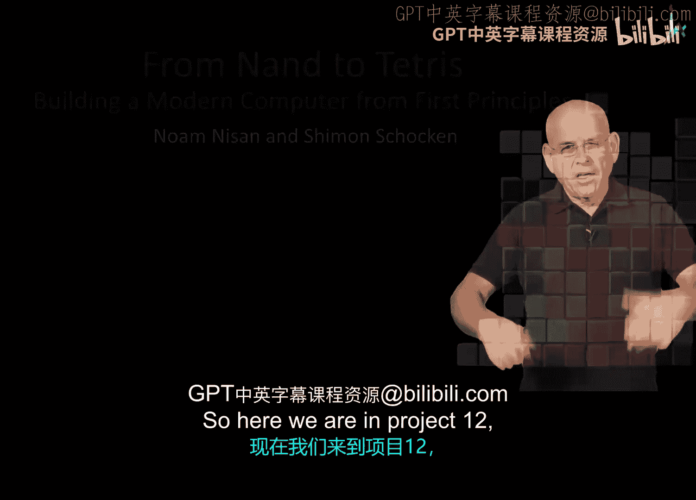

# 079：构建操作系统 🖥️



在本项目中，我们将从零开始构建一个完整的操作系统。这是课程的最后一个项目，我们将实现一个由八个不同类组成的操作系统，每个类负责特定的功能，如内存管理、屏幕管理和键盘管理等。

## 概述

操作系统本质上是一组应用程序接口，它定义了操作系统能为应用程序开发者提供的服务。在本项目中，我们不仅会学习这些API，还将亲手实现它们。

## 操作系统的结构

操作系统由八个不同的类组成，每个类都设计用于提供特定的功能。例如，`Screen` 类负责屏幕管理，`Memory` 类负责内存管理等。

以下是操作系统的主要组成部分：

*   `Memory`：内存管理
*   `Array`：数组操作
*   `Math`：数学运算
*   `String`：字符串处理
*   `Output`：输出控制
*   `Screen`：屏幕绘制
*   `Keyboard`：键盘输入
*   `Sys`：系统调用

## 实现策略：逆向工程

上一节我们介绍了操作系统的结构，本节中我们来看看如何实现它。我们将采用一种称为“逆向工程”的开发策略。

逆向工程是一种重要的软件开发技术。假设我们要实现一个现有的操作系统，它由多个可执行模块组成，但我们没有源代码。我们可以采取以下步骤：

1.  专注于实现其中一个模块。
2.  在开发过程中，调用其他模块的功能时，使用系统提供的可执行版本来支持。
3.  逐个模块地重复此过程，最终完成整个系统的开发。

这正是像GNU和Linux这样的操作系统最初的开发方式。开发者从一个已知的可执行系统（Unix）开始，逐步替换并实现自己的版本。

## 以Screen类为例

让我们以 `Screen` 类为例，具体说明开发流程。`Screen` 类是操作系统的八个类之一。

### 开发步骤

我们将获得一个名为 `Screen.jack` 的存根文件。这个文件包含了 `Screen` 类中所有子程序（包括对应用程序开发者不可见的内部子程序）的签名。我们的任务就是使用Jack语言实现这些子程序的具体功能。

```jack
// Screen.jack 存根文件示例
class Screen {
    function void init() { ... }
    function void clearScreen() { ... }
    function void drawPixel(int x, int y) { ... }
    function void drawLine(int x1, int y1, int x2, int y2) { ... }
    // ... 其他方法
}
```

### 测试方法

为了测试我们实现的 `Screen` 类，我们将使用一个名为 `Main.jack` 的测试文件。这个文件会调用 `Screen` 类中的各种方法。

测试流程如下：
1.  将我们编写的 `Screen.jack` 和提供的 `Main.jack` 放在同一个目录。
2.  使用Jack编译器编译该目录，生成对应的VM文件（`Screen.vm` 和 `Main.vm`）。
3.  在VM模拟器中运行这个目录。

VM模拟器内置了操作系统的Java实现。但是，如果它发现了用户实现的VM函数（例如我们编写的 `drawRectangle` 或 `drawLine`），它会优先使用我们的实现。这样，我们就为逆向工程创造了理想的环境：我们的代码会运行，而它调用的其他OS服务则由内置版本提供。

运行测试后，如果我们的实现正确，屏幕上会显示一幅简单的图画，证明 `Screen` 类工作正常。

## 完成所有类

对于操作系统中的八个类，其中五个类（如 `Screen`）将完全采用上述技术进行开发和测试：提供存根文件和测试文件。

其余三个类的测试方式略有不同，会使用Jack测试脚本和比较文件。所有具体细节都可在课程网站的Project 12页面找到。

这些类可以按任意顺序开发，因为在VM模拟器中，你总是可以使用其他七个类的内置实现来支持你正在开发的那个类。

## 最终测试

完成所有八个类的实现后，需要进行最终测试。这个测试将在一个实际应用程序（例如“Pong”游戏）的上下文中，运行我们开发的操作系统。

测试步骤在项目说明中有详细描述。一旦通过了这个测试，我们就可以认为你的操作系统已经成功构建，并满意地完成了项目12。

## 总结


本节课中我们一起学习了如何从零开始构建一个操作系统。我们了解了操作系统的API结构，掌握了通过逆向工程策略逐步实现各个模块的方法，并以 `Screen` 类为例详细说明了开发、编译和测试的完整流程。最终，我们通过在一个完整应用程序中运行来验证整个操作系统的功能。