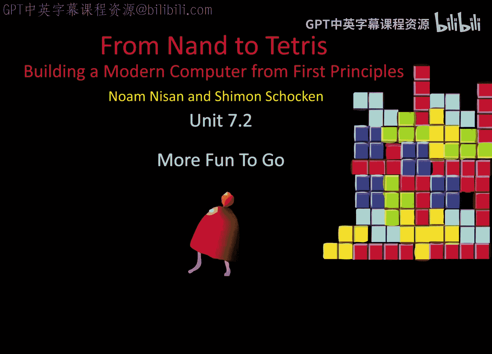

# 082：更多探索方向 🚀

在本节中，我们将探讨如何为计算机添加大容量存储和网络访问功能，并了解实现这些扩展所需的具体步骤和规划方法。

---

## 概述

我们将讨论如何将硬盘和网络接口卡等设备集成到计算机架构中。这涉及硬件修改、操作系统开发以及新芯片的设计与集成。

---

## 添加大容量存储 💾

上一节我们介绍了计算机的基本架构，本节中我们来看看如何为其添加大容量存储功能。

我们可以假设已经拥有一个内置的硬盘芯片，例如一个能够持久存储大量比特的闪存单元。利用这个新功能，一个自然的应用是保存和加载Hack程序。

任何此类新功能的添加都需要修改整体架构中的多个层面。

以下是需要修改的主要方面：

1.  **修改Hack硬件**：允许程序驻留在可写的内存空间，而非当前只读的内存区域。
2.  **指定简单的文件系统**：开发一个操作系统类，实现如`加载文件`和`存储文件`等抽象操作。
3.  **引入命令行界面**：此时，引入某种命令外壳或终端窗口将使用户能够访问和操作他们的文件。

正如所见，一项改动往往会引发一系列新的需求。

---

## 连接至互联网 🌐

现在，让我们看看如何将Hack计算机连接到互联网。

与处理磁盘类似，我们假设拥有一个内置的网络接口芯片，可以将其集成到硬件模拟器中。这个芯片的设计应使其一端与Hack硬件交互，另一端与您实际PC上的某个套接字交互。

这与当前已实现的键盘芯片的运作方式非常相似，因为键盘芯片与您PC上的实际物理键盘交互。网络接口卡也需要能够处理来自互联网（而非键盘）的比特流。

为了管理这个新设备，我们需要编写一个新的操作系统类，它知道如何使用某种标准通信协议在不同位置之间移动比特。

一旦具备了这些能力，我们就可以开发各种与这个芯片通信的Jack程序，作为通往互联网的网关。例如，使用Jack开发一个基于HTTP的简单网页浏览器会非常酷。

---

## 设计与集成内置芯片 🔧

我们讨论的所有扩展，其核心都是将外围设备添加到基础硬件中。所有这些扩展都要求首先设计和集成一个新的内置芯片，就像我们刚才讨论的磁盘和网络接口芯片一样。

那么，如何构建这样的内置芯片呢？

在开发Nand2Tetris模拟器时，我们设计了一个简单且文档完善的接口，用于添加所谓的“内置芯片”。得益于这个接口，模拟的Hack硬件平台是开放且可扩展的。

如果您想构建一个新的内置芯片（例如硬盘，或者如果您对音乐感兴趣，可以构建一个扬声器），那么您应该首先从指定和开发一个独立的Java类开始，该类实现您希望在这个新设备中使用的底层功能。

如果您想了解更多关于如何开发此类Java芯片的信息，可以从Nand2Tetris网站下载模拟器软件并阅读相关文档。我们的代码是开源的（纯Java），欢迎您按需修改和扩展。

---

## 项目规划与实施 📝

有一点不言而喻，但我还是要强调一下：我们讨论的任何优化和扩展项目都需要非常仔细、务实和现实的规划。

以下是实施步骤：

1.  **明确功能目标**：首先清晰阐述您希望通过这个新设备或新扩展交付的确切功能。目标不要定得太高，专注于绝对必要的部分，忽略其余。
2.  **识别需修改的子系统**：确定现有架构中（包括硬件和软件）所有需要修改的子系统与API。
3.  **指定新API并编写测试**：指定您将开发的新功能所需的API，并编写一些存根程序来测试这些新功能。
4.  **开始实际实现**：只有在完成所有这些准备工作之后，才应开始着手交付实际实现。

同样需要强调的是，在实现大容量存储、网络接口或任何其他您感兴趣的设备的简化版本之前，您必须先在互联网上阅读相关资料，然后再次确定您的项目绝对需要的最小功能子集，否则您可能会迷失方向。

---

## 分享与展望 🤝

最后，我想谈谈分享。如果您构思了一个很棒的项目，并希望与其他学习者分享，我们很乐意知晓。您不一定要与世界分享所有细节，可以只描述您的项目想法、通用方法、规范或任何您想分享的内容，这样其他人就可以从您的设计中受益并构建这个项目，就像我们要求您在本课程中构建我们的设计一样。

在下一个单元，我们将讨论更多在Jack语言层面的扩展以及高级语言的一般概念。我们还将讨论Nand2Tetris课程论坛中经常出现的一个话题：如何物理地构建Hack计算机（或任何其他计算机），而不仅仅是通过模拟。我们将使用一种名为**FPGA**的卓越硬件技术来实现这一点。

---

## 总结

本节课中，我们一起学习了如何为计算机架构添加大容量存储和网络功能。我们探讨了从硬件修改、操作系统开发到内置芯片设计与集成的完整流程，并强调了务实规划和分步实施的重要性。这些扩展为计算机打开了通往更广阔应用世界的大门。