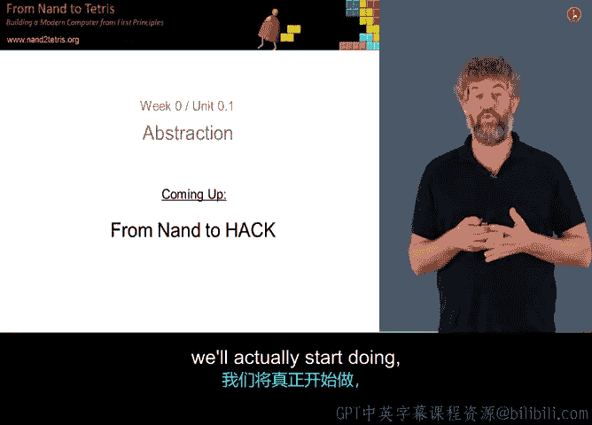

# 002：课程路线图 🗺️


在本节课中，我们将要学习本课程的核心思想工具——**抽象**，并了解我们将如何通过层层构建的方式，从最基础的逻辑门开始，最终完成一台功能完整的计算机。

## 概述：从“是什么”到“如何做”

我们通常从一门编程课开始学习计算机科学。在第一节课上，你可能会看到一个非常简单的程序，例如打印“Hello World”。你学习它的语法和命令，但程序背后的复杂机制——比如字母如何在屏幕上显示，或者代码如何被计算机理解——通常被隐藏起来，无需你操心。

这种“隐藏”并非教学的缺陷，而是计算机科学最强大的工具：**抽象**。你只需要关心某个组件**做什么**（它的接口或规范），而无需关心它**如何做**（它的实现细节）。这让你能专注于当前的任务，而将底层复杂性交给其他层级处理。

## 抽象：计算机科学的基石

上一节我们提到了“抽象”这个概念，本节中我们来看看它是如何运作的。

### 分离关注点

抽象的核心在于**分离关注点**。一旦我们构建好一个组件（例如一个“蓝色盒子”），我们就可以忘记其内部复杂的实现细节，只记住它简洁的接口（它能做什么）。然后，我们可以基于这个接口去构建更高级的组件（例如一个“绿色盒子”）。

这个过程可以重复多次，形成**多层抽象**。每一层都相对简单，但层层叠加后，我们就能得到一个极其复杂的系统。

以下是抽象分层构建的示意图：
```
[ 紫色盒子 ]  <- 基于橙色盒子的接口构建
    |
[ 橙色盒子 ]  <- 基于绿色盒子的接口构建
    |
[ 绿色盒子 ]  <- 基于蓝色盒子的接口构建
    |
[ 蓝色盒子 ]  <- 基础实现
```

### 课程中的抽象层级

这正是本课程将采用的方法。我们将从非常基础的简单逻辑门开始，逐步构建更复杂的芯片，最终组装成中央处理器（CPU）和完整的计算机。

在课程的第二部分，我们将在这些硬件抽象之上，继续构建更复杂的软件层级。

## 课程结构：分步构建

基于抽象的思想，本课程的结构设计如下：

*   **每周一个抽象层级**：每周，我们将专注于实现一个特定的抽象层级。
*   **利用已知，构建新知**：我们将已完成的底层视为已知且可靠的“黑盒”，只使用其接口，并在此基础上实现新的、更高层级的抽象。
*   **测试与验证**：每周都会提供测试套件，确保你构建的组件工作正常，为下一周的工作打下坚实基础。

通过这种方式，经过数周的学习，我们将从名为 **Nand门** 的简单逻辑门开始，最终构建出一台能够运行复杂程序（例如本课程得名的“俄罗斯方块”游戏）的完整计算机。

## 课程路线图详解

现在，让我们具体看看课程的两个主要部分。

### 第一部分：硬件构建（7周）

在第一部分，我们将构建计算机的整个硬件平台。

1.  **起点**：从最简单的**Nand逻辑门**开始。
2.  **终点**：构建出一台能够运行汇编语言程序的计算机。
3.  **过程**：分为七个清晰的步骤，每周完成一个步骤，最终得到一个可工作的硬件平台。

### 第二部分：软件构建

在第二部分，课程名“从Nand到俄罗斯方块”将得到完整体现。

1.  **起点**：基于第一部分构建好的Hack计算机。
2.  **目标**：在其上逐步添加软件层级，包括编译器、操作系统等。
3.  **终点**：最终我们将能够用高级编程语言（如本课程设计的Jack语言）编写应用程序，并在我们亲手构建的计算机上运行，例如“俄罗斯方块”游戏。

> **注**：本课程的第二部分目前尚未在Coursera平台上线。如果你在完成第一部分后迫不及待想继续，可以参考我们的配套书籍，其中包含了全部内容。

## 总结

本节课中我们一起学习了计算机科学的核心思想——**抽象**，以及本课程如何利用**多层抽象**的分步构建方法。

我们了解到，通过每周专注于一个层级，将已完成的底层视为可靠工具，并在此基础上构建新知，我们就能在14周内，从最微小的**Nand门**开始，亲手搭建出一台功能完整的现代计算机，从而彻底理解计算机的工作原理，揭开其神秘面纱。



在接下来的两个单元中，我们将更详细地探讨硬件和软件部分的具体路线图。之后，我们将正式启程，开始第一步的构建。