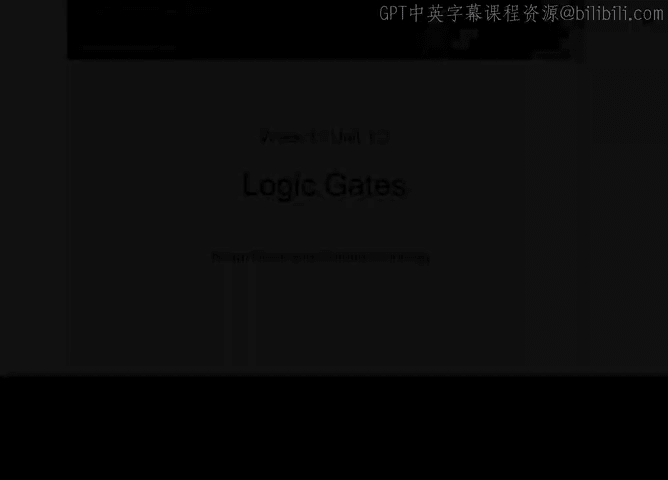
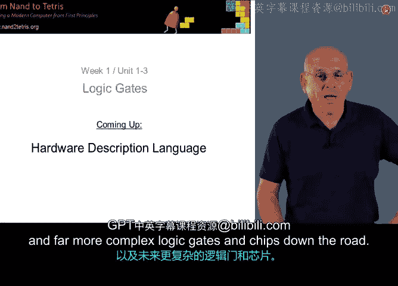

# 007：逻辑门

在本节课中，我们将要学习逻辑门的基本概念，包括其定义、类型以及接口与实现的区别。我们还将了解如何使用基本逻辑门构建更复杂的复合门。

## 概述

在本周的前两个单元中，我们讨论了布尔函数，但讨论大多是理论性的。从本单元开始，我们将探讨如何实际使用硬件来实现这些布尔函数。具体来说，我们将介绍一种称为门逻辑的通用技术，它大致上是一种使用逻辑门来实现布尔函数的技术。

## 什么是逻辑门？🚪

逻辑门是一个独立的芯片，或者说是一个非常简单的芯片或基本芯片，其设计目的是提供明确定义的功能，例如“与非”（NAND）功能、“或”（OR）功能等等。

## 基本逻辑门

以下是三个在每一个数字设计项目中都会出现的经典逻辑门：

*   **与门（AND Gate）**：当它的两个输入都为1时，输出1；在其他情况下输出0。
*   **或门（OR Gate）**：当它的任意一个输入为1时，输出1；在两个输入都为0时输出0。
*   **非门（NOT Gate）**：作为一个转换器工作，将输入取反。

我们可以将这些门组合起来，以创建更复杂的功能，稍后将进行说明。

## 复合逻辑门

什么是复合逻辑门？复合逻辑门是由基本逻辑门和其他复合逻辑门构成的。简单来说，它是比基本门更复杂的门。在本课程中，我们将开发诸如多路复用器等复合门。显然，你们大多数人还不知道这些术语的含义，不用担心，在接下来的几周课程中，你们会熟悉并实际构建它们。

现在，让我们从本课程中使用的最基本的逻辑门——**与非门（Nand）** 开始。

以下是与非门的定义。这是我们用来描述与非门的标准图示。它有两个输入（A， B）和一个输出（out），所有值都是二进制的（0或1）。

这个门的功能描述是：**如果两个输入都是1，则输出0；在任何其他情况下，输出1。** 这里也有一个真值表来描述相同的功能规范。这些描述中的任何一个都可以。综合来看，我们这里得到的是与非门的一个**抽象**。我们没有说这个东西实际上是如何工作的，我们只是描述了我们可以期望它提供什么样的功能。

## 构建复合门示例

我们可以使用这些基本门来创建复合门。例如，这里有一个三路与非门，可以看作是简单两路与非门的扩展。构建它的一种方法是使用这个技巧：我们可以取一个与非门的输出，并将其馈送到另一个与非门的一个输入中。如果我们正确连接所有线路，这个门应该能提供所需的功能。

在实现周围的虚线矩形中，我们看到的是这个芯片**接口**的文档。用户位于虚线矩形之外，因此用户只看到三个输入和输出，如门描述的左侧所示。如果你想深入了解或打开这个黑盒，你必须查看虚线矩形内记录和完成的内容。

## 接口与实现

基于此，我想就**接口**和**实现**的概念说几句。

门的接口就是门的**抽象**。这是用户思考门应该做什么的方式。接口回答了“**做什么**”的问题。

同时，如果你想理解芯片是“**如何**”做它正在做的事情，你必须更深入一层。在这一层，黑盒被打开，你看到芯片实际上是如何构建的，或者你自己去构建它（如果你的工作是实际实现这个抽象的人）。

门的接口是**唯一**的。只有一种方式来描述门的功能。否则，如果有不止一种方式，要么是你描述得不好，要么是你让用户感到困惑，因为描述门应该做什么的方式应该是唯一且独特的。

同时，可能有几种不同的**实现**来实现相同的抽象。不同的实现可能更优雅、能耗更低、成本更低或更高等。所以，**一个抽象，多种不同的实现**。这在计算机科学中非常典型。每当你构建一个大型系统时，都会遇到这种二元性。

## 电路实现

我们讨论了门的接口和门级实现。现在，让我们谈谈被称为**电路实现**的东西。

如果需要，我可以使用像这样的硬连线电路来实现这些门。这里有一种特定的图形语言来描述正在发生的事情：当我们想要表示门输出1时，我们假设一个灯泡会亮起；当门输出0时，灯泡会熄灭。

如果我们看这个与门电路的实现，我们会发现，由于这个电路的架构，只有当两个继电器都闭合时，灯泡才会亮起。在任何其他情况下，灯泡都会熄灭。这正是表示与逻辑时我想要的效果。

那么或逻辑呢？同样，如果我必须构建一个或门的电路实现，我可以使用这个特定的架构来实现。在这里，只需要一个继电器闭合电路就能点亮灯泡。同样，这与期望的或电路抽象是一致的。

继续看，这是一个三路与非门的电路实现。我想你可以很容易地说服自己，它将提供所需的功能。

然而，我想提醒你，在本单元早些时候，我们还展示了这个与非门的实现（如果你还记得的话）。因此，我想就这两种设计硬件的不同方法说几句。

## 本课程的实现方法

我想首先说明，在本课程中，我们**不涉及物理实现**。因此，关于电路、晶体管、继电器等等的所有讨论，以及你在屏幕左上角看到的内容，都属于**电气工程**范畴，而不是计算机科学。那些使用电路和类似技术构建这些门的人（其中一些技术要先进和复杂得多）被称为电气工程师。我们在计算机科学中已经有足够多的问题需要担心，所以我们完全不会担心物理实现。

我们在课程中将要使用的所有设计，都将类似于我们在屏幕右下角所做的：我们将从**与非门**（以及“与”、“或”、“非”门）开始，取现有的逻辑门，并以某种巧妙的方式将它们组合在一起，以生成和产生所需的功能。

## 总结

本节课中，我们一起学习了逻辑门的初步介绍。在下一单元，我们将向你介绍一种语言，一种称为HDL（硬件描述语言）的编程语言。使用这种语言，你实际上可以构建像本单元中看到的逻辑门，以及未来更复杂的逻辑门和芯片。