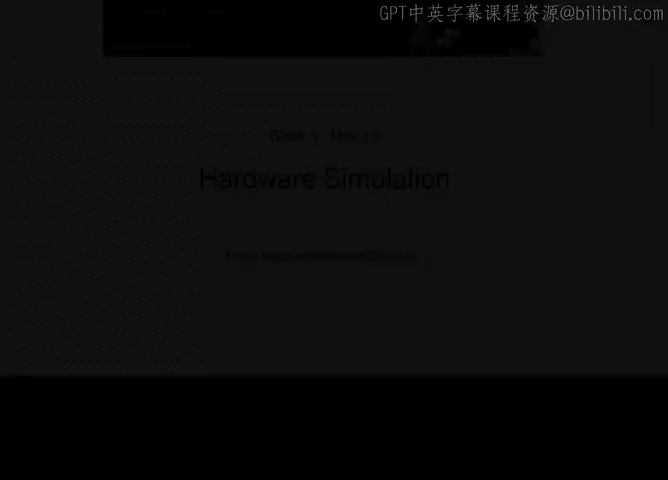
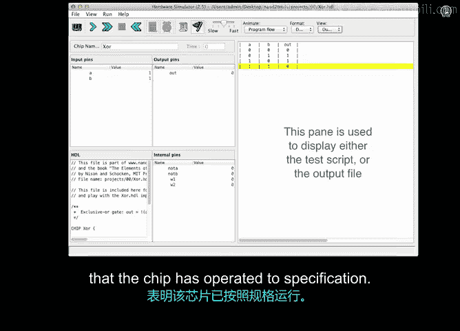

# 009：硬件仿真 🖥️

在本节课中，我们将学习如何使用硬件仿真器来验证我们编写的HDL代码是否正确。我们将了解交互式仿真和基于脚本的仿真两种方法，并学习如何利用测试脚本、输出文件和比较文件来系统化地测试芯片功能。

## 概述

上一节我们学习了如何使用HDL实现门逻辑。然而，我们编写的HDL代码并不能保证其正确性。我们无法确定设计的架构是否能实现预期的芯片功能。因此，在本节中，我们将学习如何通过硬件仿真来验证HDL程序是否实现了底层芯片的预期功能。

## 硬件仿真概览

以下是硬件仿真的大致流程。

我们有一个特定的HDL文件需要测试。我们可以将其加载到一个名为“硬件仿真器”的特殊程序中。我们已编写了此程序并在网站上提供，该程序使用Java编写，旨在模拟和测试HDL文件。

我们将HDL文件加载到程序中，可以交互式地测试该芯片的各种操作，这种模式称为**交互式仿真**。

或者，我们可以使用一种我们设计的特殊语言（称为测试语言）编写另一个文件。这种语言几分钟就能学会。我们可以编写一组预定的、可重复的测试。这样我们就不必进行交互式操作，可以提前规划如何系统地测试底层芯片。

我们将其写入所谓的**测试脚本**中，然后将两个独立的文件加载到仿真器中：HDL代码和测试脚本。接着，我们让仿真器开始工作，它会执行测试脚本中的每一步，并根据提供的脚本对HDL代码进行指定的测试。这种操作模式称为**基于脚本的仿真**。

最后，如果需要，我们可以将仿真输出记录到**输出文件**中，甚至可以将仿真结果与存储在另一个**比较文件**中的期望输出进行比较。

正如你所见，硬件仿真实践涉及许多新概念和技术。本节的目的是通过一个贯穿本节的逐步测试示例，使所有这些新信息具体化。

## 软件工具准备

在本节中，我们将介绍几个软件工具（实际上只有一个工具：硬件仿真器）。我们非常欢迎你暂停视频，在你自己的计算机上调用这个硬件仿真器，并确保我们演示的操作在你的机器上也能完成。

如果你在课程开始时下载了软件套件，那么硬件仿真器应该已安装在你的计算机上，你在讲座中看到的所有操作都可以自己完成。我们鼓励你尽可能多地动手尝试。

## 具体示例：Xor芯片

让我们开始看一些具体示例。

以下是我将在本节中使用的示例。这是一个描述我们在上一节讨论过的Xor芯片的HDL文件。代码本身你应该很熟悉，尽管理解本节内容并不需要完全理解它。

再次强调，我们编写了这段漂亮的代码，但这绝不意味着代码实际上是正确的。事实上，它很可能包含一些错误，比如语法错误、逻辑错误等等。那么我们如何测试它呢？

我们可以调用硬件仿真器，程序开始运行。我们将HDL文件加载到仿真器中，然后可以在A和B输入端输入0和1，并观察芯片内部的情况。

我们如何观察呢？我们必须告诉仿真器去评估芯片的逻辑。在我们告诉仿真器考虑我们输入的新值并评估芯片逻辑之前，仿真器不会做任何事情。如果我们这样做，仿真器会将这些值（我们输入的0和1或其他值）通过架构进行“管道传输”，最终会有结果从芯片的输出引脚输出。

此时，我们可以检查实际产生的输出。我们可以观察芯片的输出（在本例中是输出引脚`out`的值）。如果需要，我们还可以检查内部引脚（如`notB`、`notA`等）的值。仿真器为我们提供了所有这些强大的功能。

## 硬件仿真器界面详解

下图是硬件仿真器运行时的截图。仿真器包含或具有几个不同的窗格。

让我们分别讨论每一个窗格。

在屏幕的左下角，我们看到已加载到仿真器中的HDL代码。这是一个静态视图。我们无法在此操作或编辑代码。如果想编辑，必须使用外部文本编辑器修改HDL代码，然后重新加载。所以这个窗格只是让我们了解我们加载到仿真器中的具体内容。

在这里，我们可以与仿真器的输入引脚进行交互。我们可以点击它们并更改值。在这个特定示例中，我们有四种不同的0和1组合可能性（这是一个非常简单的芯片）。

一旦我们这样做了，我们可以点击这个看起来像计算器的图标。点击它，我们基本上就是告诉仿真器根据提供的输入评估芯片的逻辑。此时，仿真器会开始工作，花费一小段时间，然后会有结果输出。

然后我们可以评估芯片的输出（本例中只有一个名为`out`的输出）。同样，如果需要，我们也可以检查内部引脚的当前值。

总之，这个GUI为我们提供了进行Xor芯片（或任何其他芯片）动手交互式仿真所需的一切。

## 交互式仿真演示

现在，我想给你一个硬件仿真器实际操作的示例。让我们先演示一下，然后再回到讲座。

这就是硬件仿真器。为了使用它，我们首先需要将一个HDL程序加载到仿真器中。我们通过点击这里的图标来实现。

我们看到我们位于`Nand2Tetris`文件夹中。在这个文件夹内，我们选择`projects`，然后在`projects`中选择`Project 0`。

我们看到这里有一个HDL文件，让我们选择它。这是我们之前讨论过的`Xor.hdl`文件。

我们将芯片加载到仿真器中。现在，左下角的窗格显示了我刚刚加载的文件内容。我可以上下滚动。它只是只读显示，无法在仿真器内部更改代码。如果你想更改代码，必须使用外部文本编辑器，然后重新加载你修改并保存的文件。

假设我们对这个文件满意，我想实际模拟芯片逻辑。首先，我查看当前的输入值，我们看到Xor芯片的A和B输入默认值为0。所以，如果需要，我们可以继续将它们中的一个或两个更改为其他值。

让我们将A改为1，也将B改为1。注意，目前还没有任何变化。为了查看芯片对这些变化的响应，我必须重新评估芯片逻辑。我通过点击这里的计算器图标来实现。

点击后，我们看到输出变为0。确实，1 XOR 1的结果是0。如果我们想查看其他可能性，可以再次操作其中一个输入引脚，点击计算器，我们看到Xor现在输出1而不是0。

我们还可以做的另一件事是检查内部引脚的值，这为我们提供了另一个层次的检查，特别是在我们试图调试芯片并理解它为何在某些情况下行为异常时。

这只是使用仿真器时首先要做的事情的简要描述：加载芯片、操作输入引脚、检查输出和内部引脚。这是芯片调试和测试的基础。

最后提醒一下，如果你想更改芯片逻辑，必须使用外部文本编辑器编辑HDL文件，保存新文件，将其重新加载到仿真器中，并重新运行测试以测试新的芯片设计。

## 基于脚本的仿真

交互式仿真确实很好，但在某些时候可能会变得相当繁琐，特别是当你的设计中有很多错误，每次都需要重复进行同一组测试时。

考虑到这一点，我们很幸运地拥有了**测试脚本**的概念。

再次以Xor芯片为例（顺便说一下，我允许自己互换使用“芯片”和“门”这两个词，对我来说，门就是一个简单的芯片）。

这是一个为测试Xor门设计的测试脚本示例。让我们逐行浏览这个测试脚本。

测试脚本中的第一条命令指示仿真器将`Xor.hdl`文件加载到程序中。所以连这一步都自动处理了，我们不需要自己动手。测试脚本会为我们加载程序。顺便说一下，这在重复调试时非常重要，因为你如何使用外部文本编辑器修改门逻辑，然后点击保存，再回到仿真器。所以记住重新加载编辑后的芯片新版本很重要。这就是为什么我们在测试脚本中添加了这个命令。

一旦HDL加载到仿真器中，测试脚本就开始对芯片进行四次不同的测试。分号`;`代表一个特定测试的结束。

我们将芯片的输入值设置为0和0，评估芯片逻辑，并观察结果。然后我们进行下一个测试，依此类推，直到完成该芯片所有可能的输入组合。

这就是我们进行基于脚本的测试的方式。它有很多好处，首要的是我们不必费力地凭直觉做事，因为一切都是预先确定的。我们有一组可重复的测试，无论何时调试芯片（可能是两周或两个月后），我们都可以一遍又一遍地使用相同的测试。所以很高兴知道我们总是可以重复同一组测试。

总之，我们将尽量始终使用测试脚本。好消息是你真的不必担心如何编写测试脚本，因为我们将为你提供测试所需的所有测试脚本，以测试你将在HDL中设计的芯片。所以你专注于HDL，我们来负责测试你的工作。

## 记录仿真输出

我们可以做的另一件事是记录仿真的输出。具体来说，我们可以用类似以下命令来增强我们的基本测试脚本。

在测试开始时初始化时，我们可以指示仿真器创建一个输出文件（在本例中我们称之为`Xor.out`）。在测试过程中，在每个测试结束时，我们告诉仿真器将一组值输出到输出文件，这组值在脚本的前言中确定。

如你所见，脚本的第三行说输出列表是`a`、`b`和`out`。因此，每当仿真器看到`output`指令时，它就会将`a`、`b`和`out`的当前值写入输出文件。在仿真结束时，我们可以简单地检查输出文件的结果，并确信芯片确实按照预期运行。

事实上，在这个特定示例中，如果你检查仿真产生的输出文件，你会注意到它与Xor门的真值表完全相同。所以看起来这个门的行为是良好的。

## 脚本仿真演示

我们将展示如何使用硬件仿真器，通过测试脚本来测试HDL程序。

我们要做的第一件事是加载HDL程序到仿真器中。让我们选择之前使用的同一个`Xor.hdl`芯片。

然后，与其交互式地操作输入引脚，我们可以使用这里的图标打开一个测试脚本。我们看到在`Project 0`文件夹中有一个名为`Xor.tst`的测试脚本。让我们将其加载到仿真器环境中。

一旦加载，界面中的这个窗格会显示当前加载的测试脚本内容。我们看到它以几个命令开始，然后是实际的测试命令。下一个要执行的命令由一个黄色条高亮显示，我们可以称之为测试脚本的“光标”。

我们看到每个命令都以逗号或分号结尾。当我们点击播放图标时，仿真器将执行所有测试命令，直到遇到下一个分号。

现在，这个测试脚本中的前四个命令可以说是设置了仿真。让我们执行它们。我点击这里的图标，我们看到光标移动到了下一批命令。

这批命令说：将`a`设为0，将`b`设为0（这是该芯片的输入引脚），然后评估芯片逻辑，并将结果输出到输出文件。让我们执行这批命令。我们看到确实A和B输入现在是0，芯片的输出`out`是0，这似乎是正确的，因为我们知道0 XOR 0应该是0。

让我们执行下一批测试脚本命令。这批命令将`a`设为0，`b`设为1，评估芯片并输出结果。确实，我们看到0 XOR 1的结果是1，这似乎是正确的。

执行下一批命令，将`a`设为1，`b`设为0，得到结果1，这也似乎是正确的。然后继续，执行下一批也是最后一批命令，将A和B都设为1，我们看到Xor通过输出值0来响应，这再次似乎是正确的。

Xor门的测试脚本相对简单，因为它基本上只是执行了芯片真值表规定的所有可能输入组合。在更复杂的芯片中，这种穷举测试不太可行，因此测试脚本可能会更复杂。

当我们测试这个脚本时，脚本还将每个测试脚本批次的结果写入了输出文件。这是`output`命令的结果。

如果你想检查输出文件，我们可以通过转到这里的控件并选择`output`来实现。让我们这样做，一旦完成，我们看到输出文件确实看起来完全像Xor的真值表，这为我们提供了另一个迹象，表明芯片是按照规格运行的。

## 硬件仿真器简介

在我们继续这个逐步示例之前，我想暂停一两分钟，谈谈关于硬件仿真器的一般概念。

首先，硬件仿真器有很多种。有些是免费开源的，有些是专有的、非常复杂且昂贵的。在本课程中，我们使用一个简单的硬件仿真器，它同时为你提供了构建Hack计算机以及使用课程中描述的技术构建任何其他计算机所需的一切。

所以，现在你计算机上提供的硬件仿真器是一个工具，它再次为你提供了所需的一切。如果你想学习如何使用它，有几个地方可以查阅可用的文档。如果你访问`Nand2Tetris`网站，可以找到一个附录章节（我想是附录A和附录B），在我们的书中描述了如何使用硬件仿真器，这些章节也可以在网站上免费获取。另一件你应该做的事情是完成硬件仿真器教程，这是一套交互式幻灯片，解释了如何使用仿真器以及你在本讲座中看到的所有示例。

关于硬件仿真器的“广告时间”到此结束，我们回到正在进行的示例。

## 行为仿真与比较文件

让我们回顾一下到目前为止所做的工作。我们查看了一个记录Xor逻辑的特定HDL文件，我们向仿真器提供了一个设计用于测试此代码的测试脚本，我们还查看了生成的输出文件，并确信HDL文件实际上是正确的。

现在，查看输出文件并说“是的，它工作了”的这种特权，在现实生活的测试中很少可用。为什么？因为我们通常构建的芯片比Xor门复杂得多。没有办法查看一个ALU或CPU芯片的输出文件，然后说“是的，它工作正确”。我们必须以更系统和有计划的方式进行。那么有办法做到吗？当然有，这就是我们接下来要做的。

具体来说，我们可以使用另一个称为**比较文件**的工具进行仿真。这是一个比较文件的示例。它看起来完全像一个输出文件。事实上，在它之前的形态中，比较文件是一个行为良好的Xor芯片的输出文件。

有人（我们稍后会谈到这个人）正确地编写了一个Xor芯片，通过仿真器运行它，生成了一个输出文件，将其重命名为比较文件，然后交给我们，说：“现在你去构建Xor芯片，并将其与我做的进行比较。”

所以基本上，我们可以获取比较文件并将其加载到仿真器中，然后像之前一样开始进行仿真。现在，在仿真的每一步，当我们输出一组选定的引脚值时，仿真器会将输出的这组值与比较文件中的相应行进行比较。如果两行不一致，仿真器将抛出比较错误。

这使我们不仅能够记录芯片的输出，还能将其与期望的结果进行比较。

## 如何生成比较文件？

你可能会再次问自己，我们最初是如何生成这些比较文件的呢？我们可以把它当作一个谜，但没必要留下任何未解释的事情。以下是我们如何做到这一点。

我们使用所谓的**行为仿真**来实现。具体来说，考虑我们之前看到的Xor门，让我们再次假设这个实现是正确的。我们将其放入仿真器，连同脚本一起运行，生成结果，然后简单地将其重命名为`Xor.cmp`，它就成为该芯片的官方比较文件。

那么这张幻灯片有什么特别之处呢？我们不是已经说过这里的一切了吗？是的，我们说过。但有一个细节非常有趣。

在这个行为仿真的概念中，有趣的是芯片逻辑可以用设计者希望的任何方式实现。我们可以用Java或其他高级语言编写这个芯片逻辑。我们可以运行程序，生成输出文件，然后再次将其作为比较文件提供。

这种使用高级语言编写或实现门逻辑的技术，使你有能力在编写任何一行HDL代码之前就规划和测试你的硬件。这是一种相当复杂的工作方式。所以，我们可以在高级层面完成所有工作，只有当我们的机器的整体设计正常工作后，我们才开始用HDL逐个实现每个芯片。

## 硬件构建项目中的角色

这就是行为仿真的概念。我想继续谈谈我们实际上如何进行硬件构建项目。

任何硬件构建项目中的角色都由几个参与者组成，我想谈谈其中的两个。

首先，我们有**系统架构师**。系统架构师是被告知“去构建一个支持数码相机某种功能的芯片”或“去构建一个监控某种医疗设备的芯片”的人。架构师拥有芯片确切的用户级规格。

团队中的另一个成员是**开发人员**（可能不止一个开发人员或架构师）。他们必须一起设计这个芯片。他们如何做到呢？

系统架构师查看芯片的整体期望操作，然后他或她做出一些决定，如何将这种整体行为分解为一组更小的芯片（或更低级别的芯片）。然后，对于这些芯片中的每一个，架构师创建一个芯片API，其中包括芯片的名称、其输入和输出引脚的名称、一个测试脚本和一个比较文件。所有这些资源都由系统架构师准备（可能有人协助他或她的工作）。

最后，有了这些资源，开发人员就可以实际去构建芯片了。

所以，架构师可以进行行为仿真。他们可以做任何他们想做的事情来测试一切是否很好地结合在一起。在某个时候，开发人员实际上使用HDL来构建这个东西。

这再次是一个精心规划的模块化设计的例子，也是分而治之的另一个例子：将非常复杂的东西分解为一组更易于管理的、更小的模块，每个模块都可以独立创建和测试。

例如，Hack计算机。我本可以告诉你“去构建一台计算机”，实际上这就是我们在本课程中所做的，但我们把这个工作分解为构建大约30个不同的芯片，它们共同构成了Hack芯片组。

所以，我们（课程讲师）扮演系统架构师的角色，而你们则扮演实际硬件开发人员的角色。

## 开发人员的视角

那么，开发人员对特定芯片的视角是怎样的呢？当我们告诉你构建一个芯片时，你会得到以下内容：

*   一个**存根文件**，其中包含你需要构建的芯片的文档及其接口。
*   一个我们为你编写的**测试脚本**。
*   一个**比较文件**。

总之，你基本上得到了理解接口、理解芯片应该做什么以及我们将如何测试它所需的一切。

那么，你用所有这些资源做什么呢？你需要编写缺失的实现——即实际驱动整个过程的HDL代码。

这正是我们将在单元1.7中要做的事情。但在我们继续那个单元之前，我们还需要谈谈多比特总线，这是我们在HDL编程的一般描述中仍需填补的一个空白。

## 总结

在本节课中，我们一起学习了硬件仿真的核心概念与实践。我们了解了如何使用硬件仿真器对HDL代码进行交互式测试和基于脚本的自动化测试。我们认识了测试脚本、输出文件和比较文件在验证芯片功能中的重要作用，并理解了系统架构师与开发人员在硬件项目中的分工协作。这些工具和方法为我们后续实际构建复杂的数字逻辑芯片奠定了坚实的基础。