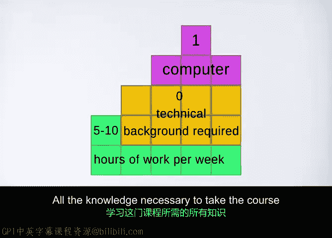

# 013：13_03_04_宣传视频

## 概述
在本节课中，我们将介绍《从零开始构建现代计算机》课程的第一部分。这是一门面向所有人的课程，即使你没有任何计算机科学或工程背景，也可以学习。课程将通过六个项目，引导你从最基础的逻辑门开始，逐步构建出一台完整的通用计算机。

## 课程介绍
大家好，我是希伯来大学和IC Herzliya的计算机科学教授Shimon Shoquikin。

我是耶路撒冷希伯来大学和微软研究院的计算机科学教授Noam Nisan。

我们非常高兴地向大家介绍《从零开始构建现代计算机》课程的第一部分。

任何人都可以学习这门课程，包括没有计算机科学或工程背景的人。

## 课程结构与项目
课程包含六个每周项目，每个项目专注于构建计算机硬件的一个不同模块。

在每个项目中，你需要构建一组芯片。对于每一个芯片，我们会提供完整的芯片规格说明，然后你需要利用之前已经构建好的芯片，来设计实现这个芯片的功能。

但请放心，你不需要进行任何焊接工作。相反，你将使用硬件模拟器来构建所有芯片，就像硬件工程师在实际工作中所做的那样。

## 项目内容详解
在课程的前三个项目中，我们将从一个最基本的逻辑门——**Nand门**开始。通过详细的项目材料，我们将指导你构建一个芯片组、一个中央处理器（CPU）和一个内存单元。

在接下来的两个项目中，你将把所有之前构建的芯片集成起来，组装成一台完整的通用计算机，我们将其命名为**Hack计算机**。

然后，我们会将这台计算机连接到键盘和屏幕上。接着，计算机就会开始运行。

在课程的最后一个项目中，我们将开发一个**汇编器**。这个工具允许我们使用符号命令而不是二进制代码来编写程序。这将使我们能够在Hack平台上运行各种酷炫的程序，比如俄罗斯方块，以及你能想到的几乎所有其他程序。

## 课程总结与要求
以上就是从Nand门到俄罗斯方块的六周旅程。课程每周大约需要5到10小时的学习时间，并且不要求任何计算机科学或工程背景。

学习本课程和构建计算机所需的所有知识都将在课程中提供。

所以，如果你希望理解计算机是如何工作的，以及它们是如何被设计出来的，那么就请注册课程，让我们一起构建一台计算机吧！

