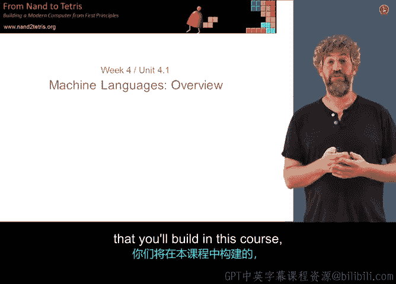

# 026：机器语言概述 🖥️

在本节课中，我们将学习机器语言的基本概念。我们将探讨为什么单一的硬件能执行多种任务，理解机器语言的核心作用，并了解如何使其对人类程序员更友好。

## 概述

过去两周，我们构建了算术逻辑单元和内存层次结构。现在，我们已经处于可以将它们组合起来构建一台计算机的阶段。但我们决定将这项工作推迟到下周。本周，我们将从用户的角度，审视我们想要构建的计算机。我们将探讨能用这台计算机做什么，以及我们将要构建的计算机的具体规格。只有在深入了解并实践之后，我们才会在下周真正开始构建它。

那么，为什么需要这样做？因为计算机是一个复杂的实体，它能做很多事情。仔细想想，这确实令人惊叹。世界上大多数机器只做一件事，例如，你的洗衣机只洗衣服，它不能煮意大利面。然而，一台计算机，比如智能手机，可以做许多不同的事情：文字处理、玩游戏、与人交流、播放视频等等。同一台硬件如何能完成所有这些不同的任务？

## 通用性的核心思想

其基本思想是**通用性**。这个思想的起源是艾伦·图灵在19世纪末20世纪初提出的理论模型。他试图形式化计算机的概念，并定义了一个理论模型——**图灵机**，以捕捉“可计算”的本质。他随后注意到一个惊人的现象：尽管在这个模型中有许多不同的计算设备（即不同的图灵机），但其中存在一个单一的机器，在给定正确程序的情况下，可以模拟所有其他机器。这被称为**通用图灵机**。这是我们第一次拥有“一台机器可以扮演所有机器角色”这一惊人想法。

冯·诺依曼将这一想法付诸实践，构建了第一台通用计算设备的严肃架构。他架构的核心是**存储程序计算机**的概念：我们可以将程序（软件）放入硬件中，然后硬件就能根据我们放入的软件（不同的程序）来执行不同的操作和功能。通过这种方式，我们第一次拥有了能够执行多种功能、运行多种不同程序的真正计算机。这个秘密一直延续至今，以至于我们甚至没有注意到我们的单一机器能完成这么多不同的事情是多么了不起。

## 软件如何控制硬件

让我们更仔细地看看这是如何工作的。我们的计算机内部将有一个中央处理单元和一些内存。它会读取一些输入，产生一些输出。但在内存内部，将有一个程序来告诉计算机该做什么。硬件是固定的，但程序（软件）可以改变。随着软件的变化，计算机将执行不同的任务。

那么，单一的、静态的硬件如何根据程序执行多种任务呢？程序由一系列指令组成，每条指令都用二进制编码。我们的硬件只需逐条执行指令。不同的指令集、不同的指令序列将导致我们的硬件产生完全不同的结果。当我们把整个指令序列（即整个程序）放在一起时，我们就得到了程序的功能，这完全取决于所编写的程序本身。

## 机器语言的关键要素

现在，让我们看看需要更仔细研究的几个关键要素，这些要素共同促使硬件按照程序的意愿工作。

以下是构成机器语言指令的三个基本要素：

1.  **指令规范**：我们的程序将由一系列指令组成。指令具体告诉计算机做什么？这是第一个要素。
2.  **执行顺序控制**：我们如何知道在任何给定时间应该执行哪条指令？假设我们现在执行第74条指令，按理下一条应该是第75条。但有时我们需要改变顺序，例如为了实现循环或条件执行。这是软件需要能够控制硬件操作的第二个要素。
3.  **操作数指定**：我们必须告诉硬件对什么进行操作。即使硬件知道现在需要将两个数字相加，软件也必须告诉硬件具体从哪里获取这两个值，以及将结果放在哪里。这是第三个要素。

每个机器语言，或者说硬件允许软件告诉它做什么的每种方式，都需要指定这三个方面。我们稍后会讨论每种要素的可能性和选项。

## 机器语言与高级语言

一旦我们有了这种机器语言，这就是硬件允许软件执行的内容。这种机器语言规范本身就是一种编程语言，但它是一种非常糟糕的编程语言。它对硬件非常方便，可以指定你想让硬件做的任何事情，但对人类来说却非常不方便。因此，在现实中，人类程序员几乎从不直接用机器语言编程，而是使用为人类设计的**高级编程语言**来轻松地编写他们想做的事情。然后，有称为**编译器**的自动程序，将高级语言翻译成机器语言，从而告诉硬件该做什么。

因此，我们通常不太担心机器语言，因为作为人类程序员，我们实际上并不使用它。然而，从计算机的角度来看，真正运行的始终只有机器语言程序。任何其他程序最终都以某种方式被翻译成这种机器语言形式，这才是确切告诉硬件该做什么的东西。

## 让机器语言更友好

尽管通常人们不直接用机器语言编程，但在本课程中，我们正在处理运行机器的硬件以及直接在其上运行的软件。为了理解如何构建计算机，我们需要学习机器语言，因此我们将不得不直接处理机器语言。此外，在某些情况下，例如为了针对特定任务获得高度优化的代码，人们也会直接处理机器语言。

在这些情况下，包括我们的课程，我们需要让使用机器语言变得稍微容易一些。通常有两种方法可以使机器语言编程更容易：

1.  **助记符**：机器语言中的指令总是比特序列。这很糟糕，因为很难通过查看像 `0111110` 这样的指令来理解它的含义。但实际上，这条指令在计算机中编码了某些我们可以理解的东西。例如，这个比特序列的第一部分可能编码了“加法”操作。在这种情况下，谈论这种指令时，使用其助记符形式会更方便，比如直接说 `ADD`，而不是 `01110` 或任何代码。同样，指令的其他部分可能编码特定的寄存器（例如 `R2` 表示第二个寄存器），而不是对人类无意义的比特序列。因此，我们将使用像 `ADD R3, R2` 这样的形式来思考，这完全等同于谈论之前的比特序列，只是对我们来说更容易。
2.  **符号**：很多时候，在机器语言程序中，我们需要访问内存位置。例如，可能有一条命令告诉计算机“给内存位置 129 加 1”。对于编写程序的程序员来说，具体是内存位置 129 并不重要。他真正想的是，我们将在那个内存位置存储某种索引。因此，对于程序员来说，这个值也可以存储在内存位置 250 或其他任何位置。重要的是，每次我使用这个值时，我都去同一个内存位置。在这种情况下，我们可以允许用户为该内存位置写一个符号名称，比如叫它 `index`。然后，让我们的汇编器（它已经提供了一些便利）自动将这个单词 `index` 翻译成某个空闲的内存位置（例如 129）。这使我们能够以对人类更简单的方式编写程序，而实际上，每当你看到 `index`，它都意味着某个固定的内存位置。

## 总结

本节课中，我们一起学习了机器语言的基本概念。我们探讨了计算机通用性的核心思想，理解了软件如何通过指令序列控制固定的硬件。我们分析了机器语言的三个关键要素：指令规范、执行顺序控制和操作数指定。我们还了解了机器语言与高级语言的关系，以及如何通过助记符和符号让机器语言对人类程序员更友好。在接下来的单元中，我们将具体讨论机器语言的细节，以及本课程中我们将要构建的 Hack 计算机的特定机器语言。