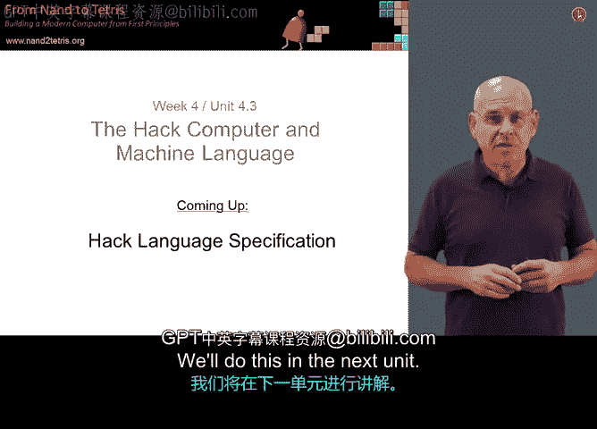

# 028：Hack计算机与机器语言 🖥️

在本节课中，我们将学习Hack计算机的硬件平台概览及其机器语言的基本语法。我们将了解Hack计算机的核心组成部分，并学习如何使用其两种核心指令——A指令和C指令——来控制计算机。

## 计算机硬件平台概览

上一节我们介绍了机器语言的一般概念。本节中，我们来看看Hack计算机的硬件平台，因为机器语言的设计与硬件平台的设计是相辅相成的。

Hack计算机是一个16位计算机，这意味着所有信息都以16位为基本单位进行处理、存储和传输。它主要由以下三个核心元素构成：

*   **数据内存**：一个由16位值组成的序列，每个值存储在一个内存寄存器中。这些寄存器从0开始编号。
*   **指令内存**：一个独立的存储空间，同样存储着一系列16位值，即机器语言指令。
*   **中央处理器**：一个能够处理16位值的设备，其核心是算术逻辑单元。

这些组件通过总线连接，你可以将总线想象成拥有16条车道的高速公路，负责在各个部件间传输16位数据块。

## 如何控制计算机

我们通过软件来控制这台计算机，具体来说，就是使用Hack机器语言编写的程序。一个Hack程序本质上就是一系列用Hack机器语言编写的16位指令序列。

要让计算机执行有用的工作，我们需要遵循以下步骤：首先编写程序，然后将这些16位指令加载到指令内存中，最后按下复位按钮。一旦按下复位按钮，程序便开始运行。

## 关键硬件寄存器

在深入了解语言语法之前，我们需要认识Hack计算机识别的三个关键寄存器：

*   **D寄存器**：用于存储一个代表数据的16位值。
*   **A寄存器**：用于存储一个16位值，该值可以代表一个数据值，也可以代表一个内存地址。
*   **M寄存器**：代表当前选中的数据内存寄存器。无论数据内存有多大，在任一时刻，只有一个寄存器被选中并可通过M进行访问。

## Hack机器语言语法

现在我们已经具备了理解语言语法的基本背景。Hack机器语言包含两种指令：A指令和C指令。

### A指令（寻址指令）

A指令的语法是 `@value`，其中 `value` 是一个非负十进制常数或指向该常数的符号。

A指令执行时会发生两件事：
1.  将A寄存器设置为指定的值。
2.  将数据内存中地址为该值的寄存器选为当前寄存器（即M）。

**示例**：假设我们想将内存地址100的寄存器值设为-1。
1.  首先，使用A指令选择要操作的寄存器：`@100`
2.  然后，使用C指令（见下文）将-1存储到当前选中的寄存器M中：`M=-1`

### C指令（计算指令）

C指令是语言的核心，大部分操作都在这里进行。其语法包含三个字段：**计算**、**目的地**和**跳转**。

其基本逻辑是：首先进行某项计算，然后可以选择将计算结果存储到某个目的地，和/或根据计算结果决定是否跳转到程序的其他指令。

以下是各字段的详细说明：

**计算字段**
计算字段指定要执行的操作。以下是一些可用的计算操作示例：
*   `0`, `1`, `-1`
*   `D`, `A`, `M`
*   `D+1`, `D-1`, `A+1`, `M-1`
*   `D+A`, `D+M`, `D&A`, `D|M`
*   `!D`, `!A`, `!M`

**目的地字段**
目的地字段指定计算结果的存储位置。有8种可能的选择：
*   `null`：不存储结果。
*   `M`：存储到当前选中的内存寄存器。
*   `D`：存储到D寄存器。
*   `A`：存储到A寄存器。
*   `MD`：同时存储到M和D。
*   `AM`：同时存储到A和M。
*   `AD`：同时存储到A和D。
*   `AMD`：同时存储到A、M和D。

**跳转字段**
跳转字段根据计算结果是否等于、大于或小于零来决定是否跳转。有8种跳转条件：
*   `null`：不跳转。
*   `JGT`：如果计算结果 > 0，则跳转。
*   `JEQ`：如果计算结果 = 0，则跳转。
*   `JGE`：如果计算结果 >= 0，则跳转。
*   `JLT`：如果计算结果 < 0，则跳转。
*   `JNE`：如果计算结果 != 0，则跳转。
*   `JLE`：如果计算结果 <= 0，则跳转。
*   `JMP`：无条件跳转。

## 指令使用示例

让我们通过几个例子来巩固理解。

**示例1：将D寄存器设置为-1**
我们查看语言规范，发现`-1`是可计算的值，`D`是合法的目的地。因此，指令很简单：
`D=-1`
跳转字段是可选的，此处无需指定。

**示例2：将内存地址300的寄存器值设为 D-1**
首先，必须使用A指令选择要操作的内存寄存器：
`@300`
然后，查看规范，`D-1`是可计算的值，`M`是合法的目的地。因此，完整的操作需要两条指令：
`@300`
`M=D-1`

**示例3：条件跳转**
假设我们想实现：如果 `D-1` 的结果等于0，则跳转到地址56的指令执行（这类似于循环结束条件）。
首先，使用A指令指定目标地址：
`@56`
然后，计算 `D-1`，并检查结果是否为0（使用`JEQ`跳转条件）：
`D-1; JEQ`
如果需要无条件跳转到地址56，则使用：
`0; JMP`

## 总结

本节课中，我们一起学习了Hack计算机的基本硬件架构及其机器语言。我们了解到Hack计算机是一个16位系统，由数据内存、指令内存和CPU组成。其机器语言包含两种核心指令：用于选择内存地址的A指令（`@value`），以及用于执行计算、存储结果和控制程序流程的C指令（`dest=comp; jump`）。掌握这些基本概念是后续进行编程和深入理解计算机工作原理的基础。在下一单元，我们将探讨这种语言的两种不同表现形式：符号形式和二进制形式。