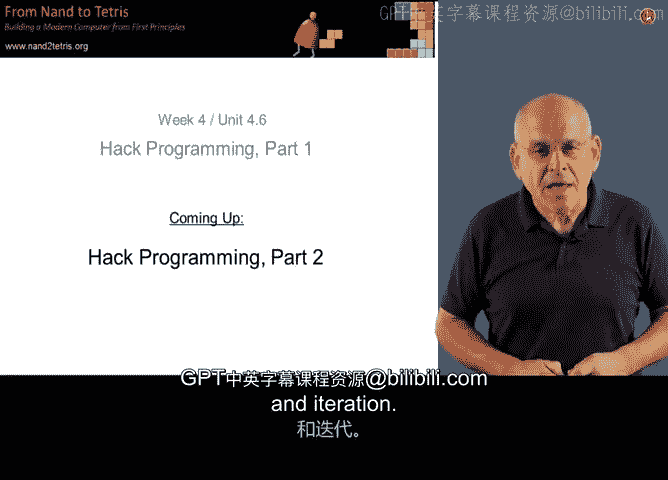

# 031：Hack编程第一部分


在本节课中，我们将学习如何使用Hack机器语言进行底层编程。我们将从寄存器和内存操作的基础知识开始，了解如何编写简单的程序，并学习如何正确地终止程序以避免潜在问题。

---

## 寄存器与内存操作

上一节我们介绍了Hack机器语言的基本指令。本节中，我们来看看如何利用这些指令来操作寄存器和内存。

Hack语言的核心操作围绕三个关键元素展开：**A寄存器**、**D寄存器**和**内存**。我们可以用以下方式表示它们：
*   **A**： 地址寄存器，可存储数据或地址。
*   **D**： 数据寄存器，存储16位数据值。
*   **M**： 代表当前由A寄存器选中的内存单元（即 `RAM[A]`）。

以下是几个基础操作的代码示例：

**将常数10存入D寄存器**
由于没有直接指令，我们需要间接操作：
```
@10
D=A
```

**将D寄存器的值加1**
这可以通过一条C指令直接完成：
```
D=D+1
```

**将RAM[17]的值存入D寄存器**
首先需要选中内存地址，然后读取：
```
@17
D=M
```

**将D寄存器的值存入RAM[17]**
操作与读取相反：
```
@17
M=D
```

**将常数10存入RAM[17]**
结合前几个操作：
```
@10
D=A
@17
M=D
```

**将RAM[5]的值复制到RAM[3]**
```
@5
D=M
@3
M=D
```

---

## 编写一个完整的程序

理解了基本操作后，我们可以将它们组合成一个有实际功能的程序。接下来，我们编写一个将两个数相加的程序。

假设我们要将存储在 `RAM[0]` 和 `RAM[1]` 中的两个数相加，并将结果存入 `RAM[2]`。程序逻辑如下：
1.  读取 `RAM[0]` 的值到D寄存器。
2.  读取 `RAM[1]` 的值并与D寄存器当前值相加。
3.  将结果（D寄存器的值）存入 `RAM[2]`。

对应的Hack程序代码如下：
```
// 程序：两数相加
// 用法：将待相加的数存入 RAM[0] 和 RAM[1]
// 结果将出现在 RAM[2] 中

@0      // 选中 RAM[0]
D=M     // D = RAM[0]

@1      // 选中 RAM[1]
D=D+M   // D = D + RAM[1]

@2      // 选中 RAM[2]
M=D     // RAM[2] = D
```

---

## 程序执行与潜在问题

在CPU模拟器中加载并运行上述程序，可以验证其功能。然而，运行结束后，程序计数器会继续向下移动，执行后续内存单元中的内容。这些内容可能是无意义的“空指令”，也可能被恶意利用，引发“空操作雪崩”攻击。

为了避免程序结束后失去控制，最佳实践是在程序末尾添加一个无限循环，主动控制程序流。例如：
```
(END)
@END
0;JMP
```

这段代码会形成一个无限循环，将程序计数器锁定在指定标签位置，从而安全地终止程序。

---

## 预定义符号与编程风格

Hack语言提供了一些预定义符号，使代码更易读写。

**虚拟寄存器**
为了方便引用前16个内存单元，可以使用符号 `R0` 到 `R15`。汇编器会自动将其转换为对应的地址。例如，`@R5` 等价于 `@5`。使用虚拟寄存器能使代码意图更清晰。

**I/O映射基地址**
`SCREEN` 和 `KEYBOARD` 分别代表屏幕和键盘内存映射的基地址。

**其他符号**
还有六个用于高级语言编译器和虚拟机实现的符号（如 `SP`, `LCL` 等），它们在本课程的第一部分不会用到。

**注意事项**
Hack语言对大小写敏感。`R5` 和 `r5` 是不同的符号，错误使用会导致难以排查的bug。

---

## 总结



本节课中我们一起学习了Hack机器语言编程的基础。我们掌握了如何使用A指令和C指令来操作寄存器和内存，编写并运行了一个简单的加法程序。我们还了解了在程序末尾使用无限循环来正确终止程序的重要性，并认识了利用虚拟寄存器等预定义符号来提升代码可读性的最佳实践。下一节，我们将探讨分支、变量和迭代等更复杂的编程概念。