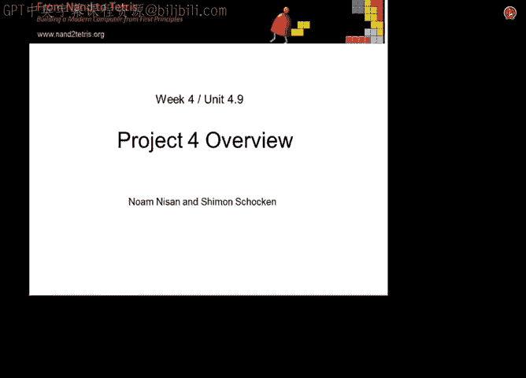
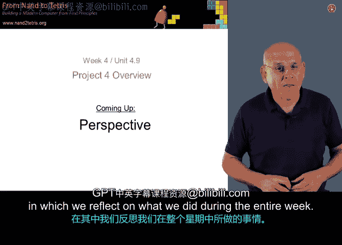

# 034：项目4概述 🖥️

在本节课中，我们将概述课程项目4的内容。我们将了解需要编写的两个程序，并学习在Hack机器语言中进行程序开发的一般流程和最佳实践。

## 项目4简介

上一节我们介绍了Hack汇编语言和硬件平台。本节中，我们来看看项目4的具体任务。项目4的目标是让你亲手操作硬件，用近乎机器级别的底层语言进行编程。

项目4包含两个相对简单的程序：
1.  第一个程序执行代数运算。
2.  第二个程序与用户交互，操作屏幕和键盘。

## 程序一：乘法运算（Mult）

第一个程序名为 `Mult`，其目的是计算内存中 `R0` 和 `R1` 两个值的乘积。

以下是该程序在CPU模拟器中执行结束时的截图。在RAM顶部可以看到，`RAM[0]` 是6，`RAM[1]` 是7，而 `RAM[2]` 是42。这正是该程序的功能：将内存中前两个寄存器的值相乘，并将乘积存入 `RAM[2]`。

程序执行的假设是：用户将此程序加载到指令内存后，还需在 `RAM[0]` 和 `RAM[1]` 中放入两个数字，然后点击运行按钮。如果一切正常，程序将计算出这两个数字的乘积。

在屏幕右侧区域，我们提供了一个测试脚本。该脚本使用我们设计的多组数字来测试你的程序。你可以查看脚本以了解我们将对你的程序进行何种测试。

需要指出的是，在模拟器和CPU模拟器中，屏幕被用作一种多功能设备：有时它作为真实的物理屏幕，有时我们用它来显示测试脚本。

再次强调，在这个区域你会看到程序的输入（两个数字）和输出。现在的问题是：我们如何编写这样的程序？

回想一下，Hack机器语言没有乘法操作，我们只有加法和减法。因此，我们面临的挑战是使用加法和减法来表达乘法运算。这里不需要多说，只再给一个提示：你需要使用一个循环，并通过这个循环以某种方式计算结果。

顺便提一下，选择学习本课程第二部分（Nand to Tetris Part 2）的同学，还将经历开发操作系统的过程。我们的操作系统将提供一个包含各种数学运算的数学库，其中就包括乘法。操作系统将使用的乘法算法非常高效，但在这个练习中，我们不期望你做到那种程度。我们只期望你能以某种方式将两个数字相乘，你可以尝试尽可能高效地完成，但我们不要求你费尽心思去设计非常花哨的乘法算法。

## 程序二：交互式屏幕控制（Fill）

第二个任务是编写一个简单的交互式程序，执行以下操作。

这个程序监听键盘。只要用户不操作键盘，就不会发生任何事情。但是，一旦用户按下键盘上的任意一个键，程序就会将整个屏幕变黑。当用户松开按键时，屏幕又会变清晰。再次按下任意键，屏幕变黑；松开按键，屏幕变清晰。这就是该程序的功能。

程序会进入某种无限循环，始终监听键盘并做出相应动作。

实际上，这里有两个独立的挑战：
1.  探测键盘，判断是否有按键被按下。
2.  能够将屏幕变黑或变白（本质上是相同的操作，只是向内存映射写入不同的值）。

这个练习相对简单的一点在于，我们操作的是整个屏幕内存映射，因此不需要精确地选择特定像素来打开或关闭。我们只需采用一种“霰弹枪”式的方法：要么打开所有像素，要么关闭所有像素。从这个角度看，程序并不非常复杂，总的来说也不是一个特别复杂的程序，但它很有趣。它让你看到如何使用标准的Hack机器语言代码来控制外围设备。

以下是通用的实现策略：
1.  监听键盘。
2.  为了将屏幕变黑或变清晰，我们编写代码，用白色或黑色像素填充整个屏幕内存映射。
3.  为了做到这一点，我们必须寻址内存映射中的每个寄存器。我们使用某种操作指针的循环来实现，这与之前讨论指针操作的单元中所做的工作非常相似。因此，你确实拥有实现这个特定程序所需的所有能力。

为了在CPU模拟器中测试这个程序，请确保选择了“无动画”选项。我们无法（或者说可以，但认为太复杂）提供一个测试脚本来测试这个程序，所以你只需像我演示的那样进行测试：按下按键，松开按键，并希望屏幕能相应地变黑或变白。

如果你愿意，也可以思考一些花哨的方式来使屏幕变黑或变白。例如，你可以不按行操作，而尝试按列操作，或者创建一些逐渐增长、旋转的图案等等。你可以发挥想象力，用任何你想要的方式来使屏幕变黑或变白，这实际上也是这个特定程序对你的期望。

## 程序开发流程

接下来，我想描述一下使用Hack机器语言进行程序开发的一般流程或周期。

首先，你的程序将驻留在普通的文本文件中，你可以使用任何文本编辑器编写。启动你喜欢的文本编辑器，编写程序，并使用 `.asm` 扩展名保存。按照惯例，我们给程序起的名字以大写字母开头，例如 `Do.asm`。然后，你将这个程序原样加载到CPU模拟器中。如前所述，CPU模拟器有一个很好的服务：当你加载程序时，它会自动将程序翻译成二进制代码。接下来，你可以在CPU模拟器上运行程序，并自问是否对结果满意。如果满意，你就完成了，可以将程序提交给我们。如果你对程序不满意（在最初的几次调试迭代中很可能如此），那么你就修复程序：查找错误并修正。修正错误的方法是回到文本编辑器，在编辑器中修改，再次保存程序，重新加载到CPU模拟器中，如此循环。因此，在屏幕上同时打开两个窗口非常方便：一边是文本编辑器，另一边是CPU模拟器，你可以轻松地在两者之间切换，但别忘了在修复后加载更新后的程序。

CPU模拟器的错误诊断功能相当原始。当你将程序加载到CPU模拟器时，如果程序存在语法错误，CPU模拟器会拒绝加载它，并发出一些晦涩的错误信息。它会提供一些非常重要的信息：出错的**行号**以及发现的**第一个错误**。然后你可以找到这一行并修复问题。一旦你解决了语法错误，真正的问题（即运行时错误）就开始了，这些错误更难检测。你通常需要通过观察程序的执行、发现某些部分工作不正常来检测它们，然后再次经历相同的循环：修复程序，直到它按你的期望工作。

这就是使用CPU模拟器和文本编辑器开发程序的一般机制。正如你所见，它相当简单和友好。

## 最佳实践与建议

最后，我想就注意事项和最佳实践说几句。

没有理由真的将机器语言程序视为某种奇怪的动物。它只是编程制品的又一个例子，所有适用于高级语言编程的原则在底层同样适用。我们期望你的程序简短（或不必要地冗长），它们应该简短、高效、优雅且自文档化。因此，我们期望你为程序添加文档，但要运用判断力，不要过度注释。我认为最好的做法就是参考我们提供的示例，并遵循类似的风格。通常，我们使用一些高级操作来描述：我们开始一个注释，写下类似“如果 I 大于 N，则跳转到...”的内容，然后写下实际实现此语义的六七条机器代码指令。

以下是一些非常重要的技术提示，它们将使你的工作更轻松：
1.  **必须使用符号变量和标签**。否则，你的程序将变得极其复杂和晦涩。如果你想跳转到程序中的某个地方，请使用标签。如果你想重复存储某些内容，请创建一个变量名。写完程序后，检查一下，确保没有看到任何实际的地址，一切都应该是符号化的。这是编写良好的机器语言程序的一个重要优点。
2.  **为变量和标签使用合理的名称**。与常规编程一样，当你创建变量和标签时，请使用有意义的名称。不要使用像 `GU5,31%` 这样晦涩的名称，而应使用像 `loop`、`end`、`stop`、`positive`、`negative` 等名称，具体取决于你想做什么。尝试使用合理的标签名，同样，变量名也应使用像 `i`、`sum`、`count` 等好名字。
3.  **变量使用小写，标签使用大写**。如果你回顾我们的程序示例，会发现所有标签（通常是像 `END`、`STOP` 这样的词）都是大写的，而所有变量（如 `i`、`x`、`y` 等）都是小写的。遵循这个约定（顺便说一下，这不是汇编程序的要求）将使你很容易区分变量和标签。因此，当你看到一条 `A` 指令时，如果符号是小写的，你就知道它是一个变量；如果是大写的，你就知道它指的是一个名为该符号的标签。
4.  **使用缩进**。再次遵循我们在之前单元中给出的示例，确保你的程序看起来美观且易于阅读。
5.  **始终建议从伪代码开始**。编写机器级代码总是具有挑战性，如果你的生活会更轻松：首先用某种你可以为自己设计的高级语言构思或编写程序，或者再次参考我们的示例。一旦程序在伪代码中运行良好（这是你必须在纸上检查的东西），你就可以将其翻译成机器语言并继续调试过程。

## 所需资源

你可以在哪里找到所需的一切？和往常一样，访问 Nand to Tetris 网站，查看项目4。此项目所需的所有文件都在该网页中有描述。你不需要下载任何东西，因为如果你在课程开始时下载了软件套件，现在你的个人电脑上已经有一个名为 `projects/04` 的目录，该目录已经包含了你在项目4中必须使用和操作的所有文件。

本节课中，我们希望能为你提供一些关于如何编写项目4程序的提示。现在，我们将进入本周的最后一个单元，回顾我们在整个星期中所做的工作。