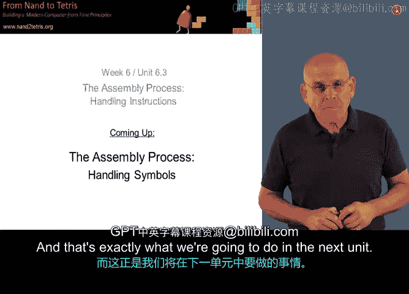

# 044：指令处理 🖥️

在本节中，我们将学习如何将汇编语言中的单条指令（A指令和C指令）从符号代码翻译成二进制代码。我们将重点关注不包含符号的指令处理过程。

上一节我们介绍了如何处理空白字符和符号的延迟处理。本节中，我们来看看如何具体翻译A指令和C指令。

## 翻译A指令

A指令的语法规则如下：`@value`，其中`value`可以是一个十进制常数或一个符号（我们稍后处理符号）。其二进制形式的操作码（op-code）是`0`。

以下是翻译A指令的步骤：
1.  如果`value`是一个十进制常数，计算其二进制表示。
2.  将这个二进制数填充为15位（在前面补零）。
3.  在最前面加上操作码`0`，形成一个16位的二进制指令。

例如，指令 `@5` 的二进制表示为 `0000000000000101`。

## 翻译C指令

C指令的符号形式包含三个字段：计算（comp）、目标（dest）和跳转（jump）。其二进制形式总是以三个`1`开头。

翻译C指令的过程涉及查表，将每个符号字段映射到对应的二进制位。以下是翻译步骤：
1.  初始化一个二进制字符串，以`111`开头。
2.  处理`comp`字段：根据其值（如`D+1`）查询对应的7位二进制码（包含`a`位和`c1-c6`位），并追加到字符串后。
3.  处理`dest`字段：根据其值（如`MD`）查询对应的3位二进制码，并追加到字符串后。
4.  处理`jump`字段：根据其值（如`null`）查询对应的3位二进制码，并追加到字符串后。

让我们通过一个例子来具体说明。假设我们有C指令 `MD=D+1`。

以下是翻译过程：
1.  解析器将指令分解为三个字段：
    *   `dest = MD`
    *   `comp = D+1`
    *   `jump = null`
2.  构建二进制字符串：
    *   起始位：`111`
    *   `comp`字段 `D+1` 对应 `0011111`
    *   `dest`字段 `MD` 对应 `011`
    *   `jump`字段 `null` 对应 `000`
3.  最终得到的16位二进制指令是：`1110011111011000`

## 整体汇编逻辑

综上所述，对于一个只包含A指令和C指令（无符号）的Hack程序，汇编器的整体工作流程如下：

1.  读取源程序文本文件。
2.  逐行处理文件中的每条指令。
3.  对于每一行：
    *   如果是A指令：提取`value`，将其转换为15位二进制数，并在前面加上`0`。
    *   如果是C指令：将其分解为`comp`、`dest`、`jump`三个字段。分别查询每个字段的二进制码，并与前缀`111`组合成16位指令。
4.  将生成的每条16位二进制指令（作为由字符`0`和`1`组成的字符串）写入一个新的输出文件。

请注意，汇编器生成的输出文件是一个文本文件，内容仅由字符`0`和`1`构成。当这个文件被加载到计算机中时，这些字符才被解释为真正的二进制位。

本节课中，我们一起学习了如何将不包含符号的A指令和C指令从汇编语言翻译成机器语言。我们掌握了A指令的简单转换规则，以及通过查表分解并翻译C指令三个字段的方法。然而，目前我们的汇编器还无法处理程序中出现的符号，这将是下一单元要解决的核心问题。