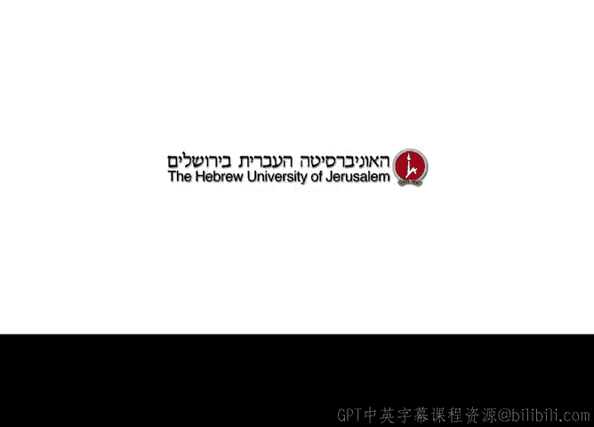

# 047：项目6概述（编程选项）🚀


在本单元中，我们将介绍如何开发项目6，即实现一个汇编器。我们将详细说明项目的目标、推荐的软件架构、分阶段开发方法以及如何测试你的汇编器。

## 项目目标与契约 📝

我们需要开发一个名为 `HackAs` 的汇编器程序。该程序的功能是将用符号化Hack汇编语言编写的程序（源文件）翻译成可执行的Hack二进制代码。

我们假设输入的源程序是一个名为 `Xxx.asm` 的文本文件，且该文件没有语法错误。汇编器应生成一个名为 `Xxx.hack` 的输出文件。如果目标文件已存在，汇编器应覆盖它。

在命令行环境中，使用Java实现的汇编器调用方式如下：
```bash
java HackAssembler Xxx.asm
```
执行此命令后，汇编器将开始工作，读取 `Xxx.asm` 文件，并生成或覆盖 `Xxx.hack` 文件。

## 推荐的软件架构 🏗️

上一节我们介绍了项目的整体目标，本节中我们来看看实现它的推荐软件架构。我们建议将汇编器划分为四个独立的软件模块，每个模块都可以进行单元测试。

以下是四个核心模块：
*   **解析器 (Parser)**：负责解析每一条汇编指令，将其拆解为底层字段（如指令类型、符号、计算字段、跳转字段等）。
*   **代码模块 (Code)**：包含一组方法，用于将汇编指令中的助记符（如计算字段 `D+M`、跳转字段 `JGT`）翻译成对应的二进制数值。
*   **符号表模块 (SymbolTable)**：包含一组方法，用于创建和管理符号表。它负责处理标签（如`(LOOP)`）和变量符号，并将其解析为具体的内存地址。
*   **主驱动模块 (Main)**：这是程序的入口点。它负责打开输入文件、创建输出文件，并通过调用上述三个模块的方法，驱动整个翻译流程。这个模块通常以汇编器命名，例如 `HackAssembler`。

## 分阶段开发策略 🔄

面对一个复杂的软件开发项目，分阶段进行是明智的选择。我们将采用“分而治之”的策略，先构建核心功能，再逐步完善。

以下是建议的开发阶段：
1.  **基础汇编器**：首先实现一个能处理**不包含任何符号**（即没有标签和变量符号）的Hack汇编程序的汇编器。完成此阶段后，应进行独立测试。
2.  **符号表模块**：独立开发并测试符号表模块，确保其能正确创建、添加和查询符号与地址的映射关系。
3.  **完整汇编器**：将前两个阶段的工作整合起来，实现能够翻译**包含符号**的任意Hack汇编程序的完整汇编器。

## 测试程序介绍 🧪

为了帮助你进行单元测试和集成测试，我们提供了七个测试程序。上一节我们讨论了开发策略，本节中我们来看看这些具体的测试资源。

以下是提供的测试程序及其用途：
*   **Add.asm**：一个非常简单的程序，仅包含几条A指令和C指令，**没有符号**。用于验证你的汇编器能正确处理空白字符和基本指令。
*   **Max.asm / MaxL.asm**：一个计算两个数值最大值的程序。`MaxL.asm` 是其**无符号版本**（所有符号已被替换为具体数值），`Max.asm` 是**完整符号版本**。你应在基础汇编器阶段测试 `MaxL.asm`，在完整汇编器阶段测试 `Max.asm`。
*   **Rect.asm / RectL.asm**：一个在屏幕上绘制矩形的程序。同样提供有符号和无符号两个版本，测试策略与Max程序相同。
*   **Pong.asm / PongL.asm**：这是一个复杂的“乒乓球”游戏程序。它最初是用名为Jack的高级语言编写，然后通过编译器（和中间的虚拟机）自动翻译成Hack汇编代码。因此，这个程序包含了大量自动生成的、看似“神秘”的标签和符号（如 `Sys.init`, `Math.multiply`）。`Pong.asm` 是完整的符号化版本，`PongL.asm` 是无符号版本。成功翻译并运行此程序，是对你汇编器工业级强度的终极考验。

## 如何测试你的汇编器 ✅

开发完成后，验证汇编器是否正确工作至关重要。以下是几种测试方法：

以下是三种主要的测试选项：
1.  **使用硬件模拟器**：用你的汇编器生成 `.hack` 二进制文件，然后将其加载到课程提供的硬件模拟器中的Hack计算机芯片上运行，观察程序行为是否符合预期。
2.  **使用CPU模拟器**：这是一种更用户友好的方式。将生成的 `.hack` 文件加载到CPU模拟器中运行和调试。
3.  **与参考汇编器对比（推荐）**：我们提供了一个已经过验证的汇编器（`Assembler`）。你可以用它来翻译同一个 `.asm` 源文件，然后将生成的 `.hack` 文件与你自己的汇编器生成的文件进行逐行比较。如果两者完全一致，则证明你的汇编器工作正确。

课程网站提供了参考汇编器的图形化工具。你可以在其中加载源文件（`.asm`）和你的输出文件（作为比较文件），工具会自动进行比对并给出结果。

## 资源与总结 🎯

本项目所需的所有资源（测试程序、参考汇编器、CPU模拟器、教程、建议的API等）都已包含在你课程开始时下载的软件套件中，位于 `projects/06` 目录下。你也可以在 `nand2tetris.org` 网站上找到相关描述和额外资料。



**本节课中我们一起学习了**：项目6（汇编器）的完整实现蓝图。我们明确了程序契约，理解了四模块软件架构的优势，掌握了分阶段开发的实践方法，熟悉了用于验证的测试程序套件，并学会了通过对比参考输出来确保汇编器正确性的高效测试策略。现在，你可以根据这些指南，开始动手构建你自己的Hack汇编器了。