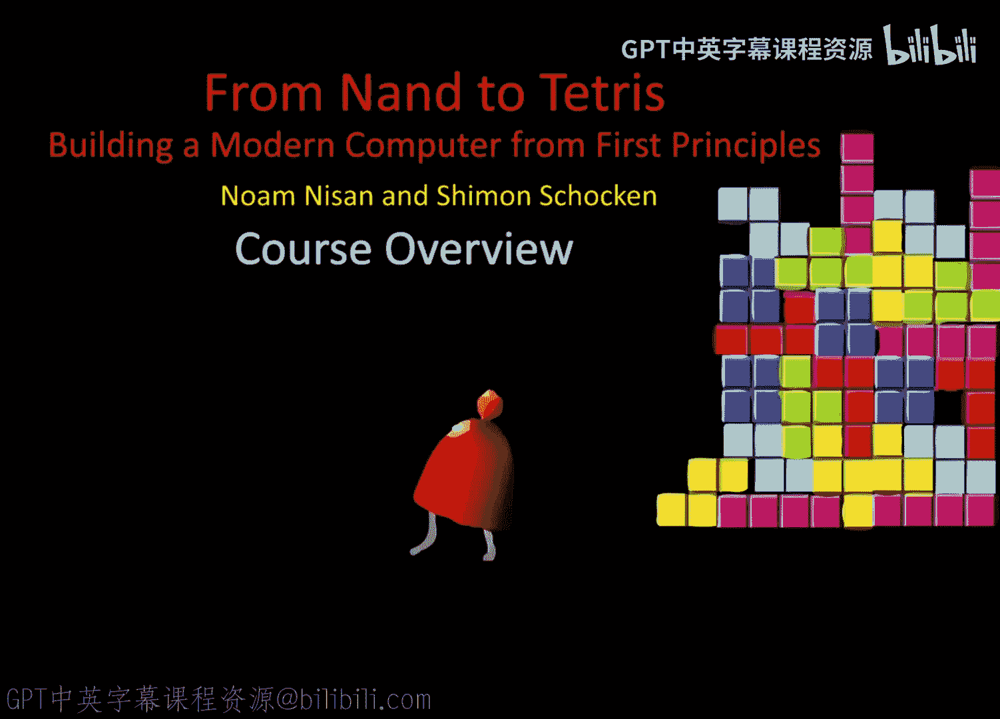
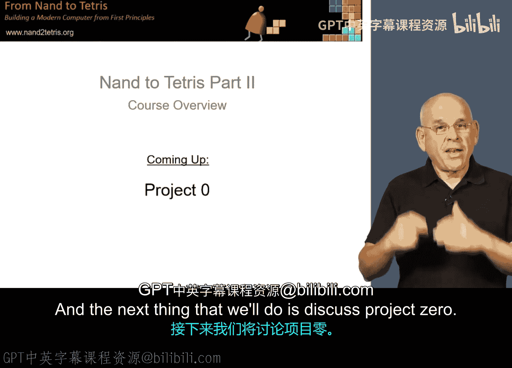

# 耶路撒冷希伯来大学《从零开始构建现代计算机2｜Build a Modern Computer from First Principles》中英字幕 p01 01_01_02_课程概述.zh_en -BV1DA4m1w7FU_p1-

Welcome to Nutotetriris， Part 2。Nantotattriris is the name of a computer science educational adventure in which we build a complete modern general purpose computer system。

 hardware and software from the ground up。Because this is quite a substantial journey of discovery。

 we decided to split it into two separate and standalone courses in the first course which in Coursera is simply called Nant to Tetriris。

 we start with a most elementary and sort of primitive logicgate conceivable called Nant。

 and using a series of six hardware construction projects we build a computer platform which we call heck。

And then in the second course in Ntoteris PA2 in this course。

 we start with the heCC platform as a point of departure。

 and then we build on top of it a virtual machine， a compiler。

 and operating system and all the systems which are necessary so that we'll be able to write highleve object-based programs on this bareborn hardware。

 that's what we do in the second part of the Nanttotetriris journey。

The creators of Ntotetriris are Profess Nom Nissan。

 who works at the Hebrew University of Jerusalem and myself， my name is Shimon Shokkin。

 I work at IDC Herzeia， and as you see from these pictures both Nom and I enjoy getting into and playing with the most elementary and fundamental building blocks of applied computer science。

And I must tell you that the deeper we look into computer science and mathematics for this matter。

 the more beauty that we discover， and as you take the Ntetriris courses。

 you will share with us exactly the same profound feeling。

So here is the big picture of Nantotteris and what we see here are the two endpoints of our journey。

At the bottom we see the Burborn hardware， which is capable of nothing more than detecting between two different signals。

 zeros and ones and processing these signals in remarkably clever ways and at the top of the journey we see some human highleve programmer or an entrepreneur who have all sorts of lofty thoughts and fantasies about developing computer games and search engines and airline reservation systems and whatnot。

And the question， of course， is how do you bridge the gap between the abstract thoughts of the high level programmer and the bearborne hardware that can do nothing more than process zeros and ones。

 Well， bridging this gap is what Ntoteris is all about。And as you see。

 we do it in several different well defined stages。

 and each one of these stages entails one or more programming projects。

 and once again we split it into two different courses。

So in Nteris part1 also called simply Ntetriris in Cosera。

 we begin with many instances of the Nand generic gate and using these gates。

 we build some elementary logic gates like end or not so multiplexes and so on。

 then we put these gates together and we build memory systems， A CPU and the entire hec chipset。

 then we assemble these chips together and we create what is known as a classical Phon Neman hardware architecture and we end this course with writing an assemmbler for this particular computer。

And so at the end of this process，voila， we have a computer， which we call heck。Now， at this point。

 Notteti spa 2 kicks in。And in this course， we treat the hec computer platform as an obstruction。

 We don't care about questions like how the CPU was constructed and how registers are built from lower level data flip flops。

 We don't care about all these details because we have a computer。

 which for us is a black box obstruction， and we are going to interact with this computer through its interface。

 which is machine language。But actually it's more convenient to think about the second part of this course top down。

 so let's shift our attention to the left side of the screen and focus on what happens in the process of writing highlevel programs and this by the way。

 is exactly what you guys do when you write programs in Java or Python or C sharpp。

 you don't care about you know all the other parts of the computer。

 you just focus on the high-level programming task。

Now in Noterispa2 we're going to introduce a highleve language called Jack。

 which is a simple version of Java and Python C sharpp。

 and it's a language that if you know any one of the languages that I just mentioned you can learn it in something like one hour of learning and then you can write very nice programs in the jack language let me show you some examples of programs that our students have written in a previous versions of this course so here's a program in which we play a pong and that's a program that the student wrote in order to teach typing skills in an interactive and engaging computer game here is a space invaders here is Socoban。

 a famous game that came from Japan here is a bouncing ball。

 a very nice animation and here is a raw game and of course you know many students。

Developed all sorts of versions of Tetriris。 you know， by now。

 thousands of students have taken these courses， and therefore there are many examples of cool jack programs out there。

 And here is one program that I wrote。 And in this program， we see some two dimensional points。

 and the program construct these points and manipulates them using all sorts of algebraic manipulations。

 So let's take a look at this program。😊，What we see here is the jack code that actually generated some of the output that you see in front of you。

 it begins with a class called point which implements the two dimensional point functionality。

 and then we have another class called main that uses the services of the point class in order to create and manipulates some points on the screen。

So that's how the J code looks like， and I think that you will agree with me that it looks very similar to other languages like Java and Python。

And in fact， in the third week of this course， you guys are going to write some programs like this one using Jack and we want you to do it in order to get the feeling of the language for which we will have to develop a compiler later on in the course。

In particular， as you know， when you want to execute a program that you wrote。

 the first thing that you have to do is compile it。So here is our compiler。

And just like other compilers， like those of Java and C sharpharp and to a certain extent the Python。

 our compiler does not translate the source code directly into machine language。

 but rather it translates your source code into an intermediate language called VM code。

 which is designed to run on an abstractstruct virtual machine。

Now it goes without saying that I don't expect you guys to understand any of the details of what you see here and we're going to give you all the necessary background and all the techniques which are required throughout the course at this level I just want you to get the spirit of what's going on。

So here's how the compiler works， it goes through your source code and if we focus on one particular command。

 for example， the command that creates a new point with coordinates x equals 1 and y equals 2 and stores the address of this object in P1。

 well this code is going to be translated by the compiler into four VM commands as you see at the right hand side of the screen。

Now you guys are going to write this compiler under our guidance of course。

 in weeks four and five of this course。Now the resulting code that you see here。

 which is very similar to what is known as Java's Btecode。

 also similar to what is known as IL in the world of dotnet and C sharpp well this code is also an obstruction。

 it is designed to run on some imaginary computer a virtual machine in order to make this obstruction concrete。

 we have to translate this code further into machine language。

And the machine language that we are going to use is the native code of the hec computer。

 and you see it here in front of you， this is hec assembly language。

So here's an example of how this VM translator works。

 it takes let's say the first command in your VM program which is a push1。

 a typical stack oriented command and once again we'll discuss all this stuff in the course。

 I don't expect you to even know what a stack is， but it takes the first push command and translates it into what comes out as a seven or eight different machine level instructions。

And once we have these instructions generated， we can load them into the computer and finally the program will start executing。

So that's what you guys are going to do in the first two weeks of the course。

 you will develop a VM translator which is quite similar to Java's JVM and to Microsoft's CLR。

 everything that we do in this course follows。The modern paradigms of software engineering and lets you guys to sort of get into the most important ideas behind every one of these tools。

Now， there's one piece which is missing in this puzzle， and this is the operating system。

Because you see you cannot write a high levelvel language these days without using the services of the host operating system。

 because there are so many things that you have to handle graphics。

 animation reading input from the keyboard managing your objects in memory you know who is going to do all these things you there's no way that we can you know require high levelvel programmers that have so many problems of their own to take care of all these and nitty grty details for this we use an operating system。

 so in week six of the course we're going to develop exactly such basic operating system under our guidance。

So here again is the big picture of an nanothe Sp2 with the projects laid out on the roadmap and you know many people ask us。

 how can you possibly cover so much material and build you know。

 so many important fundamental systems in applied computer system in applied computer science excuse me。

 in no more than six or seven weeks of instruction？Well。

 we have a secret sauce and a secret sauce is our coursear methodology。In particular。

You have to understand that first of all， we are going to teach you all the necessary computer science knowledge。

 which is necessary in order to build all the systems which are described in this course。

 you don't have to bring from home any previous knowledge except for some basic programming skills will provide all the necessary algorithms。

 data structures， programming tricks and hacks and so on。Also。

 we are going to provide you with some very useful softwareer tools that will make your life easy。

 For example， before we ask you to implement a virtual machine yourself。

 we will give you a VM simulator that will enable you to play with an animated virtual machine and understand exactly what has to be done in the actual project that you have to develop。

😊，Also in this course Noram and I are going to play the role of the system architects and you guys are going to be the software developers who actually implement the specifications that you get from us so we are going to supply you with elaborate and wellex the APIs and blueprints and design documents and so there will be no uncertainty and confusion whatsoever。

 you will know exactly what you have to do to the letter。

And in addition with all these design documents， we are going to also provide you with a huge pile of test programs and test files and test scripts so that you will be able to test your work or I should say unit test what you do in a very low resolution。

 something like every 10 or 15 lines of code， you will have a test that you will be able to apply to what you wrote and convince yourself that what you've done is good and that you can continue to go to the next stage in the development。

And the most important feature of our course methodology is that the course is a lot of fun。

It is thrilling to build a computer from the ground up and you' are going to enjoy it tremendously。

And I must say that by now， you know， thousands， if not tens of thousands of people and selfleers and students have already taken Nteist courses and with very few exceptions。

 all of these guys are very happy campers。And so that's the big picture of Nteary Sp2 and the coursear methodology。

The course is going to last seven weeks and in every one of these weeks we' are going to have a set of video lectures that will take you something like three hours to view then you will also have a project。

 a programming project that you have to implement and there's also a book chapter that you are welcome to read。

 but it's not required， the textbook that accompies this course was written by Nom and myself。

 it was published by MIT Press and it's an optional reading if you want。

 you can use it but you don't have to。Altogether， the weekly workload is going to be something between 10 to 20 hours of work depending on which a week we are in。

 and I must say that the word weak is a somewhat weak W EAK in the sense that。

If you want your week to last 10 days or 14 days， that's perfectly okay with us， you know you should。

Work on these projects at your own pace and you are the captain of this ship you know we just give you some guidelines but you decide exactly how you want to to drive it and you will need some self-dipline and try to complete these projects within the course schedule but once again if you slips that's fine with us。

 the most important thing is to complete the projects and learn the underlying ideas and techniques。

The prerequisites of this course are quite minimal。

 we expect that you have some programming ability at the level which is acquired in typical introduction to computer science courses。

 so you have to know either Java or Python， you have to know the basic techniques and skills of object oriented programming。

 if you have this basic knowledge， then you're welcome to take NanttoterisPA2。

It is also recommended but certainly not required that you will take Nteris part one。

 in fact the two courses are so independent of each other that you can take them in reverse order if you will。

 but of course we recommend that you take part one first part two second but once again you don't have to。

 you can start from scratch with an Noteris part two。Now， in closing。

 I made a list of some of the topics that are going to be covered in this course。And it's quite。

 I think， mind boggling to see how many subjects we are going to visit in Nthets part2。

And the exciting thing about this laundry list here is that we are not going to wave our hands too much about any one of these concepts。

 we will explain them， of course there will be no， as I said， no uncertainty and no confusion。

 but every item that you see in this list is something that you will learn hands on because it will come up in the context of building a system。

 something that you are going to do with your own hands。

So this in a nutshell is the contents of once again， most of the contents of this course。

And as you go through this course。You will become a significantly more sophisticated。

 enlightened and confident software developer because you see。😊。

Right now I assume that you know you may have some very good high levelvel programming skills。

 but you have all sorts of you know doubts and some uneasy feelings about how the compiler works。

 what exactly is the virtual machine， how my program interacts with the operating system and how all this geal works together Well。

 none to Teris sheds light on all these questions and as you get this knowledge once again。

 you become a much more sophisticated developer in addition。

 you will be exposed to numerous or I should say the most important ideas and techniques in applied computer science and finally you will become a richer person。

You know， not necessarily financially richer， although I think that this course will certainly contribute to your career prospects。

 you will become richer intellectually because through this course， you will。

Connect to the soul of the machine。 You will connect to the soul of the most important machine that mankind has built。

 at least in modern times。 and connecting to the soul of this machine is what Notetriris is all about。

So。Thank you for sitting patiently through this course overview and the next thing that we'll do is discuss Project zero。

