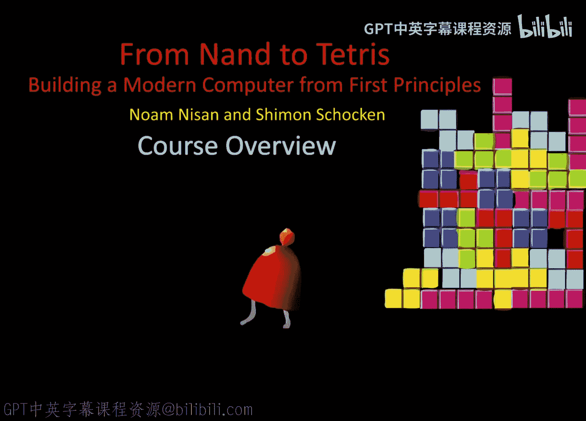
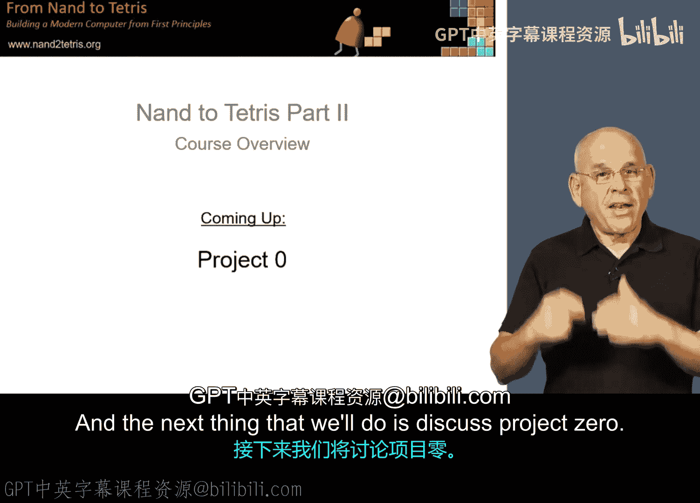

# 从零开始构建现代计算机2：01：课程概述 🚀



在本课程中，我们将一起踏上构建完整现代计算机系统的旅程。我们将从底层硬件出发，逐步构建虚拟机、编译器与操作系统，最终实现用高级语言编写程序的能力。

## 课程全景图

上一节我们介绍了课程的整体目标，本节中我们来看看实现这一目标的完整路径。

我们的旅程始于最底层的“裸机”硬件，它仅能处理0和1两种信号。旅程的终点则是一位高级程序员，他怀揣着开发游戏、搜索引擎等复杂软件的想法。那么，如何连接抽象的编程思想与只能处理0和1的硬件呢？这正是本课程要解决的核心问题。

我们通过几个定义明确的阶段来搭建这座桥梁，每个阶段都包含一个或多个编程项目。整个旅程分为两个独立的课程。

## 第一部分回顾

在Coursera上称为“从零开始构建现代计算机”的第一部分课程中，我们从最基本的逻辑门——**Nand门**出发。通过六个硬件构建项目，我们逐步搭建了称为**Hack**的计算机平台。我们构建了基本逻辑门、内存系统、CPU乃至完整的Hack芯片组，最终组装成经典的冯·诺依曼硬件架构，并为该计算机编写了汇编器。

至此，我们拥有了一个完整的计算机——Hack。

## 第二部分启程

现在，第二部分课程（即本课程）正式开始。我们将Hack计算机平台视为一个**抽象层**。我们不再关心CPU如何构建、寄存器如何由底层触发器构成等细节。对我们而言，Hack是一个可以通过其接口（即机器语言）进行交互的黑盒。

然而，更便捷的方式是从上至下地理解本课程。让我们将注意力转向屏幕左侧，聚焦于编写高级程序的过程。这与你用Java、Python或C#编程时的体验类似：你只关注高级编程任务本身，而不关心计算机的其他部分。

在本课程中，我们将引入一种称为**Jack**的高级语言。它是Java、Python、C#等语言的简化版本。如果你了解上述任何一种语言，大约一小时就能学会Jack，并用它编写出色的程序。

以下是往届学生用Jack编写的一些程序示例：
*   **打字教学游戏**：一个互动性强的打字练习游戏。
*   **太空入侵者**：经典的射击游戏。
*   **推箱子**：源自日本的著名益智游戏。
*   **弹跳球动画**：一个精美的动画演示。
*   **俄罗斯方块**：学生们开发了各种版本。

此外，这里还有一个我编写的程序，它创建并操作二维点，进行各种代数运算。让我们看看它的Jack代码：

```jack
class Point {
    // 实现二维点功能
    ...
}

class Main {
    // 使用Point类的服务来创建和操作屏幕上的点
    ...
}
```

这段代码看起来与Java或Python非常相似。在本课程的第三周，你们将亲自用Jack编写类似的程序，以熟悉这门语言，为我们后续为其开发编译器做好准备。

## 核心构建模块

上一节我们体验了用Jack编程，本节中我们来看看如何让Jack程序在硬件上运行起来。这需要一系列系统软件的支撑。

### 编译器

众所周知，执行程序的第一步是编译。我们的编译器（类似于Java、C#的编译器）不会直接将源代码翻译成机器语言，而是先翻译成一种称为**VM代码**的中间语言，这种语言设计用于在抽象的**虚拟机**上运行。

例如，一条创建新点对象的Jack命令：
```jack
let p1 = Point.new(1, 2);
```
会被编译器翻译成四条VM命令。这个过程类似于Java生成字节码或.NET生成IL。

你们将在本课程的第四、五周，在我们的指导下编写这个编译器。

### 虚拟机与翻译器

然而，VM代码本身也是一个抽象层，它需要进一步翻译成机器语言。我们将使用的机器语言是Hack计算机的原生代码，即Hack汇编语言。

因此，我们需要一个**VM翻译器**。它接收VM命令（例如一个典型的栈操作命令`push 1`），并将其翻译成大约七到八条机器级指令。生成这些指令后，我们就可以将其加载到计算机中执行。

你们将在课程的前两周开发这个VM翻译器，其原理与Java的JVM和微软的CLR非常相似。本课程的所有内容都遵循现代软件工程范式，让你们能够深入理解这些工具背后的核心思想。

### 操作系统

目前还缺少关键的一环：**操作系统**。现代高级语言编程离不开操作系统服务的支持，例如处理图形、动画、读取键盘输入、管理内存中的对象等。我们不可能要求高级程序员亲自处理所有这些底层细节。

因此，在课程的第六周，我们将在指导下开发一个基本的操作系统。

## 课程方法论与安排

面对如此庞大的知识体系，如何在六到七周内掌握并构建这些核心系统呢？我们的“秘密武器”是独特的课程方法论：

1.  **提供全部必要知识**：我们将教授构建本课程所有系统所需的计算机科学知识。除了基本的编程技能，你们无需自带任何先验知识。我们将提供所有必要的算法、数据结构和编程技巧。
2.  **提供强大的软件工具**：在要求你们实现某个系统（如虚拟机）之前，我们会提供相应的模拟器（如VM模拟器），让你们可以通过动画演示来玩转和深入理解该系统，明确实际项目中需要完成的任务。
3.  **清晰的架构与规范**：我和Noam教授将扮演系统架构师的角色，你们则是软件开发者。我们将提供详尽、明确的API、蓝图和设计文档，确保你们能准确无误地理解任务要求。
4.  **全面的测试支持**：我们将提供大量的测试程序、测试文件和测试脚本。你们可以对自己编写的代码进行高频率的单元测试（例如每编写10-15行代码就测试一次），从而逐步建立信心，稳步推进开发。
5.  **乐趣与成就感**：从零开始构建计算机的过程激动人心，你们将从中获得巨大的乐趣和成就感。迄今为止，已有成千上万的学习者完成了这门课程，他们绝大多数都成为了“快乐的露营者”。

本课程将持续七周，每周包含：
*   约3小时的视频讲座。
*   一个需要实现的编程项目。
*   一章可选的参考书阅读（教材由Noam和我编写，MIT出版社出版）。

每周的工作量大约在10到20小时之间，具体取决于当周内容。请注意，这里的“周”是弹性的。你们可以按照自己的节奏学习，如果一周需要10天或14天来完成，完全没有问题。你们是自己学习之旅的船长，我们只提供指南。最重要的是完成项目并掌握背后的思想与技术。

## 先修要求与课程收获

本课程的先修要求非常基础：
*   具备典型的计算机科学导论课程所教授的编程能力。
*   熟悉Java或Python。
*   掌握面向对象编程的基本技术与技能。

如果具备这些基础知识，就欢迎你加入本课程。虽然建议先学习第一部分，但**并非必需**。两部分课程相互独立，你甚至可以先学习第二部分。

最后，我想列出本课程将涵盖的部分主题，其广度令人惊叹：
*   高级语言设计与实现
*   编译器构造
*   虚拟机设计与实现
*   操作系统服务（内存管理、I/O驱动、数学函数库等）
*   软件工程最佳实践（模块化、抽象、测试）

这份清单的激动人心之处在于，对于其中的每一个概念，我们都不会仅仅停留在理论讲解。你们将在构建系统的实践过程中，亲手实现并深刻理解它们。

总而言之，通过本课程的学习，你将：
*   成为一名**更加成熟、开明和自信**的软件开发者。你将驱散对编译器、虚拟机、程序与操作系统如何交互等问题的疑虑。
*   接触到应用计算机科学中**最重要的一系列思想与技术**。
*   在智力上成为**更富有**的人。你将连接到人类所建造的最重要机器（至少在当代是如此）的灵魂深处，而这正是“从零开始构建现代计算机”系列课程的全部意义。

感谢你耐心听完课程概述。接下来，我们将讨论“项目零”。

---



**本节课中我们一起学习了**“从零开始构建现代计算机”第二部分课程的整体蓝图、从Jack高级语言到Hack硬件之间的完整软件栈构建路径（编译器、虚拟机、操作系统）、独特的实践驱动教学方法论，以及学习本课程所需的先备知识和你将收获的宝贵技能与深刻理解。旅程即将开始，你准备好了吗？