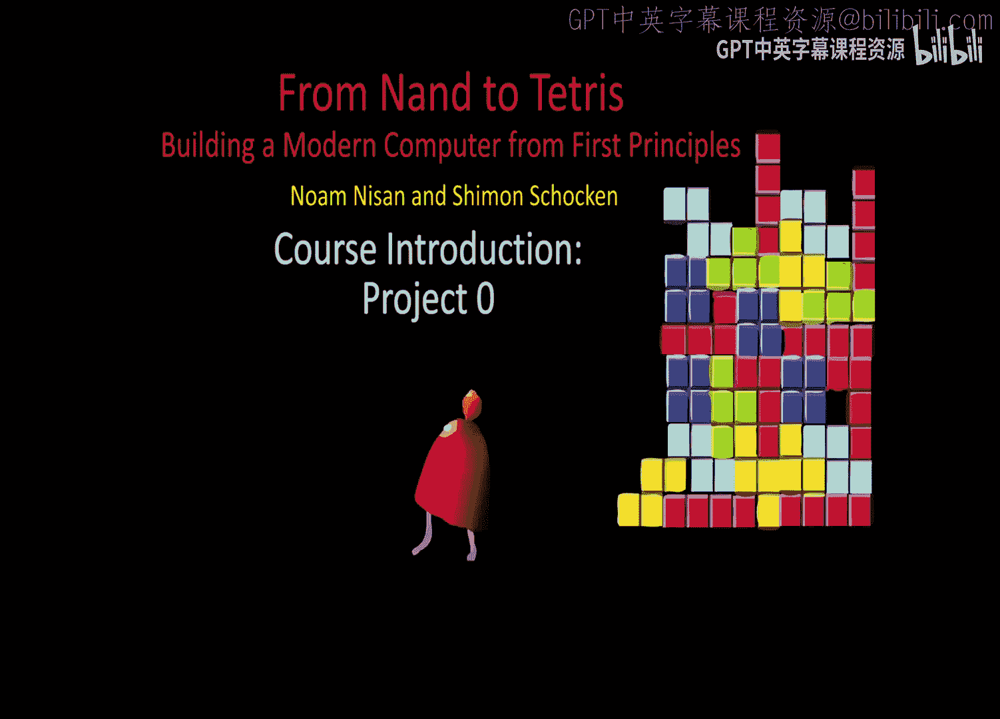

# 耶路撒冷希伯来大学《从零开始构建现代计算机2｜Build a Modern Computer from First Principles》中英字幕 p02 02_01_03_项目0概述.zh_en -BV1DA4m1w7FU_p2-

The first project in this course， project 0。Is so trivial that it hardly merits the word project。

 but so be it。In this project we have to do two things。 first of all。

 we request that you download the Nanttooteris software suite and put it on your personal computer and the second thing that you have to do is submit a file to the Cosera website and we want you to do it just that you go through the motions of compressing and submitting a file as we'll describe in a moment。

 so the first thing that we have to do is download the Nanttoteris software to your PC and in order to do so we request that you go to this website www Nanttooteris。

org locate the software page as we see here within this software page you have to locate this particular link and once you click this link a file named Nantteris。

 zip is going to be downloaded。To your PC。Once you get this file。

 we request that you extract it on your PC and the result will be a directory or a folder called Nant toteris We recommend that you put this folder on your desktop and we are going to use this folder obviously extensively throughout the course in particular if you look into this folder。

 you will see that it is divided further into two subfolds named tools and projects。By the way。

 before I go on， I have to say that even if you took Nantoteris part1。

 we still highly recommend that you re downloadload the Nantteris software to your PC because we are making changes in the software as we go along and it is quite possible that you don't have the most upto- dateate version of our stuff so please download the software again before you start Nantteris part2 so going back to this folder。

 you will see there two subfolds named tools and projects。

 tools contains all sorts of useful software tools that will help you go through Nteris part1 and part 2 and the projects consists of 14 directories named 00 to 13。

Now what you see here are all the tools and projects and resources which are needed to take both Nottetrapar1 and NantottetraPA2 in NottetriPA 2 we are going to focus on these tools and projects only and all the other stuff is irrelevant to NanttetraPA2 as you see Project4 has a dashed outline because it's an optional project in NantottetraPA 2 and I will have more to say about it as as we go along very soon in one of the next units。

All right， so that's the structure of the nanooteis folder once again we recommend that you put it on your desktop and going back to project 0。

 let us assume that you have already downloaded， extracted and took a look at this Nteis folder。

 what do we have to do next？Well， the next thing that you have to do is within the Nteus folder。

 you have to locate this file， which is named file dot Txt。

And then the only thing that we want you to do with this file is submit it as is you see。

 we want to make sure that we go through the very simple mechanics of submitting a file and once you will do this we'll give you feedback that we got this file and then we can actually you know start moving with the course itself。

 So here's what we want to do we want you to take file do Txt and compress it into project0 do zip。😊。

And once you have this zip file made， we request that you submit it to the Coursera Cour website。

 you know just follow the instructions there will be written instructions on how to submit the project zero。

 just follow them and submit the file to us once we'll get this file we'll send you an acknowledgement that we got it and then once again we can start the real projects in this course so this has been the overview of our trivial project zero and the next units that we are going to explore will deal with machine language。

