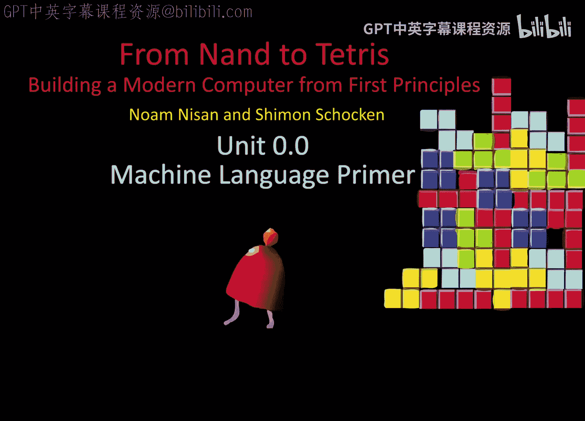
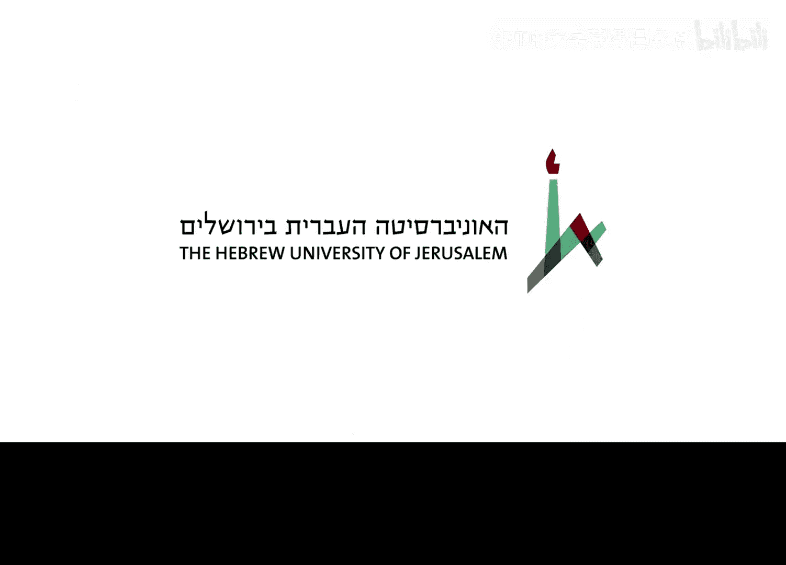

# 耶路撒冷希伯来大学《从零开始构建现代计算机2｜Build a Modern Computer from First Principles》中英字幕 p03 03_02_02_单元0-0_机器语言入门.zh_en -BV1DA4m1w7FU_p3-

Welcome to Mo 0 of Nantotetriris Part2， in which we're going to talk about machine language basics。

Now a note to graduates of nanooteris Part one， even if you feel completely competent with heCC programming and lowlevel programming。

 you still have to bear with me at least through this preliminary unit and then you can decide how much more you want to take from this primer because almost all the material that we're going to cover in this module is something that we covered already in part one。

 but once again bear with me until the end of this unit。Alright。

 so here is the big picture of nanoteris part 2。 Here are the various modules that we are going to go through throughout the course。

 beginning with module 0。Now， module 0 deals with a very exciting interface in applied computer science。

 And this is the point where hardware meets software in particular。😊。

We meet the hardware or we use the hardware platform through its interface。

 which is machine language。And we need this machine language。

 and we need module 0 in order to set the stage and build a foundation for the next two modules in which we are going to build the computer's virtual machine。

And in order to explain this delicate handshake， take a look at this slide here。

And you will notice that what we have here is some VM code written in a language called the virtual machine language of which you know I don't expect you to understand anything。

 This is something that we are going to describe later on。

 but notice that we are going to discuss this language as well as the task of translating programs written in this language into machine language into assembly。

So in particular the VM translator is going to be a program that you guys will write under our guidance in some language like Java or Python。

 this program will treat the VM code as input and it will start marching through this input and generating assembly code from it so for example it will start with push1 and generate the assembly code that you see here then it will go on to pass push2 and generate from it this code segment and so on and so forth。

 so you see that in order to accomplish this task you have to be able to generate code in assembly you have to be able to write code in in assembly language。

And so in modules1 and2 we are going to do two things。

 first of all we'll talk about the virtual machine architecture， obstruction and commands。

 the commands of the VM language and then we're going to talk about actually building this machine by realizing it using a VM translator and in order to do this we have to once again generate code in assembly so module 0 is about explaining you know the notion of lowlevel programming in assembly language and you know writing a programme or two in order to gain this fundamental competence without which you will not be able to write your VM translator。

Now in order to do this， we are going to supply you with nine instruction units which culminate in what is known as Project4。

And you have to understand that all these units are exact replicas of exactly the same units that we taught in Nteris part 1 and in Anoteris part 1。

 these units where the substance of module 4， that's why the project is also called project 4。

 and with that in mind I think that。The group of people who are listening to this video now。

Fall into three possible categories。First of all， there are people who took Nteric S one。

 probably recently。And they are happy campers， they enjoy the course。

 they understand machine language quite well。And are eager to start working on antiteric spot， too。

Well， if that is the case， we recommend that you review only unit8 of the table of contents that you have here。

And we highly recommend that you also review your project4 in unit 9。

 the numbering is a bit confusing here， and you may also consider resubmitting Project 4 if you want。

 this is an optional project， but just make sure that you remember how to write programs in the heCC assembly language。

 So that's this group。The second group consists of people who took Natitis part one in the past。

 but by now the part of their brains that was committed to machine language is now occupied by some other thoughts。

Well， if that is the case， you have to remove the rust and the best way to do it is to review this subset of units that you see here and we highly recommend that you do again project 4 and submitted。

 but once again this project is optional in Anteist part2。

And finally there is this group of people who did not take Nantoteus S 1 and decides to jump into Noteus S2 heads on well you know there's no need to be gloomy about it you can certainly do that but if this is your choice。

 then we insist that you learn carefully all the units that you see here and in particular you must do Project 4。

 if you will not gain the requisite knowledge of lowlevel programming you won't be able to proceed with the nanooteus S2。

 so it's up to you to fulfill this prerequisite knowledge。All right。

 so with that that's the end of this preliminary unit。

 please locate yourself in one of these three tracks according to your level of low level programming expertise。

Decide what you want to learn from these remaining units。 and once you do this。

 I will meet you in module1 in which well begin building our virtual machine。

