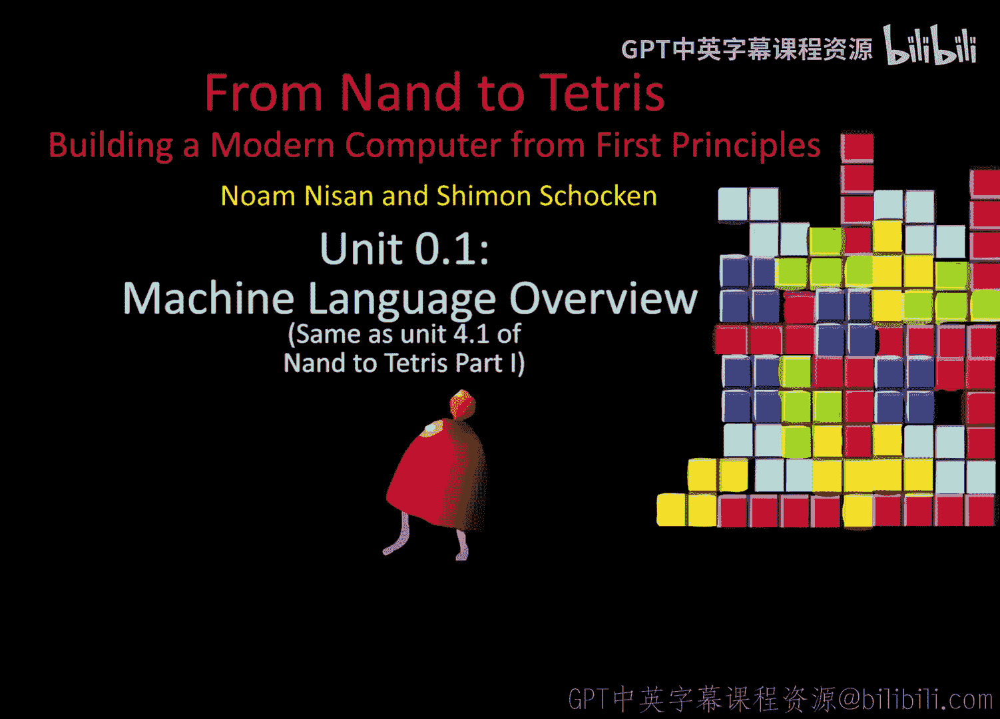

# 耶路撒冷希伯来大学《从零开始构建现代计算机2｜Build a Modern Computer from First Principles》中英字幕 p04 04_02_03_单元0-1_机器语言概述.zh_en -BV1DA4m1w7FU_p4-

So in the last two weeks， we've built an ALU and memory hierarchy。

 and basically we're at the stage we can just combine them and build a computer。

But we're going to postpone that to next week。 And this week。

 we're going to actually look at the computer that we want to build from a user's point of view。

 Sty what can we do with the computers that we're going to be。

 What exactly is the specification of the computer that we're going to build。

 And then only after we've looked into it played with it。

 We're actually going to build it the next week。😊，So why do we need to do that？ Well， basically。

 because the computer is a complicated thing。 It can do lots of things。When you think about it。

 this is really amazing。 Most machines that we have in the world do one thing。

 Your washing machine only washes clothes。 It cannot cook spaghetti。 And the other hand， a computer。

 And for that man， a smartphone is a computer can do lots of different things。

 It can do word processing。 You can play games on it。

 You can talk with other people It control show you videos that are you an enormous amount of a stuff that the same computer does。

 So how is it possible that we can do all these different things with a single hardware with a single machine。

😊，The basic idea here is that you universality。The origins of this idea were theoretical models that considered by Alan Turing in the early 19th and 20th century。

He tried to formalize the notion of a computing machine and defined a theoretical model。

 a Turing machine that actually tries to capture the essence of what can be computed。

And then he noted this amazing phenomena。Although there are many different computing machines。

 many different Turing machines in this model， there was a single one of them that could actually act like all of them。

 given the correct program， can simulate all of them。 And that is called a universal Turing machine。

 That was the first time we have this amazing idea of one machine acting as a huge amount of all machines。

 In fact， it can act as anything at any computing machine。😊。

The same idea actually turned was turned into practice by Voon Neiman。

 who actually built the first a serious architecture of a general computing machine。

 where he noticed that where the centerpiece of his architecture was the fact that we had the stored program computer。

 we can put the program software inside the hardware， and then it can act。😊，In a way that is。

 according to the software that we put there， different programs， create different operations。

 different functionalities。 And in this way， we actually had a real computer for the first time that could perform many different functions。

 many run many different programs。 And that secret is still with us today to date。

 and we don't even notice how remarkable it is that our single machine can do all these many different things。

😊，So let's look at slightly more carefully。 How does this actually work。

So we have our computer computer inside the computer。

 we know we're going to have some central processing unit。 We're going to have some memory。

 It's going to read some input， produce some output。

 but inside that memory is going to be a program that is going to tells the computer what to do while the hardware is fixed。

 that program， the software can change。 And as the program， the software changes。

 the computer will do different things。😊，So let's see how does the hardware， the single hardware。

 static hardware perform many things according to the program。

 Well the program has a sequence of instructions， each one of them is going to be coded in binary and our hardware simply go instruction by instruction and executed now different sets of instructions。

 different sequences of instructions will thus cause our hardware to produce completely different things。

😊，And when we take the whole sequence， the whole program。

 the whole sequence of instructions together， we get the functionality of the program。

 which can be completely dependent on what was written there and the program itself。😊。

So now let's look at the different elements that we will need to look at more carefully。

 which we will do in the next unit that together cause the hard work to do what the program wanted to do。

The first thing is， how are we going to specify the instructions。

 Our program is going to be going to be composed of a sequence of instructions。

 What exactly does the instruction tell the computer to do？ That's one element。The other element is。

 how do we know which instruction to perform at any given stage in time？

 Suppose we are now in instruction 74。 It makes sense that the next instruction we will do is 75。

 but sometimes well need to change the order， maybe to do some kind of loops or to do things conditionally。

 That's the second kind of element that we need to be able that software needs to be able to control the operation of the hardware。

The third element。whichch is really important is it' we're going to have to tell the hardware what to operate on。

 Even if the hardware knows it needs now to add two numbers， we have to tell it。

 the software has to tell the hardware how exactly where exactly will it get these two values that it's going to that it needs to add and where should it put the result。

 So these are the three basic elements， if you wish。

 that every machine language Every way that the hardware allows the software to tell it what to do needs to specify and we'll talk a little bit about possibilities and what kind of options are there for each one of these three possibilities later。

Now， the point is once we have this machine language。

 this is what the hardware allows the software to perform。Now。

 this machine language disification is really a programming language。

 but it's a terrible programming language。 It's really convenient for the hardware。

 It allows specifying anything you want to do to the hardware。

 but it's really not convenient for human beings。 So in reality。

 the human beings never programmer almost never program exactly in machine language。

 but they rather a program in what's called the highlevel programming language and language that was designed for humans to be able to easily write what they want to do。

 And then there are automatic programs called compilers。

 which translates that into the machine language into the software。

 which actually tells the hardware what to do when it runs。

 And thus usually we do not worry too much about the machine language because we as human programmers。

 don't actually use it。 However， from the computer's point of view。

 this is really what runs always only machine language programs run and any other programs that was really translated in some way to this machine language formalism。

 which is what exactly tells the hardware。😊，What to do， even though normally。

 people do not write in machine language in this course where we are actually dealing with a hardware that runs a machine and with the software as it directly operates above it。

 And because we're really learning about this machine language in order to understand how to build the computer。

 we're going to have to deal directly with a machine language。

And there are some other situations where people deal directly with machine language。 For example。

 if they really want to have highly optimized code for very specific tasks。In this case。

 in these cases， and in our course， we will need to pay a little。

 we need to make working with machine language slightly easier。

 and there are two things that are normally done when working with machine language which make things easier。

The first thing is， instructions in machine language are always sequences of bits。

 That's how we keep all information in a computer。 This is terrible because it's very difficult to。

 to program to look at an instruction 0，1，1，1，1，1，0 and see what it's supposed to mean。

 But in reality， there is some ways， this instruction codes something in a computer。

 And usually it code something that we can understand。 For example， it could be。

 that's the first part of this sequence of bits， really codes add addition。In that case。

 when we talk about this kind of instructions， it will be more convenient to talk about the mneumonic form of this instruction and simply say add instead of 0。

1，1，1，0 or whatever the code is。Similarly， parts of the instruction may code specific thingss。

 for example， perhaps a second part of the instruction codes as a register that we want to use。

 whatever that means for now。 In this case， again， we can write R2。

 which makes sense to humans somehow implying the second register， rather than the sequence of bits。

 which really can codes this two in some way depending on the machine language。

 So instead of talking about this sequence of bits， which makes no sense to humans。

 we're going to say we're going to think that what's really written there is a command add R3 to r2。

 And then we're going to specify exactly what that means to our computer。

And this is exactly equivalent to talking about the earlier sequence of bits。

 It will just make things easier for us。 Now， there are two ways to interpret it。 the simplest way。

 And this is the way I prefer looking at it at the beginning at this stage。

 is simply that the synthetic form， the nice nice form does not exist anywhere。

 just the way that we're talking about the real bits that exist in a computer。

 That's the first thing。 So when we I say add， I really mean 0，1，1，1。

0 or whatever the machine language specifies。😊，The second interpretation goes this one line one step further and looks at the following thing。

 Well， sometimes we do want to code in machine language and why not allow the user human to actually specify writing things in this synthetic form in this what's called assembly language form。

 And then we can translate it to the bits very easily。

 This is what in a program called an assemblymbler does。

 And you will actually need to build this asmbler in the sixth week。

 So that's a second interpretation that we will have where we actually there is a program that allows you to write this machine language not directly as bits。

 but in the slightly nicer assembly language format。😊，While we're at it。

 making things a little bit easier to actually write programs in machine language for the rare cases that we need to do that。

 including this course， then there's another thing that we get for free and which is called symbols。

 A lot of times in a machine language program， we will try need to access memory locations。

 For example， there could be a command that tells add one to memory location 129。😊，Now。

 the point is for the programmer writing that。 It's not really important that we actually talk about machine location and memory location。

129。 What he really has in mind， our programmer is that we're going to keep some kind of index in that machine location。

 in that memory location。So for the programmer， this could have been instead kept at a programme at memory location。

250 or any other memory location。 The important point was that every time that I'm talking that I use this value。

 I go to the same memory location。In this situation， we might as well translate。

 allow a user to write some kind of symbolic symbol， some kind of name for that memory location。

 let's say call it index。 and automatically lets our assembler that already is providing us with some convenience。

 allows the assembler to actually translate that word index into some kind some three memory location。

 for example，129。 Again， this will allow us to write programs in easier ways to humans that look easier way to humans without changing everything in reality。

 whenever you see index。 that really just means some some memory location。

 which is fixed and is use the same memory location whenever we talk about index。😊。

So this finishes the overview above the idea of machine languages。

 And what we're going to do in the next unit is actually talk a little bit a bit about specifics of machine languages。

 What kind of things do we have in them， What kind of elements are they composed of。

And once we have that basically background， that perspective and what kind of machine languages what kind of things we do in machine languages。

 then we'll actually start talking about the machine language of the computers that youll build in this course。

 the hack computer。

